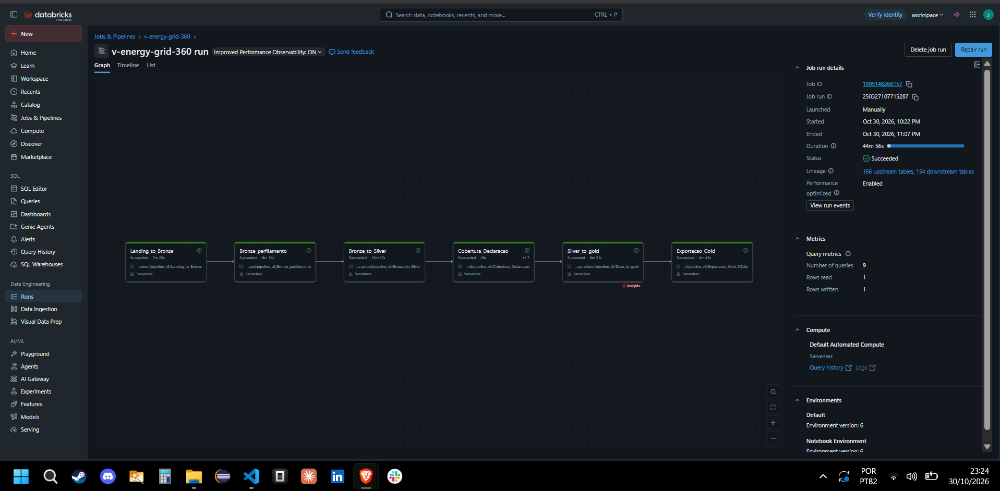

# V-Energy Grid 360

Plataforma integrada para a distribuidora V-Energy, proposta no case final Visagio Rocket Lab 2026.2. Este repositório reúne o código da solução (pipeline de dados, backend, frontend e agente de IA), a **fonte de verdade textual** do produto e as instruções de trabalho para humanos e agentes. O estado oficial de cada requisito está na tabela do [PRD](docs/PRD.md).

> O material do case traz marcação de confidencialidade e, ao mesmo tempo, pede repositório público como entrega. Antes de publicar, o time deve confirmar com a organização o tratamento permitido dos dados e do enunciado. Não versionar o dataset bruto nem credenciais sem autorização explícita.

## Comece por aqui

1. [PRD completo](docs/PRD.md): escopo, histórias, critérios de aceite, decisões e progresso.
2. [AGENTS.md](AGENTS.md): contrato de trabalho de qualquer agente.
3. [Serviços](docs/services/README.md): responsabilidades e contratos de cada módulo.
4. [Fluxo de desenvolvimento e qualidade](docs/agents/workflow.md): como concluir e comprovar requisitos.
5. [Integrações e hooks](docs/agents/tooling.md): skills, Context7, Figma e automações de proteção.
6. [Acompanhamento no Trello](docs/agents/issue-tracker.md): cartões dos requisitos obrigatórios sincronizados com o PRD.
7. [Diagnóstico da receita](docs/revenue-diagnosis.md) e [status report](docs/status-report.md).
8. [Engenharia de Dados: Workflow, dicionário e suposições](#engenharia-de-dados-workflow-dicionário-e-suposições): print do run limpo, links e decisões da camada de dados.
9. [Protótipo visual](docs/design/grid360-prototype.md): arquivo Figma, temas, componentes, jornadas e limites da demonstração.

## Estrutura do repositório

```text
data-engineering/  pipeline Databricks e documentação local
backend/           API FastAPI e acesso às tabelas Gold
frontend/          aplicação React + TypeScript (Vite)
ai-agent/          agente Text-to-SQL e insights integrados
docs/              PRD, diagnóstico, dicionário e decisões
.agents/           skills compartilhadas e hooks/MCP do Antigravity
.claude/           hooks e adaptadores de skills para Claude Code
.codex/            hooks e MCPs para Codex
.hooks/            scripts compartilhados pelos três clientes
```

Cada pasta de serviço tem seu guia em [docs/services](docs/services/README.md). O dataset do case é disponibilizado separadamente na plataforma da atividade; o repositório não o contém.

## Engenharia de Dados: Workflow, dicionário e suposições

O pipeline Bronze → Silver → Gold roda inteiro no Databricks (PySpark, arquitetura Medalhão) e é orquestrado pelo Job `v-energy-grid-360`, com seis tarefas encadeadas: `Landing_to_Bronze`, `Bronze_perfilamento`, `Bronze_to_Silver`, `Cobertura_Declaracao`, `Silver_to_gold` e `Exportacao_Gold`. A exportação gera CSVs das tabelas Gold (contrato [`gold-csv-v2`](docs/contracts/gold-csv-v2.md)) que alimentam o backend; o cadastro com dados pessoais sai em pacote separado e restrito, nunca neste repositório.

**Execução bem-sucedida do Workflow** (run de ponta a ponta, seis tarefas `Succeeded`, sem tarefas isoladas): [registro do run](data-engineering/evidencias/workflow/run-limpo-250327107715287.md).



| O que | Onde |
| --- | --- |
| Dicionário de dados da Gold | [docs/dicionario_gold.md](docs/dicionario_gold.md) |
| Diagnóstico da variação de receita | [docs/revenue-diagnosis.md](docs/revenue-diagnosis.md) |
| Notebooks e YAML do Workflow | [data-engineering/](data-engineering/README.md) |
| Decisões técnicas e o porquê de cada número | [data-engineering/decisoes-tecnicas.md](data-engineering/decisoes-tecnicas.md) |
| Estratégia de agendamento (proposta, não ativada) | [data-engineering/README.md](data-engineering/README.md#estratégia-de-agendamento-proposta-não-ativada) |

**Suposições da camada de dados** (onde o case não era explícito):

- **Receita é a faturada, não a recebida.** Fatura em aberto usa o valor declarado em aberto, sem afirmar pagamento.
- **Não há kWh faturado na fonte.** A tabela de faturas traz valores, não energia. O volume do diagnóstico é o consumo medido nos pares UC/mês com fatura, e não energia faturada; a limitação consta no diagnóstico e no dicionário.
- **Preço é o preço efetivo observado** (receita ÷ consumo medido nos mesmos pares UC/mês), não a tarifa homologada.
- **Recorte geográfico e de classe vem do cadastro atual**, sem histórico de mudanças.
- **DEC e FEC** seguem a definição simplificada do case: servem para comparar alimentadores e períodos, não para comparar com limites regulatórios reais.
- **Cobertura:** consumo e faturamento têm cobertura certificada (`FECHADO`); domínios sem evidência de fechamento ficam `NAO_CERTIFICADA`, e a Gold e o portal mostram esse estado em vez de esconder a lacuna.
- **Energia recuperável por UC:** a estimativa individual só é publicada quando passa em validação temporal; sem isso o campo fica nulo e o portal mostra apenas a referência histórica, rotulada como tal.
- **Confidencialidade:** o case é confidencial e o repositório é público. Não são versionados dataset bruto, valores em R$, contagens de registros nem identificadores de UC; as evidências trazem apenas estados e percentuais.

## Executar localmente com Docker

O `docker-compose.yml` sobe portal, API e PostgreSQL. Os arquivos de ambiente são locais e não versionados; sem eles o Compose aborta com `env file ... not found` antes de criar qualquer container.

```bash
cp .env.db.example .env.db
cp backend/.env.example backend/.env
docker compose up -d db
docker compose run --rm backend sh -c 'alembic upgrade head && python scripts/bootstrap_local_auth.py'
docker compose up -d --build
```

O modo padrão do Compose é autenticação individual por sessão. Aplique migrações explicitamente antes da provisão: o comando acima altera o banco configurado. As senhas aleatórias iniciais de `reader` e `operator` ficam em `work/local-auth/credentials.txt` (ignorado pelo Git); preserve esse arquivo e não o publique. Provisione somente o banco operacional local escolhido.

| Serviço | URL | Observação |
| --- | --- | --- |
| Portal web | http://localhost:5173 | Vite com HMR; `/api` usa proxy para o backend |
| API FastAPI | http://localhost:8000/api/v1 | OpenAPI em http://localhost:8000/docs |
| PostgreSQL | localhost:5432 | Banco `v_energy`, usuário `v_energy_app` |

O Compose é um ambiente de desenvolvimento e seleciona explicitamente `ANALYTICS_SOURCE=synthetic` para demonstrar os indicadores; autenticação do portal usa `ORDERS_AUTH_MODE=session`. A API executada fora dele continua com padrão `unavailable`. Para testar indisponibilidade no Compose, defina `ANALYTICS_SOURCE=unavailable` no ambiente do comando e recrie o backend. Os números exibidos são fictícios, sem reconciliação Gold. O contrato de sessão, limites e provisão está em [autenticação local](docs/contracts/local-auth.md).

O navegador usa a mesma origem do portal (`VITE_API_URL=/`); o Vite encaminha `/api` para `http://backend:8000` dentro do Docker. Assim o cliente não depende do próprio `localhost` para chegar à API. Para abrir no celular da mesma rede, use o endereço da máquina na porta 5173, conforme a conectividade local permitir. O frontend usa polling no volume Docker para refletir alterações feitas no Windows.

Comandos de apoio: `docker compose ps`, `docker compose logs -f backend` e `docker compose down` (o volume `pgdata` é preservado; `docker compose down -v` apaga os dados).

`docker compose` sem `up` apenas exibe a ajuda. O Compose é a forma suportada de subir a stack; rodar `npm run dev` e `uvicorn` na máquina assume que o PostgreSQL local usa as mesmas credenciais de `backend/.env`.

## Preparação dos agentes

Codex, Claude Code e Antigravity compartilham os `AGENTS.md`, as skills compatíveis em `.agents/skills/` e os scripts em `.hooks/`. Cada cliente tem configuração própria de hooks e MCPs. Consulte [o estado de validação e os passos de ativação](docs/agents/tooling.md#ativacao-e-verificacao) antes de depender das automações. O PRD continua sendo a referência dos requisitos e nenhum item funcional foi concluído nesta fase.

O GitHub Actions em `.github/workflows/quality.yml` roda em pull requests, na branch `main` e manualmente. Por enquanto, valida configurações dos agentes (incluindo hooks e MCPs do Antigravity), imports compartilhados, links locais da documentação e sintaxe dos hooks. Ele não implementa funcionalidades nem cria branches ou pull requests.

### Compatibilidade do volume PostgreSQL local

O Compose usa PostgreSQL 16 e volume novo `pgdata16`. Um volume anterior de PostgreSQL 18 (`pgdata`) é preservado e não deve ser montado diretamente no 16. Antes de trocar um ambiente com dados úteis, siga a [orientação de migração, preservação e carga](docs/contracts/gold-load-dev12.md#preparação-para-genai-01-schema-origem-e-publicação); não use `down -v` para resolver incompatibilidade. Após preparar o banco novo, aplique as migrações antes de usar as rotas operacionais.
