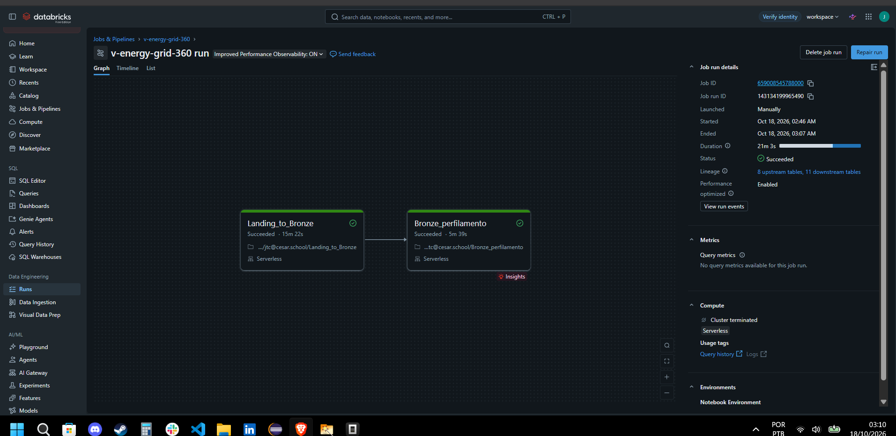

# Engenharia de dados — Bronze

Escopo desta entrega: DE-01 e perfil descritivo da Bronze. Valores ausentes,
duplicatas, datas ambíguas e vínculos inconsistentes são medidos e preservados;
tratamento e decisão de negócio pertencem à Silver. O contrato completo está no
[PRD](../docs/PRD.md) e no [guia do serviço](../docs/services/data-engineering.md).

## Arquivos

| Arquivo | Papel |
| --- | --- |
| [`Landing_to_Bronze.ipynb`](notebook/Landing_to_Bronze.ipynb) | Ingestão, rejeitados, reconciliação por origem e publicação |
| [`Bronze_perfilamento.ipynb`](notebook/Bronze_perfilamento.ipynb) | Inventário, achados e relações por arquivo/aba |
| [`Bronze_to_Silver.ipynb`](notebook/Bronze_to_Silver.ipynb) | Silver: limpeza, tipos, chaves, quarentena, reconciliação e portão de qualidade |

O scanner grava JSONL de preparo **somente no Volume autorizado**. Cada
registro aceito mantém o conteúdo bruto, arquivo, ordinal e linha física inicial
e final. Registros de largura CSV ou sintaxe inválida vão para
`bronze.rejeitados` com motivo; não são limpos nem descartados em silêncio.
O array `atendimentos.json` é contado objeto a objeto antes da leitura Spark.
Após publicação bem-sucedida, o notebook remove o schema de preparo e os JSONL
temporários; em falha, eles ficam disponíveis para diagnóstico.

## Publicação

Cada execução recebe `_lote_id` próprio e um schema de preparo isolado. O
conjunto de hashes dos arquivos forma `_versao_origem`; `lote_origem` pode ser
fornecido pelo Job e não substitui o hash. O livro `bronze.reconciliacao`
registra origem, lidos, aceitos, rejeitados, duplicatas detectadas e delta.
`bronze.arquivos_lote` guarda a identidade dos arquivos.

Após validar todas as fontes, a carga acrescenta o lote às tabelas Delta de
`bronze_hist`. As vistas `bronze.*` filtram o único `lote_ativo` de
`bronze.controle_publicacao`. Mudar esse ponteiro publica o conjunto; uma
falha antes da troca deixa visível o lote anterior. Reexecutar a mesma origem
cria histórico de execução, sem duplicar linhas na vista publicada. A primeira
execução migra as tabelas Bronze anteriores para o histórico e precisa ocorrer
em janela controlada, com conferência das tabelas legadas.

O perfilador lê o lote publicado e grava `quality.perfil_bronze`,
`quality.inventario_bronze`, `quality.achados_bronze`,
`quality.relacoes_bronze` e `quality.distribuicoes_bronze` para categorias
selecionadas. `quality.achados_bronze` também registra padrões de data, fuso e
pontuação em colunas numéricas por arquivo/aba; isso descreve a pontuação sem
assumir se vírgula ou ponto representa decimal ou milhar. `NAO_EXECUTADA` indica coluna ou vínculo ausente;
zero só é usado quando a checagem foi feita e nada foi encontrado. Nomes e valores pessoais não são exportados como exemplos. `tipo_bronze`
indica o tipo armazenado no Delta, sem afirmar significado de negócio: os campos
CSV/Excel ficam como texto e o JSON mantém sua estrutura aninhada com os tipos
físicos lidos pelo parser. `_registro_bruto` preserva a representação original
do objeto JSON.

## Silver

`Bronze_to_Silver.ipynb` lê o lote **ativo** da Bronze (`bronze.controle_publicacao`) em `bronze_hist`, com o
`_lote_id` fixado no início, e grava `silver.*`, `silver.quarentena` e `silver.controle_silver`. Parâmetros: `catalog`
(padrão `workspace`). Rode `Landing_to_Bronze` e `Bronze_perfilamento` antes: a Silver confronta seus números com
`quality.perfil_bronze` do mesmo lote.

Datas ambíguas de leitura e emissão permanecem em quarentena (opção B); a seção 13 mede por arquivo
e competência evidências de ordem e consistência das datas inequívocas para análise posterior (opção C),
sem inferir datas na publicação.
Medidores com instalação ambígua ficam em quarentena, e leituras dependentes recebem
`medidor_em_quarentena` como bloqueio em cascata (opção A). A quarentena preserva o payload integral,
inclusive `_registro_bruto`; registros aceitos preservam os metadados técnicos de linhagem.
Conflitos de CPF/CNPJ ou nome de titular ficam nulos e sinalizados na UC. Data futura e
`9999-12-31` são preservadas, sem presumir quitação nem interpretar a sentinela como data real.
Os testes sintéticos P0 executam com `python -m unittest discover -s data-engineering/tests -p test_silver_p0.py -v`
na raiz do repositório, com PySpark e Java configurados localmente. No Windows, `PYSPARK_PYTHON`
deve apontar para o executável Python instalado, evitando o alias do Microsoft Store.

- Todo registro que não entra na Silver vai para `silver.quarentena` com motivo, origem, lote e valor de controle.
- A conta fecha por tabela (`bronze = aceitos + quarentenados`), em R$ (faturas) e kWh (leituras), e ponta a ponta
  com os rejeitados do parse da Bronze.
- Se qualquer invariante falhar, a execução fica `FALHOU` em `silver.controle_silver` e o notebook **falha**. A Gold só
  deve consumir uma execução `CONCLUIDO` do lote desejado.
- Estado: executada no Databricks com o dataset real em 21/10/2026 (run `20261021T101818Z_223235ca`, `CONCLUIDO`);
  essa execução **precede esta revisão P0**, exercitada localmente com dados sintéticos. Falta executar a versão
  atual no lote real, analisar o diagnóstico C por arquivo e encadear no Workflow.
  Decisões D46–D56 e §11.2–11.4 de [`decisoes-tecnicas.md`](decisoes-tecnicas.md).

## Executar no Databricks

1. Coloque a extração autorizada no Volume informado por `raw`. Não adicione
   arquivos do case ao Git.
2. Importe os notebooks no Workspace e configure ou atualize o Job `v-energy-grid-360`
   na interface do Databricks, com `Landing_to_Bronze` antes de `Bronze_perfilamento`.
   O YAML versionado registra o Workflow existente e mantém os caminhos exportados
   do Workspace de origem; ajuste os caminhos na interface para os notebooks do seu
   Workspace. Se necessário, defina os parâmetros `catalog`, `raw` e `lote_origem`
   nas tarefas do Job.
3. Rode o Job manualmente e confira as 12 identidades de arquivo e as 14 origens
   reconciliadas (cinco CSVs
   simples/faturas, cinco leituras, JSON e três abas), além das oito tabelas de
   dados, rejeitados, arquivos, controle e perfil.
4. Compare a contagem lógica da origem com aceitos + rejeitados por arquivo/aba.
   Confira hash, linhas físicas de exemplos autorizados, uma falha induzida e
   uma reexecução da mesma versão. Registre IDs dos runs, comandos e resultados
   no Registro de progresso do PRD antes de concluir DE-01.

O YAML versionado registra a configuração de execução existente, incluindo o
compute serverless e o agendamento. Confira esses valores no Workspace antes de
executar a versão atual do notebook.

## Evidência anterior

O run `14313419965490` de 18/10/2026 terminou em `Succeeded` em 21m 03s e
comprovou o encadeamento das duas tarefas **na versão anterior**. Ele não
valida o scanner, as vistas, o perfil por origem nem a migração desta mudança.
