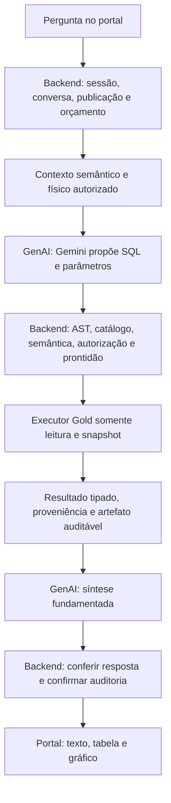

# TODO 3 — Transição do V-Energy para Text-to-SQL generativo

**Data:** 08/11/2026. **Versão:** 1.39 — TSQL-09 concluída; critérios de observabilidade, pricebook, alertas, locks de dependências e recuperação foram avançados em TSQL-10. TSQL-11 inclui comparação agrupada/ranking, variação percentual, consumo, atendimento, DEC/FEC por alimentador, GD, satisfação, receita por bairro e composição preço-volume tipada. As duas métricas de GD passaram pela rota Gold com Gemini e SQL independente; consumo médio por UC foi reconciliado na rota com candidato controlado e uma chamada Gemini posterior passou pela rota Gold. DEC/FEC ponderado para múltiplos meses/alimentadores passou pela rota Gold com SQL independente e mantém aviso de cobertura observada não certificada. A pessoa usuária confirmou o aceite visual do modo F1. A composição preço-volume passou pela rota autenticada com Gold ativa + staging local CSV/manifesto; as origens permanecem separadas e identificadas. JOIN permanece bloqueado. A configuração local do Assistente agora inicia em F1 sem seletor visual; a avaliação integral e a promoção permanecem pendentes em TSQL-12.
**Estado:** TSQL-07 concluída no escopo de execução/evidência F1. TSQL-08 tem integração sintética e requer revisão humana de clareza/acessibilidade. TSQL-09 concluída: continuidade assinada, armazenamento privado F1, isolamento, revogação, auditoria, replay, reconhecimento semântico fora da F1 sem autorizar SQL, regressão Gemini f1-16 e compatibilidade segura em implantação/rollback entre versões. A bateria Gemini acertou 13/13 estados/intenção; 11 candidatos SQL passaram pela revisão semântica e dois estados sem SQL corresponderam aos oráculos. A prova de deploy usou banco descartável e referência Gold v2 sintética de metadados, sem linhas analíticas; não representa aceite de dados Gold. TSQL-10 tem logs correlacionados, auditoria privilegiada do template F1, resumo sanitizado p50/p95/tokens, pricebook público conservador, limiares/procedimento, locks de dependências, carga local da rota, webhook local, checagem Gold e um 429 real com resposta posterior sem novo 429. A sequência não comprovou resposta F1 válida após o rate limit; carga representativa do ambiente operacional permanece pendente. A bateria de 596 invocações e revisão final permanecem em TSQL-12.
**Branch de trabalho:** `feat/genai-text-to-sql`, criada de `feat/genai-interpretacao` em `c1911d1`, com trabalho local preservado.
**Referência da inspeção inicial:** `feat/genai-interpretacao`, commit `c1911d1`, com alterações locais. Não representa o head corrente da implementação.
**Origem:** documento `TODO_3_Text_to_SQL_Generativo.md` fornecido pela pessoa usuária.
**Requisitos relacionados:** IA-01/02/03/05/06/07/08; IA-04 como integração a preservar; ENT-01 para análises de receita; DE-06/08 para publicação e dicionário; WEB-10 para acesso individual.

Este é o roteiro ativo proposto para a transição solicitada. As tarefas foram organizadas a partir do código, contratos, catálogos, testes e infraestrutura presentes na branch. Não existe migração concluída por haver um componente semelhante ou um teste artificial aprovado.

### Ordem prática e situação atual

Os números identificam frentes e dependências; não significam terminar todas as tarefas de uma frente antes de começar qualquer arquivo da seguinte. Há sobreposição prevista entre catálogo/benchmark, geração/validação e observabilidade. Essa sobreposição não dispensa os gates de integração/promoção.

| Frente | Quando entra | Situação comprovada / prioridade |
| --- | --- | --- |
| TSQL-01 | Primeiro: decisão e escopo | Preparação concluída |
| TSQL-02 | Início: perguntas, referências e baseline; acompanha a implementação | Concluída no escopo de benchmark artificial e linha de base técnica: 40 casos anotados, oráculos/contrafactuais, congelamento, reserva autoral, baseline e metas documentados |
| TSQL-03 | Junto da base: catálogo Gold v2 | Concluída; catálogo local e schema/grants da publicação ativa conferidos em leitura somente de metadados |
| TSQL-04 | Contratos e contexto autorizado F1 | Concluída como preparação contratual; integração do gerador na rota pública é TSQL-07 |
| TSQL-05/06 | Geração e validação juntas, guiadas pelo benchmark | TSQL-05 concluída em observação na f1-12; TSQL-06 mantém seus critérios próprios de integração/aceite |
| TSQL-07/08 e âncora mínima de TSQL-09 | Uma fatia vertical: execução → evidência → resposta/tabela → conversa no portal | TSQL-07 concluída para execução/evidência F1. TSQL-08: jornada unificada Edge→sessão→rota→PostgreSQL descartável concluída; candidato e readiness simulados. Pedidos independentes fora da F1. Revisão humana de clareza e acessibilidade pendente |
| TSQL-10 | Desde os primeiros contratos e chamadas | Acompanha todas as etapas; inclui rastros, custo, limites, carga e operação |
| TSQL-11 | Depois da F1 comprovada | Comparação agrupada/ranking, percentual derivado, consumo mensal, atendimento mensal, DEC/FEC por alimentador, seleção de receita por bairro, retratos de UCs com GD/queda elegível, total acumulado de protocolos e médias de satisfação estão em contratos distintos. Nove capacidades passaram pela rota autenticada contra Gold v2 ativa; as métricas de GD e consumo médio por UC tiveram Gemini real. DEC/FEC ponderado passou na rota real com ressalva de cobertura. A staging preço-volume em CSV/manifesto está preparada e reconciliada; falta integrar a composição tipada à rota/evidência |
| TSQL-12 | Final do escopo a promover | Avaliação final, rollout e retirada de legado; reutiliza o benchmark criado em TSQL-02 |

**Situação consolidada em 06/11/2026:** TSQL-01 a 07 concluídas nos respectivos escopos delimitados. TSQL-07 fecha a rota Backend e a evidência F1 com oráculos sintéticos, mais controles somente leitura na Gold ativa; não é aceite Gemini, prontidão automatizada real, jornada do portal, holdout independente ou homologação de outros domínios.

## 1. Resultado que queremos entregar

O usuário formula uma pergunta analítica em português. O Gemini recebe contexto de negócio e schema autorizado, propõe SQL parametrizado e um resumo estruturado da análise. O Backend valida a consulta, resolve autorização e prontidão, executa somente leitura na publicação Gold v2 e devolve resultados com metadados. A resposta apresenta valores, tabela e explicação vinculados à mesma execução.

A flexibilidade desejada inclui recombinar períodos, filtros, agregações, rankings e comparações sem criar uma operação no planner para cada combinação. Fórmulas, autorização, cobertura e limites continuam explícitos. O catálogo descreve o significado das medidas; não precisa cadastrar cada frase possível.

**Fora do escopo inicial:** escrita de dados; acesso ao cadastro pessoal; consultas em tempo real no Databricks; desativação antecipada do fluxo existente; troca de framework; arquitetura multiagente; recriação do pipeline Bronze/Silver/Gold.

### Primeira entrega executável

**Fatia F1: receita faturada sobre `gold_v2.diagnostico_receita`, sem JOIN.** A demonstração deve percorrer pergunta → SQL proposto → validação Backend → execução → evidência → resposta no portal. Ampliações ficam na TSQL-11.

| Elemento | Escopo F1 |
| --- | --- |
| Métrica | `billing.revenue`, capacidade `faturamento.receita`, unidade R$; soma do faturado, sem afirmar valor recebido |
| Fonte única | `gold_v2.diagnostico_receita`, conforme mapeamento `gold-catalog-v2`; a liberação depende também dos grants e prontidão atuais |
| Medida | `receita_total_reais`; preservar Decimal, regra de nulo e arredondamento do catálogo |
| Tempo | `competencia`; mês explícito, intervalo de meses completos e ano civil com cobertura completa |
| Filtros iniciais | Município (`municipio`) e classe (`classe_consumo`), igualdade/seleção de valores autorizados; intervalo de competências |
| Agrupamentos | Competência, município e classe, isolados ou combinados quando a pergunta exigir e a política validar |
| Operações | Total, série mensal, totais por grupo, ranking simples sobre soma do recorte, comparação de duas janelas completas com totais e diferença em reais |
| Granularidade da fonte | Competência × município × classe × subgrupo tarifário × bandeira × GD; somar o grão completo para evitar totais incompletos |
| Exclusões F1 | Bairro, UC individual, consumo, valor pago, decomposição preço-volume, crescimento percentual, participação percentual, causalidade, JOIN e reparo automático |

As colunas/fonte acima foram conferidas em `backend/app/catalogs/gold_v2.json`; a métrica tem outras fontes no catálogo que **não** entram automaticamente na F1. CTE/subconsulta/CASE somente quando a necessidade da comparação e a validação específica justificarem. Não ampliar a allowlist para todo o schema.

#### Perguntas e critérios observáveis

| ID | Pergunta de demonstração | Resultado esperado |
| --- | --- | --- |
| F1-01 | Qual foi o faturamento de Recife em junho de 2026? | Soma no município e competência; valor R$, período, filtro e fundamento |
| F1-02 | E o faturamento total de 2026? | Herdar Recife; somar janeiro–dezembro somente se a cobertura completa existir. Se faltar competência, comunicar o limite e pedir confirmação de outro recorte |
| F1-03 | Então mostre o acumulado de janeiro a junho de 2026. | Após limitação de F1-02, preservar Recife e executar a nova janela explicitamente solicitada, se completa |
| F1-04 | Compare esse acumulado com janeiro a junho de 2025. | Preservar município; totais das duas janelas e diferença em R$, com ambas cobertas na mesma publicação |
| F1-05 | Mostre o faturamento por mês nesse período. | Série mensal do recorte atual; após comparação de duas janelas, esclarecer qual delas se o antecedente não for inequívoco |
| F1-06 | Quais cinco municípios mais faturaram entre janeiro e junho de 2026, considerando todos os municípios? | Remover explicitamente Recife; somar por município antes de ordenar/limitar; desempate estável pelo nome |
| F1-07 | Quanto corresponde a cada classe em Recife em junho de 2026? | Totais por classe, sem percentual nesta fatia; soma dos grupos coincide com o total no mesmo universo |
| F1-08 | Qual foi a soma em reais das faturas emitidas em Recife em junho de 2026? | Mesmo significado de F1-01 sem depender dos aliases cadastrados |

- [ ] Confirmar presença e cobertura efetivas das competências necessárias antes da demonstração real.
- [ ] Preparar base artificial com anos completos e com ano incompleto para validar os dois ramos de F1-02.
- [ ] Criar referência SQL independente por pergunta/continuação; incluir município, classe, universo e nulos esperados.
- [ ] Executar F1-01 → F1-02 → F1-03 quando necessário → F1-04 no portal, registrando SQL efetivo, parâmetros, números e auditoria em artefatos privados.
- [ ] Registrar no benchmark F1-05 a F1-08 e paráfrases não usadas no ajuste de prompt.

A pergunta “total de 2026” não autoriza renomear janeiro–junho como ano inteiro. Se a fonte não admitir a demonstração numérica anual, comprovar a limitação e executar somente o recorte alternativo explicitamente solicitado. A referência de calendário é a Gold, não a data atual do computador.

## 2. Inspeção realizada e limites

- [x] Inspecionar estrutura de `ai-agent/`, `backend/`, `frontend/`, `data-engineering/`, `docs/`, `scripts/`, Docker e CI.
- [x] Conferir requisitos IA/ENT e decisões/contratos relevantes para esta migração.
- [x] Identificar executor atual, validador SQL demonstrativo e consumidores do plano lógico.
- [x] Identificar componentes experimentais locais e distingui-los da composição implantável.
- [x] Estruturar entregas, dependências e critérios de conclusão neste documento.

A inspeção é estrutural por fronteiras e componentes relevantes, não uma auditoria linha a linha de todos os arquivos. Não houve nova consulta de dados, nova execução de notebook, nova certificação de cobertura ou teste funcional nesta rodada documental. Evidências anteriores não são convertidas automaticamente em aceite da arquitetura proposta.

### Mapa de reaproveitamento

| Área | Estrutura existente | Tratamento na transição |
| --- | --- | --- |
| Composição GenAI | `ai-agent/app/gold_runtime.py`, `app/main.py`, `app/agent/composition.py` | Adaptar a fábrica existente para selecionar estratégia e injetar gerador; manter GenAI sem conexão Gold |
| Interpretação atual | `app/agent/interpreter.py`, `language_recovery.py`, `planner.py`, `schemas/analysis.py` | Preservar para comparação/compatibilidade; retirar gradualmente do caminho principal quantitativo após aprovação |
| Plano lógico | `app/agent/read_plan.py`, `app/schemas/read_plan.py`; `backend/app/schemas/genai_plan.py` | Adaptar consumidores para um contrato generativo; evitar forçar toda consulta nova a caber no plano antigo |
| Proponente experimental | `app/providers/intent_proposer.py`, `app/agent/interpretation_shadow.py` | Reaproveitar aprendizado de contexto/schema/medição; não é gerador SQL nem componente de runtime Gold |
| SQL demonstrativo | `ai-agent/app/sql/validator.py`, `dictionary.py`, `service.py`, `executors.py` | Revisar AST, qualificação, parâmetros e testes; portar/adaptar controles válidos para o Backend, sem ligar o leitor demonstrativo à Gold |
| Coordenação Backend | `backend/app/services/genai_coordination.py`, `genai_planning.py`, `genai_client.py` | Adaptar planejar → validar → executar → sintetizar; preservar sessão, publicação, prazo e auditoria |
| Executor atual | `backend/app/services/genai_executor.py` | Reaproveitar snapshot, leitor, timeout e evidência; compilação `_query` do plano não executa SQL generativo |
| Acesso e banco | `backend/app/core/genai_gold_access.py`, `genai_gold_database.py`; `services/genai_publication.py` | Preservar resolução de escopo e isolamento; estender admissão para dependências reais do SQL |
| Catálogo semântico/físico | `ai-agent/app/profiles/grid360_gold.py`, `grid360_gold_catalog.py`, `grid360_gold_mapping.py`; `backend/app/catalogs/gold_v2.json` | Adaptar como fonte versionada de contexto e políticas; impedir divergência entre catálogo enviado e autorizado |
| Gold e prontidão | `docs/dicionario_gold.md`, `docs/contracts/gold-csv-v2.md`; `backend/app/services/gold_readiness.py`, `gold_domain_controls.py` | Reaproveitar definições/controles; mapear dependências de consultas compostas e cobertura por métrica |
| Pipeline de dados | `data-engineering/notebook/Silver_to_gold.ipynb`, `Exportacao_Gold_SQLite.ipynb` | Preservar linhagem, exportação e manifesto; alterar dados somente se uma lacuna concreta exigir novo contrato |
| Evidência e síntese | `app/agent/evidence_guard.py`, `grounding.py`, `orchestrator.py`, `app/generation/selection.py` | Adaptar para resultados com várias medidas/derivações; manter ligação de cada afirmação ao resultado |
| Insight do Panorama | `app/agent/insights.py`; `backend/app/services/gold_panorama_insights.py` | Preservar composição própria e recorte da tela; migração do chat não habilita SQL livre no insight |
| Busca conceitual | `app/agent/documentation.py`, `app/providers/document_selector.py` e corpora aprovados | Preservar rota documental; perguntas conceituais não devem virar SQL artificial |
| Continuidade e histórico | `backend/app/services/genai_continuation.py`, `conversation_memory.py`, `ai_conversations.py` | Adaptar âncoras assinadas/persistidas que hoje dependem do plano; preservar propriedade da conversa e revalidação |
| Cache e replay | `ai-agent/app/providers/caching.py`; `backend/app/services/genai_replay.py`, `genai_audit.py` | Revisar chaves, fingerprints, artefatos e reconstrução; não reutilizar cache/replay de outro escopo/contrato |
| Portal | `frontend/src/features/assistente/`, `frontend/src/shared/analytics/`; contratos e consumidores de visualização | Preservar conversa, erros, publicação, histórico e apresentação |
| Tabelas/gráficos | `backend/app/services/chat_visualization.py`, `schemas/chat_visualization.py`; `frontend/src/features/assistente/visualization.ts` | Adaptar contrato de resultado, unidades, granularidade e origem sem permitir que o modelo invente séries |
| Operação | `docker-compose.yml`, overlays, `scripts/configure-docker.ps1`, `backend/scripts/check_genai_runtime.py` | Estender configuração e diagnóstico; manter senhas/DSNs locais e papéis separados |
| Avaliação/CI | `ai-agent/tests/`, `backend/tests/`, testes frontend; `.github/workflows/quality.yml` | Reaproveitar fronteiras e bancos descartáveis; adicionar benchmark SQL e contratos generativos, preservando falhas |

**Limitações confirmadas:** o validador demonstrativo usa SQLGlot, mas recusa JOIN sem relação aprovada; sua existência não aprova SQL livre Gold. A síntese Gold usa `ObservationSelection` e texto composto; não oferece atualmente narrativa generativa arbitrária. O executor Gold atual recebe `LogicalReadPlan`, nunca SQL do modelo. Replay, continuidade e cache precisam de migração explícita.

## 3. Arquitetura-alvo e fronteiras



O Backend continua proprietário da decisão de execução. Uma validação na GenAI pode antecipar erros, mas não substitui a validação final. O SQL recebido não será executado pela simples existência de uma marca `validated` enviada entre serviços.

**Preservar prazos vigentes como referência inicial:** 60 s totais Backend, até 5 s por SQL e 70 s no navegador; geração, reparo e síntese compartilham o saldo. Mudança desses limites exige decisão e medição, não reinício do cronômetro por tentativa.

### Contratos a projetar — nomes abaixo são propostas

| Objeto | Conteúdo e responsabilidade |
| --- | --- |
| Contexto de geração | Pergunta/contexto resolvido, referências autorizadas, regras do domínio, dialeto, cobertura e versões; construído a partir de dados confiáveis do Backend |
| Candidato SQL | SQL com placeholders, mapa tipado de parâmetros, estado, interpretação resumida e colunas de resultado propostas; conteúdo integralmente não confiável |
| Consulta aprovada | Artefato interno criado pelo Backend com SQL canônico, parâmetros verificados, dependências extraídas, escopo/publicação/política e limites; nunca fabricado pelo cliente |
| Resultado analítico | Colunas tipadas, medidas/dimensões, unidades, linhas limitadas, período/filtros efetivos, agregação, completude e proveniência |
| Âncora conversacional | Intenção/contexto normalizado e referências assinadas, independentes da exigência de um `LogicalReadPlan` antigo |

SQL e parâmetros não são contrato público do navegador. A explicação proposta pelo modelo não prova o que o SQL executa; metadados relevantes devem ser conferidos contra a AST e o catálogo. Envelopes HTTP e versão física Gold são dimensões distintas de versionamento.

### Saída proposta do SQL Generator — F1

Esta especificação orienta TSQL-04; ainda não existe como contrato implantado. A revisão deve escolher o encaixe/versionamento no envelope interno antes da implementação.

| Campo | Tipo e regra |
| --- | --- |
| `generation_contract_version` | Identificador próprio do contrato generativo; independente de Gold v2 e do envelope HTTP |
| `status` | Enum fechado: `sql_candidate`, `needs_clarification` ou `unsupported` |
| `sql` | String não vazia somente em `sql_candidate`; uma instrução PostgreSQL com placeholders nomeados, ainda sem autorização de execução |
| `parameters` | Objeto nome → `{type, value}`; tipos escalares permitidos e serialização definidos no contrato. Competência respeita o tipo físico do catálogo; não presumir DATE para a competência textual |
| `interpretation` | Objeto com métrica(s), agrupamentos, filtros, janelas, agregação, ordenação, limite e referência conversacional resolvida; ausências e ambiguidades explícitas |
| `clarification` | Pergunta específica e campos essenciais pendentes, obrigatórios apenas em `needs_clarification` |
| `unsupported_reason` | Código e explicação de limite de capacidade, obrigatórios apenas em `unsupported`; não representa decisão de autorização |
| `result_columns` | Lista de aliases/nomes, papéis (medida/dimensão), tipos e unidades propostos; conferidos independentemente antes da síntese |
| `context_version` | Referência do contexto autorizado recebido; Backend confere com sua própria referência |

Regras do contrato:

- [ ] Tornar obrigatórias as relações entre campos e status; estados não candidatos exigem `sql=null` e parâmetros vazios, nunca SQL executável parcial.
- [ ] Rejeitar campos extras, placeholders ausentes/extras, valor de tipo incompatível e consulta incompleta.
- [ ] Impedir que o gerador declare `authorized`, `validated` ou altere limites/políticas; metadados do modelo são propostas.
- [ ] Separar falha do provedor de esclarecimento e de falta de capacidade. Timeout/503/saída malformada são erros tipados do adaptador/envelope, sem SQL candidato aprovado.
- [ ] Representar ausência de evidência somente após consulta/prontidão; o gerador não conhece valores do banco por ter visto o schema.
- [ ] Validar aliases e linhagem das colunas antes de considerar `result_columns` como evidência.
- [ ] Fixar limites de tamanho, quantidade de parâmetros/colunas e enum de tipos na revisão do contrato e cobrir com testes dos dois serviços.

### Evidência do inventário e do dialeto

O inventário registrado na seção 2 corresponde a inspeções reais de diretórios, leitura de código/contratos e buscas por símbolos nesta branch, realizadas em 05/11/2026. Entre os comandos utilizados: `git status --short --branch`, listagem dos módulos, leitura de `genai_executor.py`/`genai_coordination.py`/`app/sql/validator.py`, inspeção dos contratos de continuação/replay e leitura dos manifests/Compose. Isso comprova o levantamento estrutural, não execução de todas as peças.

Na revisão 1.1, a fonte F1 foi conferida carregando `backend/app/catalogs/gold_v2.json` e selecionando `metric_id=billing.revenue`; nomes, grão e regras da seção 1 vieram desse registro. `docker-compose.yml` declara `postgres:16`, e `create_genai_gold_engine` em `backend/app/core/genai_gold_database.py` rejeita driver diferente de `postgresql+psycopg`. São evidências de configuração/código do alvo local. Nesta revisão não foi feita conexão nova para obter versão do servidor ou inspecionar o schema efetivo; essa conferência permanece requisito da entrega executável.

## 4. Regras de execução e conclusão

- Cada checkbox de implementação começa aberto, inclusive quando há código reutilizável.
- Cada entrega registra requisito, arquivos, consumidor real, contexto de dados, comandos/resultados, caso original, paráfrase e limitação.
- Diferenciar preparação, integração executável artificial e aceite Gold real. Um tipo não conclui automaticamente o seguinte.
- Comparar resultados e significado, não exigir igualdade textual entre SQL gerado e SQL de referência.
- Erros de provedor, avaliação e indisponibilidade permanecem nos relatórios com denominadores claros.
- Ao terminar cada rodada, atualizar este arquivo e apresentar seu link no chat.
- TODO permanece local até instrução explícita de versionamento; não incluir segredos, PDF ou dados brutos.

## 5. Entregas e checklist

### Regra de saída de cada tarefa individual

Cada checkbox das entregas abaixo só pode ser marcado após registrar:

1. Artefato entregue: arquivo/símbolo/contrato e consumidor efetivo, ou decisão/documento quando a tarefa for preparatória.
2. Verificação ligada ao comportamento da tarefa: entrada, resultado esperado e resultado observado; incluir falha/caso de borda quando aplicável.
3. Comando ou procedimento reproduzível, ambiente/versões/publicação e resultado real, incluindo skips e erros.
4. Alcance comprovado: inspeção, teste isolado, integração artificial, provedor real, Gold real ou portal; não promover um alcance a outro.
5. Limitações remanescentes e vínculo com a entrega seguinte. Item parcialmente demonstrado permanece aberto, com subitens e bloqueio identificados.

O registro deve citar a evidência concreta; “testado”, “implementado” ou “parece correto” não fecham a tarefa. Tarefa documental exige revisão de conteúdo e consistência; não exige inventar um teste funcional. Uma entrega só fecha quando todos os seus critérios de saída forem demonstrados. Mudança de escopo exige justificativa registrada antes de retirar um critério.

### Regra de saída de cada caso F1

- [ ] Pergunta/contexto, publicação, referência independente e estado esperado do caso estão identificados antes da execução.
- [ ] Interpretação, SQL aprovado, parâmetros e dependências preservam o universo, o período, a agregação, a ordem e o limite esperados.
- [ ] Resultado quantitativo coincide com a referência conforme o arredondamento definido; caso de limitação/esclarecimento não fabrica um valor.
- [ ] Resposta e fundamento exibidos correspondem à mesma execução; há evidência da sessão/conversa e auditoria.
- [ ] Caso numérico sem cobertura real é registrado como não demonstrado no lote; cenário artificial correspondente não substitui sua prova real.

Esses cinco critérios devem ser registrados por F1-01 a F1-08. Nos testes de ano incompleto/antecedente ambíguo, o acerto é a limitação/esclarecimento definido na referência, não a execução forçada de SQL.

### TSQL-01 — Decisão arquitetural e fronteiras da migração

**Dependência:** inspeção da seção 2. **Entrega:** preparação. **IDs:** IA-01/03/05/06/07, ENT-01.

- [x] Criar ADR da transição: motivo, alternativas, hipóteses de ganho, riscos, escopo inicial e rollback.
- [x] Resolver explicitamente a mudança da ADR-0002: passa a existir SQL proposto pelo modelo; Backend permanece executor exclusivo. Preservar histórico da decisão anterior.
- [x] Atualizar conjuntamente PRD e guias GenAI/Backend para refletir a arquitetura aprovada, sem alterar aceite de produto sem prova.
- [x] Inventariar consumidores dos contratos internos, evidência, auditoria, cache, âncora, histórico, visualização e replay com símbolos e testes.
- [x] Decidir onde ficará a validação AST: Backend com adaptação local ou pacote neutro versionado; evitar importação direta entre os módulos `app` dos serviços.
- [x] Conferir a configuração efetiva do alvo contra a evidência existente: Compose `postgres:16` e fábrica Gold exigindo `postgresql+psycopg`. Usar PostgreSQL como dialeto F1 após essa conferência; SQLite permanece teste/demonstração sem aceite generativo próprio.
- [x] Registrar situação dos experimentos locais: aproveitar, adaptar ou descartar cada componente com motivo; não promover `GeminiIntentProposer` como gerador SQL pronto.
- [x] Alinhar orientações locais de agentes/skills que prescrevem plano determinístico com a nova decisão, após sua aprovação.

#### Critérios de saída — TSQL-01: Preparação aprovada e rastreável

- [x] ADR registra a mudança de quem propõe SQL e a fronteira de execução; PRD e guias concordam com a decisão, sem versões normativas contraditórias.
- [x] Matriz de consumidores aponta arquivo/símbolo, contrato usado, mudança prevista, responsável de área e teste de compatibilidade para cada fronteira.
- [x] Dialeto alvo, localização do parser, escopo F1 e ordem de implantação/rollback estão decididos e documentados; decisões críticas não permanecem implícitas.

**Evidência mínima:** ADR e matriz revisadas, diff documental, caminhos conferidos e registro de decisões.

**Impede o fechamento:** Conflito normativo, consumidor crítico não mapeado ou decisão essencial aberta.

**Próximo estado permitido:** Desenhar/implementar contratos e contexto; não executar SQL generativo.


**Estado da rodada:** concluída como preparação na ADR-0025 e contrato F1; não significa integração/executor generativo habilitados. Evidências e limites em `docs/contracts/text-to-sql-f1.md`.

### TSQL-02 — Benchmark com referência executável

**Dependência:** TSQL-01 para delimitar a primeira fatia; pode avançar junto do catálogo. **IDs:** IA-01/02/03/06/08.

**Conferência de 06/11/2026:** todos os itens e critérios desta tarefa já estavam concluídos. Reconciliados os três arquivos congelados por SHA-256 (3/3 coincidem), relatórios de 40 casos e documentação de contrafactuais/reserva/metas. Corrigida apenas a tabela inicial desatualizada; nenhuma meta foi reduzida e nenhuma pendência externa foi declarada realizada. Holdout independente, revisão externa e aceite integrado continuam em TSQL-12.

**Estado atual: benchmark e linha de base inicial concluídos em 05/11/2026.** A prova cobre o planner antigo e seu compilador no recorte artificial F1. Não mede resposta final Gemini nem certifica negócio/produção. A comparação da futura integração pode usar o mesmo runner de candidatos capturados.

- [x] Materializar base artificial estável e sete referências SQL manuais independentes, conferidas em PostgreSQL 16 e cálculo Decimal.
- [x] Consolidar 40 perguntas/casos anotados: 32 casos de desenvolvimento F1 (originais e paráfrases) e oito controles de estado/cobertura/acesso. Casos avançados estão listados fora do gate.
- [x] Registrar pergunta/contexto, métrica/unidade, filtros, períodos, operação, agrupamentos, ordenação/limite, estado esperado e oráculo por caso.
- [x] Conferir anualmente ano completo/incompleto, duas janelas e janela comparativa ausente; cobrir vazio, nulo, zero, estorno, empate e grupo sem comparativo.
- [x] Adicionar quatro contrafactuais (grão extra, cidade irrelevante, período externo e ajuste negativo) e demonstrar que SQL manual continua coincidente quando deve e valores divergem quando devem.
- [x] Congelar SHA-256 das perguntas e oráculos; separar oito perguntas autorais futuras. Elas não foram avaliadas e não são holdout independente.
- [x] Implementar runner HTTP/ASGI do planner antigo, executor de seu compilador contra PostgreSQL sintético e entrada offline de candidatos novos validados por AST/semântica; as fronteiras não são confundidas.
- [x] Fixar metas de promoção: 100% dos campos F1 e valores, zero execução não autorizada, recusa falsa, esclarecimento desnecessário ou regressão; 60 s total/5 s SQL. Runner real exige teto financeiro prévio; para a rodada de até 40 contextos atuais, o teto foi configurado em US$ 1,00 contra reserva conservadora de US$ 0,6029 (preços pagos do modelo conferidos em 05/11/2026).
- [x] Registrar latência local por pergunta e estado de provedor/uso/custo. Baseline usa zero chamadas: tokens/custo do modelo não medidos; latência local não representa Gemini.
- [x] Executar a linha de base e medir a primeira divergência em planejamento ou resultado SQL. Relatórios e limitações: [benchmark F1](2026-11-05-text-to-sql-f1-benchmark.md).

#### Critérios de saída — TSQL-02: Benchmark executável e congelado

- [x] Casos F1 versionados/anotados com contexto, estado esperado, recorte, referência independente e identidade da base.
- [x] Ano parcial/completo, duas janelas completas/ausentes e estados de zero/nulo/ausência/estorno/empate/grupo sem comparativo cobertos.
- [x] Oráculos manuais cruzados por cálculo Decimal e contrafactuais; candidatos jamais servem de oráculo.
- [x] Linha de base por caso, denominadores, divergências, hash, limites e política autoral de reserva registrados.

**Evidência mínima:** [fixture de benchmark e congelamento](../../ai-agent/tests/fixtures/text_to_sql_f1_benchmark.json), [relatório de planejamento](../../ai-agent/reports/text-to-sql-f1-baseline.json), [relatório SQL](../../ai-agent/reports/text-to-sql-f1-sql-baseline.json), protocolo e resultados em [benchmark F1](2026-11-05-text-to-sql-f1-benchmark.md).

**Conclusão limitada:** TSQL-02 está concluída como benchmark artificial e linha de base técnica do fluxo atual. O holdout independente, revisão de domínio externa, qualidade/latência/custo Gemini e aceitação integrada de produção permanecem fora desta conclusão e bloqueiam a promoção TSQL-12 até serem medidos. A reserva autoral não é independente. As mudanças permanecem locais, sem commit/push.

**Próximo estado permitido:** usar as divergências para revisar a sequência já iniciada; não reabrir o escopo F1 nem promover o gerador antes de rodar os candidatos neste mesmo benchmark.

### TSQL-03 — Catálogo semântico Gold v2 utilizável pelo gerador

**Dependência:** TSQL-01; alimenta TSQL-02/04/05. **IDs:** DE-06/08, IA-02/03/06, ENT-01.

**Estado atual: concluída.** O subconjunto F1 foi reconciliado entre significado, perfil, mapeamento, JSON Backend, modelos locais e a publicação Gold ativa; o JSON tem geração/verificação reproduzível e o schema/grants físicos foram conferidos em modo somente leitura.

- [x] Fixar `ai-agent/app/profiles/grid360_gold_mapping.py` como fonte de autoria do mapeamento; gerar `backend/app/catalogs/gold_v2.json` com `python scripts/generate-gold-v2-catalog.py` e falhar no teste `--check` em caso de drift.
- [x] Reconciliar versões `gold-catalog-v2`, `gold-readiness-v2`, `gold-csv-v2`, schema `gold_v2`, perfil/fonte Gold v2 entre catálogo, perfil, Backend e contexto F1.
- [x] Para receita F1, conferir definição faturada versus paga, R$, decimal(38,2), SUM, nulo, grão completo de seis colunas, competência mensal, dimensões/operadores e fonte física.
- [x] Manter consumo medido separado de receita faturada; razões de tarifa/ticket/consumo são razões de somas; DEC/FEC ficam na chave de alimentador/mês. Controles existentes conferem as fórmulas.
- [x] Preservar competência `YYYY-MM`, cobertura de meses completos e limites de janela; TSQL-02 contém controles de ano parcial/completo. Contexto F1 não usa relógio local como evidência.
- [x] Manter cadastro pessoal/operacional e identificador individual fora da superfície Text-to-SQL F1; permitir somente `diagnostico_receita` sem JOIN.
- [x] Comparar as referências do mapeamento com o dicionário de negócio, o contrato `gold-csv-v2` e os modelos SQLAlchemy das 15 tabelas; testes de mutação rejeitam drift de coluna, tipo, grão, período e capacidade.
- [x] Inspecionar metadados do schema na publicação Gold ativa e grants efetivos do leitor; modelos versionados não substituem a instância publicada. Em 06/11/2026, o container PostgreSQL local respondeu em transação `READ ONLY`: publicação ativa `gold-csv-v2`; 15/15 tabelas, 239/239 colunas e chaves/grãos/tipos físicos iguais aos modelos SQLAlchemy. Os grants efetivos cobrem somente 69 colunas Gold v2 explicitamente permitidas e as três tabelas de controle da publicação; nenhuma leitura efetiva fora dessa matriz, nenhum acesso de escrita, sequência ou função de aplicação, privilégio elevado, membership, `CREATE` ou `TEMP`. Nenhuma linha analítica foi consultada.
- [x] Consolidar relações candidatas, cardinalidade estrutural, risco de fanout e evidência exigida para etapas futuras; F1 segue em fonte única e nenhum JOIN é habilitado. Inventário em [TSQL-03 — schema e relações](2026-11-06-tsql03-schema-live-joins.md).
- [x] Proteger admissão e execução F1 contra drift da publicação: comparação ao vivo de colunas, tipos, precisão, grão e SELECT necessário, repetida dentro do snapshot antes do SQL; fixture local cobre drift e a publicação ativa foi comparada sem divergências.

#### Critérios de saída — TSQL-03: Catálogo coerente com a fonte autorizada

- [x] Metadados locais e definição F1 coerentes: provado pelo perfil/mapeamento, catálogo JSON, modelos e testes.
- [x] Definições e versões do perfil, mapeamento, contrato Gold e readiness v2 coerentes: provado localmente.
- [x] Fórmula de receita não implica recebimento nem consumo; cobertura mensal e estados ausente/nulo/zero/estorno têm regras documentadas e controles.
- [x] Contexto/candidato F1 exclui cadastro pessoal e tabelas operacionais, e usa uma única fonte sem JOIN; provado por metadados e validação local.
- [x] Grants efetivos do papel leitor confirmam essa exclusão na publicação ativa: varredura de todos os schemas não sistêmicos encontrou zero colunas com SELECT fora da matriz, zero escrita, zero acesso a sequência/função e zero privilégio de leitura nas tabelas pessoais/operacionais.
- [x] Schema local e drift contra modelos/catalogo versionados são conferidos; testes de mutação detectam divergências.
- [x] Admissão e execução F1 repetem a checagem física de schema/grão e de privilégios SELECT antes de aceitar/executar; falha fechada em fixture local.
- [x] Schema físico e grants efetivos conferidos na publicação Gold ativa; bloqueio de drift da admissão/runtime permanece coberto por testes locais de compatibilidade sem provocar drift deliberado na instância.

**Evidência e limites:** [conferência de catálogo F1](2026-11-05-text-to-sql-f1-catalogo.md), [schema ativo e relações candidatas](2026-11-06-tsql03-schema-live-joins.md), [TSQL-02](2026-11-05-text-to-sql-f1-benchmark.md). Verificações locais: 16 testes de catálogo/publicação passaram e 19 cenários PostgreSQL foram ignorados; mais 38 testes dirigidos de admissão/executor/catálogo passaram com stub de importação para `pwdlib` ausente (senha não exercitada); `compileall` passou; Ruff passou ignorando S110/BLE001 preexistentes do verificador operacional. `python scripts/generate-gold-v2-catalog.py --check` cobre o artefato versionado. Conferência operacional da publicação ativa em 06/11/2026: `docker exec ... psql -U venergy_genai_reader -d v_energy` executou somente `SELECT` em catálogos e tabelas de controle, com `BEGIN READ ONLY`, timeout de 5 s e `COMMIT`; 15 tabelas/239 colunas sem drift, 69 colunas Gold v2 com SELECT efetivo, zero acessos fora da matriz e flags restritas do papel confirmadas. Não foram consultadas linhas analíticas. O verificador de prontidão `backend/scripts/check_genai_runtime.py` não foi executado contra essa instância; os testes locais cobrem a falha fechada do guard de runtime. Nenhum privilégio ou dado foi alterado.

**Limite da evidência:** `backend/scripts/check_genai_runtime.py` não foi executado contra a instância porque compõe outras verificações operacionais. O aceite de TSQL-03 se apoia na consulta direta, somente leitura, de schema e grants efetivos documentada acima, além dos testes locais do guard; não houve teste provocando drift na publicação. A checagem completa desse entrypoint deve acompanhar sua integração operacional em TSQL-07.

**Próximo estado permitido:** avançar TSQL-05/06/07 conforme dependências; TSQL-03 não habilita JOIN nem libera execução para usuários finais.

### TSQL-04 — Contratos e contexto autorizado

**Dependência:** TSQL-01/03. **IDs:** IA-02/03/05/06/07.

**Estado:** Contratos de candidato, evidência e contexto autorizados concluídos para F1. A integração executável pelo endpoint público pertence às TSQL-07/09.

- [x] Definir schemas de candidato e resultado nos dois serviços, com estados explícitos, limites e campos extras rejeitados. Schemas independentes têm fixtures compartilhadas para candidato, transporte e evidência.
- [x] Definir placeholder/parametrização única para PostgreSQL e SQLAlchemy/psycopg; validar nomes, tipos, quantidade e referências dos parâmetros. AST/Backend usa nomes ligados e os testes de parâmetros recusam nomes faltantes, extras ou substituídos.
- [x] Definir contrato para datas, Decimal, tipos de coluna, aliases, unidades e múltiplas medidas. Datas e escalares são tipados; Decimal atravessa como string canônica; evidência valida alias, R$ e linhagem das medidas/dimensões.
- [x] Projetar metadados de análise pretendida sem usar o plano antigo como limitação obrigatória; declarar o que é intenção e o que será verificado independentemente.
- [x] Resolver contexto pela conversa e sessão atuais antes da geração; fornecer publicação, cobertura e recortes necessários sem números antigos como evidência atual. A preparação re-resolve o escopo e compara publicação antes de chamar o modelo; aceita somente caller `session:<sha256>`. Os turnos da requisição Backend entram no contexto/digest. A conexão da estratégia SQL à rota pública permanece em TSQL-07.
- [x] Recuperar somente schema/glossário autorizado; incluir valores de dimensão apenas quando autorizados e necessários, sem linhas brutas ou cadastro pessoal.
- [x] Começar com seleção de contexto simples e mensurável; avaliar embeddings/banco vetorial somente se houver falha demonstrada de recuperação.
- [x] Versionar contexto e registrar elementos recuperados, truncamentos e faltas; limite de tokens não pode apagar restrição essencial silenciosamente. Digest/versões estão no envelope; o trace sanitizado registra versões, IDs/colunas selecionados, contagens e `truncation=none`; falta de contexto e excesso registram motivo tipado/tamanho sem conteúdo bruto.
- [x] Preservar caminho documental para conceitos e os estados públicos compatíveis; definir versão/migração quando a estrutura realmente mudar. Contrato público v1 permanece separado; teste garante que o transporte privado/SQL não se infiltre nos schemas públicos.
- [x] Definir implantação compatível: Backend entende contrato novo antes de habilitar envio pela GenAI; chamadas sem estratégia explícita seguem política documentada. Ordem Backend → GenAI registrada no contrato; fixtures cruzadas e teste confirmam geração desativada por padrão.
- [x] Criar fixtures de contrato comuns e testes dos dois lados, inclusive campos maliciosos, resposta incompleta e contrato antigo. Fixtures comuns cobrem candidato, request/response HTTP inválidos e evidência; a compatibilidade pública v1 tem teste separado.

#### Critérios de saída — TSQL-04: Contrato válido nos dois serviços

- [x] Backend e GenAI aceitam/rejeitam as mesmas fixtures de status, SQL, parâmetros e resultados, inclusive exemplos inválidos e limites. Testes cruzados comparam schema e validação em processo Backend separado.
- [x] Estados não candidatos não carregam SQL executável; SQL/placeholder/parâmetro incoerente falha antes de conexão ao banco. Comprovado por validação de estrutura/parâmetros e testes de que a revisão não abre conexão.
- [x] Contexto contém somente referências autorizadas, versões e restrições essenciais; excesso/truncamento material gera estado explícito. Contexto F1 minimiza catálogo/esquema e falha acima de 64 KiB; não há truncamento silencioso.
- [x] Compatibilidade com o envelope público, documentação conceitual e implantação gradual é comprovada em testes de contrato. Schemas públicos v1, separação do candidato e flag de geração desligada por padrão estão cobertos; a ordem Backend → GenAI está definida no contrato.
- [x] A preparação generativa usa somente contexto ligado ao escopo e publicação atuais; turno/conversa altera o digest e caller/publicação divergentes são recusados antes do modelo. O ponto de integração na rota pública é TSQL-07.

**Evidência mínima:** Schemas, fixtures compartilhadas, relatórios dos dois serviços e exemplos de transporte, sem segredos. Conferência e limitações desta rodada: [TSQL-04 — contratos e contexto F1](2026-11-05-text-to-sql-f1-contratos-contexto.md).

**Impede o fechamento:** Contrato aceito de um lado e inválido no outro, restrição omitida ou ambiguidade entre candidato e consulta aprovada.

**Próximo estado permitido:** Gerar candidatos em observação e integrar validador; execução ainda depende de TSQL-06/07.

### TSQL-05 — Gerador SQL em observação

**Dependência:** TSQL-02/03/04. **IDs:** IA-01/02/08.

**Aceite final — 06/11/2026: TSQL-05 concluída em observação.** Prompt f1-12, temperatura 0 e limite 1.536: 40 intenções exatas; 29 consultas reconciliadas em PostgreSQL artificial e 11 estados esperados. Foram 44 tentativas, incluindo quatro indisponibilidades preservadas e retestadas com a mesma configuração. Reserva acumulada US$ 2,319857 dentro do teto US$ 2,50 autorizado. Registros parciais abaixo são históricos e foram superados por este aceite. Evidência: [matriz final f1-12](2026-11-06-tsql05-aceite-final.md).

**Continuação de 06/11/2026:** evidência de desenvolvimento correta para cada um dos 40 casos, com versões explícitas f1-10/11/12: 29 consultas reconciliadas e 11 estados não quantitativos esperados; zero divergência na seleção corrigida. Isso NÃO é taxa uniforme do prompt final. Corrigidos LIMIT literal e cobertura de ambas as janelas. O aceite final permanece aberto até repetir os 40 na f1-12; reserva conservadora reconciliada US$ 1,945078, teto mantido US$ 2. [Conferência dos 40 casos e limites](2026-11-06-tsql05-conferencia-40.md).

**Estado em 06/11/2026:** aberta. Prompt `text-to-sql-f1-10` corrigiu precedência da pergunta atual sobre histórico e separou datas completas da interpretação dos parâmetros SQL `YYYY-MM`. Nos mesmos três casos problemáticos, f1-9 teve 0/3 resultados quantitativos corretos; f1-10 teve 3/3 intenções, SQL e resultados corretos contra controles independentes em PostgreSQL artificial. Não equivale a 40/40 nem encerra as metas globais. Reserva conservadora acumulada US$ 1,985884; pessoa usuária manteve teto US$ 2, impedindo nova matriz completa. Evidência: [piloto e limites f1-10](2026-11-06-tsql05-f1-10.md).

- [x] Implementar porta de geração e adaptador Gemini na composição existente; manter credencial apenas no serviço GenAI. Fábrica Gold e transporte privado testados com provedor artificial, flag desligada por padrão.
- [x] Usar saída estruturada com SQL/parametrização/estado e versões; temperatura, limite de saída e tempo configuráveis.
- [x] Instruir o gerador a tratar schema, histórico e pergunta como conteúdo não confiável; teste confirma que conteúdo hostil fica nos dados da requisição, sem substituir a instrução de sistema. Resistência efetiva do Gemini ainda precisa ser medida nos casos F1.
- [x] Suportar soma, agrupamento, filtros, ordenação, limite e comparação de duas janelas da F1; comprovados nos casos de desenvolvimento, com proveniência por versão. Participação percentual e ranking temporal ficam para ampliação posterior.
- [x] Produzir esclarecimento específico só quando faltar informação essencial; propor limitação quando a pergunta é entendida mas não executável. Onze estados esperados conferidos, incluindo comparação sem cobertura na f1-12. Regressão uniforme final ainda pendente.
- [x] Não concluir ausência de dados olhando apenas metadados incompletos; 29 execuções artificiais reconciliadas e estados não quantitativos conferidos por caso. Isso não comprova a integração pública futura.
- [x] Respeitar interpretação temporal e agregar antes de limitar rankings; conferido nos SQL recebidos pelo revisor e na execução artificial. LIMIT parametrizado foi corrigido na f1-11; cobertura das duas janelas, na f1-12.
- [x] Medir geração nas perguntas de desenvolvimento, sem executar candidatos contra o banco real. Os 40 casos têm captura e comparação; a qualidade ficou abaixo do necessário e não implica aceite.
- [x] Registrar modelo, versão do prompt, latência, tamanho do contexto, parâmetros de geração, tokens disponíveis e classe/status de falha sem conteúdo. Qualidade semântica por campo/operação continua pendente; JSON válido não conta como análise correta.
- [x] Classificar timeout/rede, 429/5xx, rejeição e saída inválida; fixar uma tentativa SDK e compartilhar o orçamento do `ExecutionController`.
- [x] Medir objetos inventados, divergência semântica e recusa/esclarecimento incorretos por caso no benchmark completo. Relatório inclui diferenças de intenção e rejeições AST/semânticas; os resultados demonstram falha, não aprovação.

#### Critérios de saída — TSQL-05: Geração observada e mensurada

- [x] A fábrica/entrypoint usado na aplicação compõe o gerador e seu adaptador; confirmado em `build_sql_generator`, `create_gold_app` e testes HTTP internos; a feature permanece desligada por padrão.
- [x] Casos F1 de desenvolvimento geram candidatos ou estados esperados com a configuração final: 40/40 intenções exatas na f1-12, 29 resultados numéricos reconciliados e 11 estados esperados. Quatro falhas do provedor preservadas; quatro retestes com a mesma configuração, total de 44 tentativas. Evidência no relatório final; nenhum caso obrigatório omitido.
- [x] Nenhum candidato de observação é executado automaticamente na Gold real; runner termina em geração/captura e relatório registra execução numérica como não executada. SQL nunca foi enviado ao banco nesta rodada.
- [x] Chamadas reais opt-in registram modelo/prompt, tamanho do contexto, parâmetros, latência, uso quando disponível e classes/status de falha. A rodada f1-2 registrou 44 chamadas observadas e até 26 tentativas sem telemetria recuperável; f1-3 capturou três respostas inválidas e um 503.
- [x] A comparação com o benchmark foi feita por caso/campo, sem confundir JSON válido com intenção ou SQL corretos; os limites de qualidade foram reprovados e permanecem explícitos.

**Evidência mínima:** Teste da composição, relatório por caso, candidatos sanitizados e rodada real limitada com evidência de isolamento.

**Impede o fechamento:** Somente mock, sucesso declarado sem semântica, falha do provedor omitida ou observação influenciando execução real.

**Próximo estado permitido:** Submeter candidatos ao validador/execução artificial da F1; não habilitar usuários finais.

#### Atualização de implementação — 05/11/2026

- Prompt atualizado para `text-to-sql-f1-2`, com operações F1 explicitadas e regras contra instruções encontradas em pergunta/histórico/schema; teste inspeciona contrato e separação entre instrução fixa e conteúdo recebido. Isto verifica a configuração enviada, não a obediência semântica do modelo.
- Telemetria de sucesso e falha agora carrega modelo/prompt, latência, tamanho do contexto, limite de saída, temperatura e tokens quando informados. Resposta inválida recebe classe própria. Nenhuma pergunta, histórico, conteúdo, digest de contexto ou texto de exceção é logado. O probe real registra também tamanho/parâmetros e mantém uma única tentativa.
- Adicionado runner de captura de candidatos Gemini para casos selecionados do benchmark congelado. A seleção exige orçamento explícito (padrão: uma chamada), valida hash/casos/contexto, grava candidatos e telemetria sem prompts e não executa SQL; interrompe o lote após indisponibilidade/rejeição do provedor e pode alimentar o avaliador Backend existente. Ao retomar, pula todos os casos já observados, inclusive erros, sem repetir chamadas; cada caso tem no máximo uma tentativa. O teto prévio reserva tokens de entrada por bytes/contexto + schema/instrução + 8 KiB de margem por solicitação, e até 4.096 tokens de saída. Referência do preço pago para `gemini-3.5-flash-lite`: US$ 0,30/1M entrada e US$ 2,50/1M saída, incluindo pensamento, conforme [tabela oficial](https://ai.google.dev/gemini-api/docs/pricing) consultada em 05/11/2026; preços e custo efetivo podem variar.
- `ruff`, `compileall`, smoke dos eventos, nove testes puros de telemetria/captura/fábrica e `git diff --check` passaram. O avaliador Backend exportou 40 contextos artificiais e o runner conferiu hash/cobertura dos 40, sem chamar o Gemini. A execução de `test_sql_generator.py` ficou bloqueada no ambiente Windows ao criar o self-pipe Proactor (`socket.accept`); a política Selector também não encerrou no tempo observado e foi interrompida. A suíte não é declarada aprovada. Próximo passo é repetir os testes de integração do gerador numa execução Python/ambiente com loop funcional.
- Sem nova chamada Gemini, sem execução de candidatos e sem alteração da estratégia pública. A última evidência real disponível é duas falhas Gemini 503 e uma geração anterior válida de contrato; nenhuma delas compara semântica nos 40 casos. TSQL-05 permanece em andamento.

#### Reavaliação do gerador — 05/11/2026

- A captura f1-2 cobriu os 40/40 contextos sintéticos. Comparação de intenção: 28/40 exatas; divergências em status (9), filtros (3), operação/período/agrupamento/ranking (uma cada). O estado observado foi planned→sql_candidate em 28 casos, needs_clarification→sql_candidate em seis, needs_clarification→unsupported em dois, planned→unsupported em um e refused→unsupported em três.
- O revisor Backend rejeitou os 34/34 candidatos SQL: 18 predicados fora da F1, 11 construções fora da F1, duas instruções múltiplas, dois modificadores e um alias ambíguo. Trinta candidatos não tinham placeholder/parâmetros ligados. Zero SQL foi executado; não havia endpoint PostgreSQL descartável disponível e não se contornou a validação.
- Prompt promovido a `text-to-sql-f1-3`, com instruções explícitas de placeholders/parâmetros nomeados, um único SELECT, formas permitidas de comparação por `SUM FILTER`, ordenação por operação e distinção entre esclarecimento e capacidade não suportada. Isso é hipótese de correção, não evidência de qualidade.
- Piloto Gemini sintético f1-3 limitado a seis IDs, orçamento local máximo US$ 0,10 e sem retries: três respostas não conformes ao contrato, uma indisponibilidade HTTP 503 e duas chamadas não realizadas após a interrupção. Nenhum candidato válido foi produzido. Uso observado deu somente limite inferior estimado de US$ 0,002745; custo exato é desconhecido por metadados incompletos. A reserva conservadora do piloto (US$ 0,092126) somada à reserva anterior (US$ 0,89201) permanece sob o teto acumulado de US$ 1,00; não fazer novas chamadas dentro desta rodada.
- Falha de contrato ganhou subcategorias de baixa cardinalidade (`invalid_json`, `contract_validation`, `incomplete_generation`, `context_version_mismatch`, `invalid_response_shape`), sem registrar texto gerado, detalhes de validação, pergunta ou SQL. O runner anexa essa razão sanitizada aos eventos por caso.
- `python -m pytest --noconftest tests/test_sql_generator.py tests/test_telemetry.py tests/test_sql_generation_benchmark_capture.py tests/test_sql_candidate_http.py::test_sql_factory_requires_supported_provider_and_key -q -p no:cacheprovider --tb=short` passou com **33 testes em 2,13 s**, já incluindo classificação segura de falhas e fábrica.
- `ruff check app/providers/sql_generator.py app/telemetry.py tests/test_sql_generator.py tests/test_telemetry.py tests/test_sql_generation_benchmark_capture.py`, `python -m compileall -q` nos mesmos arquivos Python e `git diff --check` passaram. Avisos do Git são apenas conversões esperadas LF→CRLF na working tree.
- Conclusão da etapa: instrumentação, composição, captura, cobertura e comparação reproduzíveis estão entregues. O critério de comportamento F1 permanece reprovado; TSQL-05 continua aberto. O piloto f1-3 precedeu a nova classificação e por isso suas três respostas inválidas não podem ser separadas por causa. Capturas futuras incluem classificação sem conteúdo. Nenhum SQL deve ser executado sem passar pelo revisor.

#### Correções locais do gerador — 05/11/2026

- A instrução f1-3 proibia “funções” sem ressalvar `SUM`, embora SUM seja a agregação principal. Isso criava uma contradição direta. Versão `text-to-sql-f1-4` declarou `SUM(receita_total_reais)` como única agregação permitida e proibiu apenas funções adicionais.
- Adicionados exemplos compactos de SQL para total, série mensal, agrupado, ranking determinístico e comparação com dois `SUM FILTER` em um único SELECT. Todos usam parâmetros nomeados para competências e dimensões, sem valores literais.
- O schema Pydantic anterior foi enviado diretamente ao Gemini. `model_json_schema()` contém `const`, `patternProperties`, `default`, regex e limites de texto; a documentação do SDK consultada informa suporte apenas a um subconjunto e não lista essas palavras-chave. A nova função remove palavras-chave não suportadas, converte `const` em `enum` e o mapa parametrizado para `additionalProperties`. A validação Pydantic estrita permanece após a resposta.
- Fonte técnica: `google-genai 2.31.0` no ambiente local; documentação oficial da biblioteca consultada via Context7 em 05/11/2026. Testes garantem schema do provedor dentro da allowlist e validação local de valores continua coberta. Não foi possível medir efeito no Gemini sem novas chamadas; isto é correção compatível e fundamentada, não melhoria comprovada no benchmark.
- Verificações após a correção: `python -m pytest --noconftest tests/test_sql_generator.py tests/test_telemetry.py tests/test_sql_generation_benchmark_capture.py tests/test_sql_candidate_http.py::test_sql_factory_requires_supported_provider_and_key -q -p no:cacheprovider --tb=short` — 34 passaram em 2,11 s; `ruff check` — passou; `compileall` — passou. Smoke offline construiu `google.genai.types.GenerateContentConfig` com o schema normalizado (`google-genai 2.31.0`), sem chamada de rede. `git diff --check` passou; Git emitiu apenas avisos esperados de conversão LF→CRLF.
- Resultado inicial f1-4, 40/40 tentativas com uma tentativa por caso, checkpoint e sem SQL executado: 20/40 intenções exatas; 23 SQL passaram revisão estrutural+semântica e sete foram rejeitados; sete casos não produziram candidato por falhas de provedor/contrato (3 HTTP 503, 4 `contract_validation`). A f1-2 teve 28/40 intenções exatas e zero SQL candidato aprovado. Houve melhora de forma/parametrização, mas queda de intenção; portanto não há melhora geral demonstrada nem aceite. Captura/evaluação privada: `work/text-to-sql-f1-gemini-f1-4-capture.json` e `work/text-to-sql-f1-gemini-f1-4-evaluation.json`. Limite inferior de custo pago estimado US$ 0,0664836; reserva conservadora US$ 0,518079; custo efetivo exato desconhecido. TEST_TEXT_TO_SQL_URL ausente e Docker indisponível, então não houve execução numérica.
- Diagnóstico por caso: f1-4 ainda carregava junho/Recife após pedido explícito do ano inteiro ou “todos”; série mensal omitia alias explícito da competência; comparação não ordenava consistentemente a janela atual antes da referência; modelo convertia consumo/segredo em candidato/esclarecimento em vez de `unsupported`. f1-5 passou a expandir o ano, preservar/retirar filtros conforme a frase, emitir alias da competência, ordenar comparação e classificar pedidos fora da F1. Hipóteses avaliadas em piloto real, não presumidas como melhoria.
- Piloto Gemini f1-5, nove casos sintéticos e uma tentativa por caso, sem execução SQL: 5/9 estados/intenção exatos; 3 candidatos passaram o revisor semântico; 2 candidatos anuais foram corretamente expandidos e mantiveram Recife, mas deveriam pedir esclarecimento pela falta de cobertura de julho a dezembro e foram barrados pelo Backend; dois casos falharam a validação do contrato (`contract_validation`). A comparação, a série mensal e os dois pedidos fora do escopo passaram. Reserva conservadora acumulada f1-4+f1-5: US$ 0,664165; limite inferior estimado: US$ 0,0153688; custo exato não informado.
- Avaliação Gemini f1-6 nos 40 casos sintéticos, uma tentativa por ID e sem execução SQL: 24/40 intenções exatas (60%); 18/18 candidatos SQL passaram no revisor estrutural+semântico Backend, mas um deles veio de caso que exigia esclarecimento por ambiguidade. Houve 11 falhas sem candidato: 6 indisponibilidades HTTP 503 e 5 respostas inválidas por contrato. Dos 29 casos esperados como consulta, 17 produziram SQL, 3 esclareceram indevidamente e 9 falharam no provedor/contrato; dos 8 que exigiam esclarecimento, 5 foram tratados corretamente, 1 gerou SQL e 2 falharam; os 3 pedidos fora do escopo foram classificados corretamente. Uma série mensal explicitamente em 2026 usou 2025. Assim, os números provam cobertura de tentativa e análise, mas não o critério de qualidade. Avaliação: `work/text-to-sql-f1-gemini-f1-6-evaluation.json`; captura bruta: `work/text-to-sql-f1-gemini-f1-6-pilot.json` (38 observações retidas; os dois casos anuais iniciais tiveram captura bruta sobrescrita, com avaliação de campos preservada).
- Prompt f1-7 tentou corrigir ano explícito, intervalo parcial em acompanhamento e mês sem ano ambíguo. Piloto de quatro casos: 2/4 intenções exatas; acertou o ano explícito da série mensal e pediu esclarecimento para “junho” ambíguo; ainda pediu esclarecimento indevido num acompanhamento explícito de janeiro a junho e teve uma resposta inválida de contrato. Captura/avaliação: `work/text-to-sql-f1-gemini-f1-7-pilot.json` e `work/text-to-sql-f1-gemini-f1-7-evaluation.json`. Não há avaliação completa f1-7.
- Reserva conservadora acumulada f1-4+f1-5+f1-6+f1-7: US$ 1,291319, sob o teto desta rodada de US$ 1,30; limite inferior acumulado US$ 0,1425857; custo exato desconhecido. As capturas são artificiais, não são holdout independente e não executam SQL.
- TSQL-05 permanece aberto: a matriz f1-6 completou tentativas, mas ficou aquém da qualidade e teve 11 falhas técnicas; f1-7 ainda é parcial. Não há endpoint PostgreSQL descartável configurado e o Docker daemon está indisponível, então não há reconciliação numérica de candidatos. Próximos bloqueios: corrigir falso esclarecimento/ambiguidade e a instabilidade de contrato, avaliar f1-7 nos 40 casos sob novo teto aprovado, e obter endpoint descartável para validação numérica independente. Não habilitar usuários finais.

Exemplo: primeiro exportar contextos do avaliador Backend e depois capturar um caso de cada vez. O comando de exportação não acessa banco nem provedor:

```powershell
cd backend
python -m tests.text_to_sql_f1_baseline --baseline ..\ai-agent\reports\text-to-sql-f1-baseline.json --output ..\work\text-to-sql-f1-contexts.json --export-contexts
cd ..\ai-agent
python -m tests.sql_generation_benchmark_capture --contexts ..\work\text-to-sql-f1-contexts.json --case-id F1-01-V0 --max-requests 1 --max-cost-usd 1.00 --output ..\work\text-to-sql-f1-gemini-candidates.json
```

Depois, passar a captura ao avaliador de candidatos Backend junto do PostgreSQL descartável configurado em `TEST_TEXT_TO_SQL_URL`. Não promover os contextos/candidatos artificiais a evidência Gold real.

### TSQL-06 — Validação SQL final no Backend

**Dependência:** TSQL-03/04; desenvolver junto do gerador. **IDs:** IA-03/06/08, WEB-10.

- [x] Auditar o `validate_sql` demonstrativo e seus testes; identificar controles reutilizáveis e dependências de SQLite/dicionário antigo. Inventário registrado no contrato F1; o artefato antigo e seus parâmetros posicionais não são aprovação Gold v2.
- [x] Adotar o parser/AST compatível com o dialeto alvo e fixar/testar sua faixa de versão. Backend usa SQLGlot `>=30.24.0,<30.25`, observado 30.24.0, com round-trip PostgreSQL e matriz estrutural. Não encerra validação de negócio nem prova do driver em banco.
- [x] Validar uma instrução e raiz no subconjunto F1: todos os CTEs/subconsultas são recusados; testes cobrem escrita escondida, SELECT INTO, locks, administração e múltiplos comandos. Aceitação de CTE/subconsulta permanece fora da F1.
- [x] Resolver colunas físicas e aliases no escopo plano da única fonte autorizada; identificadores citados são testados. CTEs, shadowing, colisões entre fontes e correlação são recusados com a construção completa, não resolvidos.
- [x] Aplicar allowlist positiva de construções, funções e casts; avaliar funções com efeitos, acesso externo, catálogos de sistema, sequências e operações caras.
- [x] Validar regras e construções combináveis, sem exigir correspondência com uma lista de consultas prontas; medir se a política permite as recombinações analíticas pretendidas.
- [x] Validar/parametrizar literais sem reescrita que altere a semântica; conferir round-trip AST → SQL e placeholders do driver.
- [x] Extrair tabelas, colunas, medidas, dimensões e predicados da AST; não confiar no resumo de dependências declarado pelo modelo.
- [x] Traduzir o escopo lógico F1 de faturamento/receita para a superfície física permitida. Combinações de métricas e fontes continuam fora da F1; nenhuma combinação nova é autorizada.
- [x] Garantir filtros obrigatórios em cada ramo e subconsulta quando aplicáveis; WHERE escrito pelo modelo não é autorização.
- [x] Validar regras reconhecíveis de medidas, grão, tempo, agregação e ranking na F1. Inclui dois totais e diferença em reais com cobertura de ambas as janelas; construções fora do subconjunto são recusadas. Não comprova interpretação da linguagem natural nem prontidão.
- [x] Revalidar prontidão e cobertura de todas as dependências, inclusive capacidades escondidas em derivadas/subconsultas; não aceitar uma métrica pronta como autorização do restante.
- [x] Aplicar `observed_uncertified` somente no domínio permitido pela ADR-0024: o contrato de prontidão não o representa como autorização SQL; a admissão de faturamento exige `faturamento.receita=available` e rejeita cobertura incompleta, mesmo que DEC/FEC esteja presente. Teste dedicado impede transferir prontidão observada entre domínios. Implementar a leitura DEC/FEC observada continua fora desta fatia.
- [x] Aplicar limite de nós/profundidade/bytes/linhas/prazo; CTEs são recusados. Timeout limita execução, mas não há estimativa de custo/EXPLAIN nem cotação de recurso.
- [x] Criar artefato aprovado no Backend e vincular digest à AST/SQL canônico, parâmetros, escopo, catálogo, política e publicação. Implementado como admissão interna e testado com I/O artificial; aceite interno no executor restrito comprovado nesta rodada; prontidão operacional completa continua em TSQL-07.
- [x] Testar mutação do candidato após validação, troca de usuário/lote/política e tentativa de reaproveitar aprovação antiga. Casos internos de admissão/revalidação passaram; sete mutações repetidas na fronteira PostgreSQL: nenhum comando enviado ao leitor.
- [x] Testar SQL válido que viola negócio: soma de razões, intervalo errado, denominador errado, percentual fora do mesmo universo e futura duplicação por JOIN.

**Escopo das marcações:** somente F1 de fonte única e receita aditiva certificada. CTEs, subconsultas, JOIN, casts, razões e percentuais são recusados, não implementados. Multi-métrica/fonte e execução DEC/FEC observada ficam pendentes fora deste aceite; a regra de não transferência foi testada. Política de custo: limites AST/resultado e timeout, sem estimador EXPLAIN. Resolução de colunas no escopo único; prontidão de admissão ainda artificial na prova PostgreSQL. [Evidência e limites](2026-11-06-tsql06-validacao-final.md).

#### Critérios de saída — TSQL-06: Aprovação determinística do subconjunto SQL

- [x] Todos os testes proibidos/críticos da matriz rejeitam a consulta antes da execução: zero acessos indevidos no conjunto testado.
- [x] Consultas permitidas representativas da F1 passam sem exigir igualdade com templates de SQL prontos.
- [x] AST qualificada, parâmetros, dependências e regras reconhecíveis são conferidos pelo Backend; escopo/cobertura não dependem do texto declarado pelo modelo.
- [x] Troca de SQL/parâmetro/identidade/publicação/política após aprovação invalida o artefato ou exige revalidação.
- [x] Subconjunto não comprovável e funções/construções não autorizadas têm rejeição explícita, sem fallback para executar o texto original.

**Evidência mínima:** Suíte adversarial e positiva, artefato canônico, testes de mutação/TOCTOU e registro de regras não cobertas.

**Impede o fechamento:** Qualquer execução não autorizada, dependência oculta não conferida ou SQL diferente do validado chegando ao banco.

**Próximo estado permitido:** Executar somente candidatos aprovados no ambiente de integração; acesso real depende de catálogo/grants/prontidão.

### 06/11/2026 — TSQL-07 — composição interna ponta a ponta

- Criado `genai_sql_pipeline.run_sql_question`: gera candidato pelo cliente Backend, admite/revalida, executa no executor restrito e constrói evidência sob o mesmo prazo/escopo. Esclarecimento/recusa não segue ao SQL; publicação e sessão são revalidadas.
- Testes de integração usam candidato/provedor artificial, mas executam de fato no PostgreSQL 16 descartável e reconciliam total R$ 150,03 e comparação R$ 150,03/R$ 80,00/diferença R$ 70,03. Matriz PostgreSQL: 13 passaram; sem agregado injetado.
- Rota autenticada `/api/v1/ai/sql-analyses` adicionada com `GENAI_SQL_EXECUTION_ENABLED=false` por padrão; requer também `ANALYTICS_SOURCE=gold`, permissão ai:ask e escopo de faturamento. Resposta pública não expõe SQL nem parâmetros. Testes confirmam autenticação, desligamento padrão e execução HTTP bem-sucedida em PostgreSQL descartável com referência independente.
- Marco E1 interno integrado. A ampliação e o fechamento desta etapa estão registrados abaixo; provedor Gemini/readiness continuam substituídos nos testes HTTP e não são aceites de TSQL-07.

### TSQL-07 — Executor, resultado e evidência da primeira fatia

**Dependência:** TSQL-06 e candidatos de TSQL-05. **IDs:** IA-01/03/06, DE-06/08.

- [x] Adaptar executor interno Backend com admissão revalidada. `execute_sql_admission` implementado e provado no PostgreSQL descartável, sem rota de SQL no navegador ou reabertura de `/ai/query`. Integração pública permanece em etapa própria.
- [x] Preservar engine analítico, credencial de leitura, snapshot da publicação e revalidação do escopo antes/depois da execução. Prova PostgreSQL no executor; a composição interna agora também liga geração, admissão, execução e evidência.
- [x] Executar o SQL canônico validado com parâmetros vinculados e digest interno. Provado em PostgreSQL 16 descartável com papel leitor e cursor server-side; caminho HTTP público e prontidão real ainda pendentes.
- [x] Reaproveitar `GenAIRequestDeadline` e teto SQL; timeout PostgreSQL, cancelamento de coroutine/thread artificial e devolução da conexão cobertos na matriz do executor.
- [x] Limitar linhas e bytes durante leitura/materialização; excesso falha sem publicar parcial. Testes cobrem limite e fechamento do cursor; streaming provado em PostgreSQL.
- [x] Preservar precisão Decimal e unidades da F1; evidência espelhada converte valores monetários em texto canônico na fronteira testada. Competências/períodos vêm do contrato mensal; novas fontes com datas de linha exigirão extensão. Prova PostgreSQL → evidência passou.
- [x] Normalizar aliases/colunas na F1 com linhagem AST, unidade R$ e dois totais/diferença validados; schema de evidência exige correspondência de dimensões/medidas. Outras derivadas e consumo público permanecem em etapas futuras.
- [x] Representar vazio, agregado nulo e zero legítimo em estados/resultados distintos (`empty`, `all_measures_null`, `available`); ausência de cobertura bloqueia admissão antes da execução.
- [x] Adaptar evidência e `EvidenceGuard` para envelopes SQL F1, resultado composto de comparação e revalidação sem plano legado fictício. Participação e outras fórmulas permanecem fora da F1 e são recusadas até etapa de capacidade explícita.
- [x] Vincular pergunta/contexto e parâmetros por `context_version` e digests de admissão/execução/resultado; publicação, catálogo, interpretação, colunas, unidades, ressalvas e status seguem no envelope. SQL e parâmetros brutos não são expostos.
- [x] Rota autenticada opt-in percorre geração, validação, executor e evidência no PostgreSQL artificial com sessão. Provedor/readiness simulados; prova mede integração Backend/SQL, não qualidade Gemini.
- [x] Conferir amostras válidas no lote Gold v2 ativo, sem transportar resultados reais para fixtures/commits: janela recente de seis meses, série mensal, totais por mês/classes, comparação equivalente e ranking reconciliaram em transação somente leitura sob `venergy_genai_reader`. Publicação identificada no registro sanitizado por impressão digital `0efb887c4bd7f24a0c29e5e3555c69c0`.

#### Critérios de saída — TSQL-07: Execução reconciliada com controle independente

- [x] Endpoint autenticado percorre geração/validação/executor/evidência no PostgreSQL restrito. Prova HTTP com sessão e provedor/candidato artificial; SQL e valores vêm de execução PostgreSQL, sem agregado injetado. Não é prova Gemini real.
- [x] Todos os sete oráculos numéricos obrigatórios da F1 coincidem com suas consultas independentes no fixture sintético (`backend/tests/test_genai_sql_public_route.py`); comparação exata em centavos e diferença zero nos casos executados. A rota não foi executada contra Gold real.
- [x] PostgreSQL bloqueia escrita; executor confere papel/READ ONLY, grants e drift. Mutações e revogação de grant bloqueiam consulta; revalidação de escopo coberta pela suíte de admissão/executor.
- [x] Timeout/cancelamento e devolução de conexão cobertos por testes do executor; limites de linhas/bytes descartam o resultado excedente em vez de truncar total.
- [x] Lote Gold v2 ativo foi conferido somente leitura nas operações cujos períodos tinham seis competências no recorte e no ano anterior; sem cobertura não foi convertido em zero. A conferência executou controles SQL diretos, não Gemini nem rota HTTP.

**Evidência mínima:** JUnit de integração, SQL de controle independente, identidade do lote, referência de auditoria, resultados sanitizados e prova de permissões/cancelamento.

**Impede o fechamento:** Número divergente, teste com agregado injetado no lugar de SQL, pool vazando, cobertura insuficiente tratada como completa ou ausência de lote real exigido.

**Próximo estado permitido:** Entregar resultado à síntese e ao portal; prova artificial sozinha fecha apenas o marco E1, não o aceite Gold da entrega.

### 06/11/2026 — TSQL-07 — conclusão da fatia de execução e evidência

- Teste HTTP autenticado ampliado para os sete casos numéricos F1 e o esclarecimento de ano incompleto. A rota executou os candidatos fixos no PostgreSQL 16 descartável; cada resposta numérica foi comparada com `reference_sql` do fixture artificial. Resultado: 7/7 exatos e estado `needs_clarification` com campo `period` no oitavo caso. Autenticação, flag desligada por padrão e ausência pública de SQL/parâmetros também cobertas.
- `EvidenceGuard.validate_sql_evidence` revalida o envelope espelhado, digests, publicação/contexto atuais, métrica/dimensões autorizadas e tamanho; comparação composta passa sem construir `LogicalReadPlan`. Participação continua fora das operações aceitas da F1.
- Gold ativa: PostgreSQL em transação READ ONLY e role `venergy_genai_reader`; seis competências recentes e seis comparáveis do ano anterior, cinco classes e cinco posições de ranking. Soma total reconciliada de duas formas independentes (por mês e por classe), comparação conferida e nenhuma quantia publicada neste artefato. Impressão digital sanitizada da publicação: `0efb887c4bd7f24a0c29e5e3555c69c0`.
- Verificações: suíte Backend de executor/rota/contrato, 19 passaram em 6,29 s; suíte GenAI de EvidenceGuard/contrato, 27 passaram em 1,32 s; Ruff dirigido e `compileall` passaram. JUnits privados: `work/tsql07-backend.xml` e `work/tsql07-genai.xml`.
- Limites: teste HTTP usa candidato, prontidão e cliente GenAI simulados; consulta Gold foi controle direto em SQL, não execução pelo endpoint. Não houve chamada Gemini, ativação da flag em serviço, auditoria durável ou jornada do portal. Isso fecha TSQL-07 no escopo de execução/evidência F1, sem antecipar TSQL-08/09/10.

### TSQL-08 — Síntese, tabela e gráfico na mesma execução

**Dependência:** TSQL-07; contrato mínimo de resultado já nasce em TSQL-04. **IDs:** IA-03/05, IA-04 como não regressão.

- [x] Adaptar a camada factual de apresentação para totais, diferença em reais, grupos e rankings da F1; valores e observações permanecem ligados à evidência. Participações percentuais não fazem parte da F1; ficam para uma extensão versionada. A seleção usa as linhas SQL já retornadas, não o `ObservationSelection` do fluxo legado.
- [x] Definir o limite da narrativa Gemini e a extensão futura com alegações tipadas: a F1 não chama Gemini depois do SQL; eventual texto gerado exige registro Backend de alegações, referências por trecho, valores numéricos somente do servidor e fallback determinístico. A extensão não está implementada.
- [x] Validar unidade, período, filtros, universo e arredondamento: resposta inclui unidade, período, filtros e universo agrupado; valores monetários não são arredondados. F1 não calcula percentuais, portanto não introduz denominadores.
- [x] Gerar conclusão direta e tabela quando a pergunta exigir valores; totais e comparações incluem valores no texto, e a tabela mantém todas as células exatas.
- [x] Separar fatos, hipóteses, recomendações e causalidade: a apresentação determinística emite somente fatos observados; causas e recomendações não são inferidas nesta fatia.
- **Fora do escopo F1 por decisão da pessoa usuária:** responder vários pedidos independentes na mesma mensagem.
- [x] Adaptar visualização e contrato frontend para metadados da F1; o gráfico deriva da mesma apresentação/evidência, não do texto.
- [x] Conferir tabela/gráfico/texto contra digest, colunas e linhas da evidência. A tela mostra fonte, publicação, período, filtros e universo; gráfico é omitido se houver lacunas temporais ou precisão numérica insegura, enquanto a tabela preserva decimais exatos.
- [x] A rota F1 devolve apenas resposta final JSON, sem preview/NDJSON parcial; erro de geração, execução, publicação ou auditoria não vira resposta quantitativa parcial.
- [x] Manter teclado, viewport mobile e movimento reduzido nos componentes exercitados. Tabela navegável por teclado, sem overflow horizontal a 390 px; `npm run test:motion` passou em movimento normal/reduzido.
- [ ] Revisar contraste e operação com leitor de tela nos componentes afetados; falta revisão humana registrada.
- [x] Definir a falha de provedor depois da consulta: a F1 não chama modelo de síntese; provedor indisponível, evidência vazia, auditoria falha após execução e publicação alterada não devolvem resposta quantitativa sem fundamento. Rota HTTP validada em PostgreSQL descartável.
- [x] Executar jornada visual no navegador suportado e conferir pergunta, resposta, tabela, fundamento e auditoria pelo portal. Edge desktop/mobile percorreu F1-01 a F1-08 com sessão e rota reais até PostgreSQL sintético. Candidato SQL/readiness são simulados; a Gold ativa não é consultada.

**Limite explícito para perguntas compostas:** o contrato candidato F1 só admite uma análise executável ou um estado integral de esclarecimento/não suportado. Não afirmar que respondeu a parte suportada se o modelo omitir outra solicitação no mesmo enunciado; essa detecção exige cobertura estruturada das partes pedidas. Pedidos independentes ficam excluídos da F1 por decisão da pessoa usuária. Até existir detecção confiável de pedido composto, o sistema deve esclarecer ou recusar a mensagem inteira, sem executar uma interpretação parcial. A cobertura dessa recusa ainda precisa de benchmark.

**Progresso em 06/11/2026:** apresentação `text-to-sql-f1-presentation-v1` conectada ao endpoint `/api/v1/ai/sql-analyses` e ao Assistente por modo experimental desligado por padrão. Backend reconstitui a apresentação a partir da evidência antes de serializar; Frontend confere digest, colunas e cada célula. Fonte Gold v2, publicação, período, filtros, universo agrupado e referência de auditoria aparecem junto da resposta. A resposta deixa explícito que faturamento não confirma recebimento/pagamento; períodos mensais são descritos em português natural. Gráficos escondem séries com lacunas/desordem e valores que excedem a precisão numérica segura; tabela conserva valores exatos. A tabela tem rolagem acessível por teclado, e escopo do gráfico inclui filtros e universo. A rota grava eventos sanitizados de início, consulta e resposta, sem pergunta, SQL, parâmetros ou filtros livres; se a auditoria falha, a resposta quantitativa é bloqueada.

**Verificações desta atualização:** `npm run test:assistente-f1-browser` passou no Edge em desktop/mobile pelo portal, sessão real, rota HTTP e PostgreSQL 16 descartável. Os oito resultados e o ramo de esclarecimento foram exibidos; a tabela confere valores da resposta atual, digest/evidência, e série/ranking/grupos exibem visualização derivada. `npm run test:motion` passou em movimento normal/reduzido. Backend: `python -m pytest -q -p no:cacheprovider tests/test_genai_sql_presentation.py tests/test_genai_sql_public_route.py`: 13 passaram, 1 aviso de depreciação Starlette. Frontend: `npm test`: 562 passaram em 77 arquivos; `npm run build` passou. Oxlint passou com avisos `react(set-state-in-effect)` preexistentes em `AuthProvider.tsx:115` e `AssistentePage.tsx:653`; Ruff e `compileall` dirigidos passaram. API usou provedor candidato/readiness determinísticos; nenhuma chamada Gemini ou consulta Gold ativa. Revisão humana fica para etapa posterior. Pedidos independentes estão fora da F1; recusa integral segura ainda requer benchmark.

**Revisão humana posterior:** clareza, utilidade, naturalidade, contraste e leitor de tela. A pessoa usuária fará essa revisão.

#### Critérios de saída — TSQL-08: Resposta exibida e fundamentada

- [x] F1-01 a F1-08 têm o comportamento esperado no portal, inclusive o ramo de limitação anual e os esclarecimentos legítimos. Comprovado com candidato conhecido, sessão/rota reais e PostgreSQL sintético; não comprova geração Gemini.
- [x] Valores exibidos em texto/tabela/gráfico coincidem com a mesma evidência executada; unidade, recorte, universo e fonte são visíveis e corretos. O Backend vincula apresentação a digest; o portal confere células, e a jornada verificou tabela e gráficos derivados.
- [ ] Revisão humana registrada avalia clareza/utilidade/naturalidade da resposta final; aprovação anterior de plano não substitui esta revisão.
- [x] Provedor indisponível, evidência vazia, auditoria falha após SQL e publicação alterada produzem estados honestos, sem resposta final falsa. Testes HTTP sintéticos verificam ausência de evidência quantitativa nos erros.
- [x] Jornada visual em navegador suportado cobre sequência, fundamento, teclado e viewport mobile; não há overflow horizontal nem erro de página na jornada Edge. A execução usa rota real, sessão real e banco sintético; gerador/readiness são fixtures.

**Evidência mínima:** Roteiro e captura/registro visual privado, respostas finais, SQL de controle vinculado, testes UI/contrato e revisão humana.

**Impede o fechamento:** Apenas endpoint ou plano aprovado, tabela divergente, frase sem evidência, jornada visual não executada ou erro escondido por preview.

**Próximo estado permitido:** Considerar E3 concluído no escopo comprovado e iniciar avaliação de rollout; não promover automaticamente.

### 06/11/2026 — TSQL-08 — HTTP descartável e jornada visual F1

- Executada a suíte da rota autenticada em Backend Linux contra PostgreSQL 16 descartável com dados sintéticos: 13 testes passaram. O caso percorre autenticação, consulta pela rota, evidência/apresentação e esclarecimento anual; provedor e prontidão continuam simulados. Não consultou a Gold ativa nem chamou Gemini.
- Executada a jornada Playwright no Microsoft Edge em desktop (1440×960) e mobile (390×844), F1-01 a F1-08 em sequência. Fixture da API é sintética; a jornada confere respostas, valores da tabela, contexto conversacional após esclarecimento, fonte/publicação, limitação, referência de auditoria, gráfico, navegação por teclado, ausência de overflow horizontal e erros de página. Capturas privadas em `work/tsql8-visual-review/*-synthetic.png`.
- `npm run test:motion` passou nos modos de movimento normal e reduzido. Frontend dirigido: 65 testes passaram; build e Prettier passaram. Oxlint passou com aviso existente `react(set-state-in-effect)` em `AssistentePage.tsx:653`. Backend: 13 testes de rota/apresentação passaram; Ruff e `compileall` passaram.
- A jornada visual usa API interceptada, enquanto a suíte PostgreSQL exercita a rota sem navegador: não são uma execução única portal→Backend→PostgreSQL. Não foram avaliados leitores de tela/contraste por revisão humana; a pessoa usuária ainda deve avaliar clareza/utilidade/naturalidade. Não há orçamento autorizado restante para chamada Gemini. Nenhum dado Gold foi exposto em artefatos.
- TSQL-08 continua aberta: contrato F1 ainda representa uma única análise e não rastreia todas as partes de pedidos mistos, então não é seguro afirmar que respondeu a parte suportada quando outra parte ficou omitida. Próximo passo exige estender o contrato de cobertura de intenção/resultado ou recusar integralmente a pergunta composta; nenhuma heurística textual foi adicionada.

### 06/11/2026 — TSQL-08 — jornada HTTP integrada e falha no esclarecimento corrigida

- A jornada agora executa no Microsoft Edge com login/session reais, Vite→Backend HTTP real e consulta real à rota em PostgreSQL 16 descartável. F1-01 a F1-08 passaram em desktop (1440×960) e mobile (390×844), incluindo continuação após esclarecimento, valores, gráfico, fonte/publicação, limitação, auditoria, teclado e viewport. O cliente candidato e readiness continuam determinísticos; não houve chamada Gemini nem Gold ativa.
- A execução integrada reproduziu que a rota serializava `evidence`, `presentation` e `unsupported_reason` como `null`, enquanto o decodificador recusava a presença desses campos no esclarecimento. O contrato Frontend agora permite null somente para campos mutuamente exclusivos vazios; evidência/presentation não nulas continuam rejeitadas. Mantida a serialização de `unit: null` nas dimensões, necessária ao contrato de tabela.
- A regressão da rota incluiu quatro ramos: consulta agrupada sem linhas → estado `empty`; cliente indisponível → HTTP 503 sem resposta quantitativa; troca de publicação no meio da geração → HTTP 409 sem resposta quantitativa; erro da auditoria final após consulta e auditoria de origem → HTTP 503 sem evidência/publicação.
- Comandos/resultados: `npm run test:assistente-f1-browser` com `PLAYWRIGHT_CHANNEL=msedge` e `TSQL8_LIVE_BACKEND=true`: desktop/mobile passaram; `npm run test:motion`: normal/reduzido passaram; `npm test`: 562 testes/77 arquivos passaram; `npm run build`: passou; `npm run lint`: passou com avisos `react(set-state-in-effect)` em `AuthProvider.tsx:115` e `AssistentePage.tsx:653`; `ruff check` e `python -m compileall` nos arquivos Backend alterados: passaram; suíte Backend `tests/test_genai_sql_presentation.py` e `tests/test_genai_sql_public_route.py`: 13 passaram, 1 aviso de depreciação Starlette.
- Harness de navegador Backend: `backend/tests/support/tsql8_browser_harness.py`, importado somente por execução explícita no container isolado. Capturas privadas distinguem `*-live-postgres-synthetic.png`. Não publicar como prova de dados Gold nem de qualidade do Gemini.
- A revisão humana de clareza/utilidade/naturalidade, contraste e leitor de tela ficará para etapa posterior conforme combinado. Perguntas com várias análises independentes estão fora da F1. Até testar a recusa/esclarecimento integral desses pedidos, não se deve alegar cobertura sem omissões.

### TSQL-09 — Continuidade, histórico, cache e replay

**Dependência:** contrato em TSQL-04; primeira fatia integrada em TSQL-07/08. **IDs:** IA-03/05/06/07.

#### Progresso 06/11/2026 — continuidade e histórico privado F1 (parcial)

- A rota F1 aceita `conversation_id` e token de continuação assinado, vinculado à sessão autenticada, conversa, escopo efetivo, catálogo e publicação Gold. Cada continuação captura publicação e escopo atuais antes de restaurar o contexto; token inválido, expirado ou incompatível retorna `invalid_continuation` antes da geração.
- O token mantém até três turnos já exibidos ao usuário. Não contém candidato SQL, parâmetros, linhas nem evidência; contexto enviado pelo cliente não é autoridade. A continuação volta a passar pelo gerador e pelo validador; a camada de geração não mantém cache reutilizável.
- O portal usa o armazenamento privado existente para F1: formato 2, escopo e lote associados, reserva concorrente com lease, deduplicação pelo `request_id`, retenção de 30 dias e resposta armazenada sem token bearer. Histórico F1 é filtrado por publicação atual e pela trilha de auditoria original. O replay idempotente devolve o artefato existente somente após conferir proprietário/sessão, escopo, lote atual e evento de auditoria correspondente; ele não executa SQL novamente. Uma nova execução exige outro `request_id`.
- Formato legado 1 e F1 formato 2 coexistem no leitor atual. Uma versão antiga do serviço pode ocultar um item F1 desconhecido como indisponível, sem interpretá-lo como formato legado; a coexistência foi coberta no armazenamento, mas não houve implantação/rollback real.
- Semântica de interrupção/refusal: a pergunta continua no histórico privado para o usuário; um estado `unsupported` interrompe a cadeia de contexto, sem reativar filtros anteriores. Testes cobrem isso, isolamento por proprietário/escopo/lote, request fingerprint (publicação e refresh), validação de replay e leitura de auditoria em lote.
- Verificações locais/Linux isolado: `tests/test_ai_history_store.py`, `test_ai_history_http.py`, `test_ai_conversations_contract.py`, `test_genai_sql_continuation.py`, `test_genai_sql_context.py`, `test_genai_audit.py`, `test_genai_sql_public_route.py` e `test_text_to_sql_f1_continuity_benchmark.py` — **74 passaram, 1 skip**, incluindo a rota HTTP real, o export/avaliador de continuidade e o oráculo f1-13. A imagem Backend foi usada sem rede, repositório somente leitura, SQLGlot 30.24.0 montado como dependência pura. `ai-agent/tests/test_sql_generator.py` — **22 passaram**; `ai-agent/tests/test_sql_candidate_http.py` — **16 passaram**, incluindo chamadas repetidas sem cache. Frontend: 49 testes dirigidos passaram e `npm run build` passou. Ruff, `compileall` e `git diff --check` passaram. Um aviso Starlette/httpx de depreciação permanece na suíte; não afeta o resultado.
- A integração HTTP provou: contexto anterior carregado do histórico privado; `refresh_context` limpa esse contexto; duplicata do mesmo `request_id` retorna o artefato auditado sem nova geração; alteração de lote bloqueia replay e oculta respostas históricas; remoção do evento de auditoria oculta a troca; revogação do perfil durante a geração descarta a resposta e marca a tentativa como interrompida.
- Sonda Gemini real `text-to-sql-f1-12`, 10 perguntas de continuidade sem execução SQL: 8/10 corresponderam exatamente à intenção e passaram pelo revisor semântico SQL; o conjunto observável foi 8/9, pois a nona solicitação (`F1-CONT-08`, consumo fora da F1) retornou `unsupported/metric_outside_f1`, mas o contrato atual não transporta `metric_id` nem interpretação para esse estado. Um caso (`F1-CONT-10`) pediu esclarecimento por antecedente ambíguo e o modelo propôs total agrupado por classe; a expectativa é provisória e merece revisão humana. Captura: `work/tsql09-continuity-capture.json`; comparação: `work/tsql09-continuity-evaluation.json`; fixtures e avaliador: `ai-agent/tests/fixtures/text_to_sql_f1_continuity.json` e `backend/tests/text_to_sql_f1_continuity.py`.
- Sonda Gemini real complementar, 3 perguntas sem SQL/Gold: `F1-CONT-11` (“ano anterior”) divergiu (gerou total em vez da comparação pedida); remover município e trocar para classe comercial foram exatos. Resultado conjunto das sondas f1-12: 10/12 intenções observáveis exatas, 2 divergentes e 1 estado fora da F1 sem métrica observável no contrato. Evidências: `work/tsql09-continuity-followups-capture.json` e `work/tsql09-continuity-followups-evaluation.json`.
- Prompt corrigido e versionado como `text-to-sql-f1-13`: “ano anterior” compara o mesmo intervalo de calendário; referência ambígua a vários valores por dimensão pede esclarecimento. Cinco invocações reais sintéticas (quatro cenários distintos, com ano anterior repetido) passaram pela avaliação de intenção; candidatos SQL passaram também pelo revisor semântico. Nenhum SQL foi executado nem houve leitura Gold. Fixtures, capturas privadas e avaliações: `ai-agent/tests/fixtures/text_to_sql_f1_continuity_prompt13.json`, `work/tsql09-prompt13-capture.json`, `work/tsql09-followups-prompt13-capture.json`, `work/tsql09-prompt13-evaluation.json` e `work/tsql09-followups-prompt13-evaluation.json`. Esta amostra pequena não é regressão ampla.
- Reserva conservadora acumulada após 18 chamadas: **US$ 2,499385 de US$ 2,50**. Limite inferior reportado: US$ 0,0403649; custo pago exato permanece desconhecido sem tokens de pensamento. Faturamento não foi alterado. Restam US$ 0,000615; não cabe outra chamada sob o teto autorizado.
- **Estado registrado em 06/11/2026:** TSQL-09 permanecia aberta. Naquela versão, a integração HTTP cobria revogação, publicação, auditoria, continuidade e replay com gerador simulado; f1-13 tinha amostra pequena e o contrato `unsupported` ainda não expunha a intenção semântica. A avaliação completa e o rollback implantado estavam pendentes.
- **Revalidação isolada em 07/11/2026:** após a mudança de contrato, usando o código deste worktree montado como somente leitura, sem rede e sem acesso aos serviços/bancos ativos, Backend: `tests/test_genai_sql_continuation.py`, `test_ai_history_store.py`, `test_ai_history_http.py`, `test_genai_sql_public_route.py`, `test_genai_sql_admission.py` e `test_text_to_sql_f1_continuity_benchmark.py` — **71 passaram, 1 skip**. AI-Agent: `tests/test_sql_generator.py`, `test_sql_candidate_http.py` e `test_sql_generation_contract.py` — **68 passaram**. A imagem Backend local precisou de SQLGlot 30.24.x montado como dependência somente leitura; os diretórios irmãos `ai-agent/`, `backend/` e `docs/` também foram montados read-only para as fixtures/paridade. Um aviso Starlette/httpx de depreciação permanece. Os testes verificam contratos e comportamento simulado, não chamam o Gemini nem validam qualidade de geração real.
- **Pendências externas mantidas em 07/11/2026:** o teto Gemini autorizado de US$ 2,50 está praticamente esgotado (reserva registrada de US$ 2,499385), portanto não foi executada regressão ampla da nova f1-14. O Docker acessível contém serviços de outro worktree; foram usados apenas containers efêmeros e isolados para testes automatizados, sem deploy/rollback entre versões. Assim, não há evidência operacional entre versões implantadas, e TSQL-09 continua aberta.
- **Ajuste de contrato em 07/11/2026:** `SqlGenerationCandidate.semantic_intent` registra `metric_id`, períodos completos e filtros em estados `unsupported`, sem SQL, parâmetros, interpretação executável ou colunas de resultado. O campo é aditivo/opcional para aceitar respostas de provedores anteriores; esclarecimentos não podem carregar intenção parcial, e candidatos SQL não podem carregar o campo duplicado. O avaliador de continuidade agora compara a intenção reconhecida para `F1-CONT-08`. A política do prompt foi atualizada e versionada como `text-to-sql-f1-14`; nenhuma chamada Gemini foi feita para esta versão. A preparação Backend devolve `admission=None` para o candidato fora da F1, provado em teste.
- **Limite atualizado:** a lacuna de representação no contrato foi corrigida localmente, mas ainda não se comprovou que o Gemini f1-14 preenche `semantic_intent` nem que as correções de continuidade mantêm a qualidade nos demais casos. O rollback continua sem execução entre versões implantadas.
- **Validação Gemini em 07/11/2026 — f1-16:** o contexto Backend agora envia um registro de métricas (`metric_id`, rótulo, definição e unidade) explicitamente marcado para reconhecimento semântico apenas; fonte, colunas, métrica executável e admissão permanecem limitadas à receita F1. Isso permitiu identificar `energy.consumption` como consumo medido em kWh sem gerar SQL. O schema enviado ao Gemini não inclui limites de tamanho de arrays para reduzir complexidade; Pydantic continua impondo todos os limites localmente, e o provedor é obrigado a explicitar `semantic_intent`.
- **Resultado da regressão:** 13/13 casos sintéticos do fixture `text_to_sql_f1_continuity_f14.json` foram capturados pelo `gemini-3.5-flash-lite` com prompt `text-to-sql-f1-16`: 11 `sql_candidate` tiveram intenção exata e passaram pelo revisor semântico SQL; `F1-CONT-08` foi `unsupported` com `energy.consumption`, Recife e junho/2026 exatos, sem SQL; `F1-CONT-10` pediu esclarecimento conforme o oráculo. Nenhum SQL foi executado e nenhuma linha Gold foi consultada. Captura e avaliação privadas: `work/tsql09-f16-capture-final.json` e `work/tsql09-f16-evaluation-final.json`. O runner observou 13 chamadas, sem falha de provedor; limite inferior equivalente na tarifa paga: US$ 0,0335716. O custo pago exato permanece desconhecido por ausência dos tokens de pensamento; nenhuma ativação de faturamento foi realizada.
- **Verificações em 07/11/2026:** Backend TSQL-09/contexto — `tests/test_genai_sql_context.py`, `test_genai_sql_continuation.py`, `test_ai_history_store.py`, `test_ai_history_http.py`, `test_ai_conversations_contract.py`, `test_genai_audit.py`, `test_genai_sql_public_route.py`, `test_genai_sql_admission.py`, `test_text_to_sql_f1_continuity_benchmark.py`: **104 passaram, 1 skip**. AI-Agent `test_sql_generator.py` + `test_sql_candidate_http.py`: **38 passaram**; Ruff focado: passou. Os testes locais foram executados fora do sandbox Windows devido ao travamento do loop de eventos ao criar socketpair; as provas de banco/HTTP usam fixtures e banco descartável. O Docker foi acessado, mas nenhum serviço existente foi alterado.
- **Critérios semântico e operacional fechados:** trocas/remoções de filtros, mudanças de período, “ano anterior”, mudança de classe, esclarecimento de antecedente ambíguo e métrica fora da F1 foram avaliados em f1-16. A prova integrada deploy → rollback → restore entre containers confirmou compatibilidade e ocultação segura do formato desconhecido. TSQL-09 concluída; estados oficiais IA/WEB não foram alterados.
- **Deploy/rollback integrado em 07/11/2026:** builds separados para a versão atual do worktree e o commit-base `a1ea7ae` foram executados como containers Backend distintos contra o mesmo PostgreSQL 16 descartável. Após aplicar `alembic upgrade head` uma vez, a versão atual leu uma conversa com um intercâmbio legado e um F1; o rollback para `a1ea7ae` manteve o legado visível e marcou F1 desconhecido como `unavailable`, retornando pergunta/resposta/batch como nulos; a restauração da versão atual tornou ambos legíveis novamente. Cada fase respondeu HTTP 200 e usou a mesma sessão sintética. A referência `gold-csv-v2` foi somente um registro sintético de metadados, acessível por papel de leitura; nenhuma tabela de fatos foi consultada e nenhuma consulta SQL analítica foi executada. Relatório sanitizado: `work/tsql09-rollback-deployment-report.json`. Containers, rede, imagens e arquivos auxiliares efêmeros foram removidos após a prova; serviços existentes não foram alterados.

- [x] F1 não reutiliza `canonical_question`, âncoras ou planos do fluxo legado; contexto é limitado a turnos visíveis do histórico F1 versionado. Validar comportamento semântico do modelo continua pendente abaixo.
- [x] Implementar vínculo por sessão/conversa, expiração, assinatura, retenção e isolamento do histórico privado; a rota HTTP verifica revogação durante a geração.
- [x] Encaminhar contexto assinado/privado ao gerador e regenerar candidato para a validação completa; a rota HTTP comprovou a passagem do contexto privado, com gerador simulado.
- [x] Executar matriz Gemini real sob f1-12 e testes-alvo f1-13 para mudar/remover município, classe e período, trocar o contexto por pergunta completa, pedir agrupamento/ranking e “ano anterior”. f1-12: 10/12 intenções observáveis exatas; divergências em antecedente ambíguo e “ano anterior”. f1-13: cinco invocações em quatro cenários corrigidos exatas. Um pedido fora da F1 não expôs intenção semântica.
- [x] Executar casos de “ano anterior”, “os cinco maiores”, “retire o município”, mudança de assunto, correção de classe e antecedente ambíguo. Cobertura executada; falta regressão ampla f1-13 e a lacuna de intenção no contrato fora da F1 impede aceite.
- [x] Implementar revalidação do escopo e publicação em continuação/retomada; texto recuperado permanece dado de contexto, e SQL anterior não é admitido como candidato. A rota HTTP comprovou revogação durante geração.
- [x] Confirmar que a F1 não usa cache reutilizável de geração, resultado ou síntese. O fingerprint de idempotência inclui pergunta, escopo, estratégia, lote, `refresh_context` e publicação esperada; a falta de cache evita colisões entre perfis/conversas. Se um cache for proposto depois, esta análise deve ser refeita com todas as dimensões e versões.
- [x] Restringir resposta idempotente por conversa/dono/escopo/lote e ocultar resposta antiga quando publicação muda ou auditoria não confere; o histórico reaproveitado não executa SQL.
- [x] Persistir artefato como formato 2 e preservar versão do contrato, contexto, mapeamento e dicionário quando a evidência existe; falhas sem evidência continuam protegidas pelo formato da troca e fingerprint da estratégia.
- [x] Devolver replay somente após identidade atual, publicação atual, escopo e evento de auditoria correspondente; incompatibilidade retorna conflito. Reexecução SQL acontece apenas por novo `request_id`, para manter a idempotência.
- [x] Testar coexistência dos formatos legado/F1, requisição duplicada, colisão de identidade/escopo/lote/publicação, expiração e ocultação por corrupção no nível do armazenamento e na rota HTTP integrada. Implantação/rollback real entre versões distintas continua pendente.

#### Critérios de saída — TSQL-09: Conversa e artefatos isolados

- [x] Trocas/remoções de filtros, métrica e período alteram somente o solicitado; ambiguidade de antecedente é esclarecida. A regressão Gemini f1-16 teve 13/13 estados/intenção exatos; 11 candidatos SQL passaram pelo revisor semântico, o pedido de consumo foi reconhecido como `energy.consumption` e recusado sem SQL, e a referência ambígua pediu esclarecimento.
- [x] Sessões/conversas/perfis não compartilham âncoras ou resultados; testes cobrem escopo/proprietário, binding de sessão, revogação durante geração, expiração e troca de lote.
- [x] A F1 não tem cache reutilizável de geração/resultado/síntese; teste HTTP do serviço GenAI confirma duas chamadas independentes para duas requisições novas. A idempotência separada é coberta por fingerprint de escopo/contexto/lote/publicação e testes de colisão.
- [x] Replay verifica integridade, identidade atual e disponibilidade da publicação e auditoria antes de reutilizar o artefato; teste HTTP confirma resposta idempotente e conflito após mudança de lote. Replay não reexecuta SQL; novo cálculo exige outro `request_id`.
- [x] Histórico antigo e contrato novo coexistem no leitor atual, sem expor SQL ou dados privados. Em deploy/rollback real entre containers atual e `a1ea7ae`, o leitor antigo manteve o formato legado e ocultou F1 desconhecido com pergunta/resposta/batch nulos; ao restaurar o leitor novo, os dois formatos voltaram a ser lidos. Evidência HTTP 200 em todas as versões e relatório sanitizado em `work/tsql09-rollback-deployment-report.json`; banco descartável e sem linhas analíticas.

**Evidência mínima:** Sequências conversacionais, testes de isolamento/cache/replay/retomada, artefatos versionados e compatibilidade histórica.

**Impede o fechamento:** Qualquer vazamento entre usuários, filtro herdado indevido, resultado antigo como atual ou replay sem reautorização.

**Próximo estado permitido:** Estabilizar conversação e ampliar capacidades; âncora mínima já deve estar comprovada antes da demonstração E3.

### TSQL-10 — Observabilidade, custo e operação

**Dependência:** começa em TSQL-04/05 e acompanha todas as entregas. **IDs:** IA-03/05/06/08.

- [x] Reaproveitar correlação/auditoria e registrar estratégia, contratos, catálogo, modelo/prompt, dependências e motivos classificados de falha.
- [x] Medir duração de contexto, geração, revisão semântica, prontidão, execução, materialização, evidência, apresentação e HTTP; geração/SQL compartilham o mesmo prazo da requisição.
- [x] Registrar eventos de uso/tentativas e tokens de entrada/saída/cache/pensamento quando retornados; valores ausentes permanecem `null` e são contados como desconhecidos.
- [x] Calcular custo somente com tabela de preços versionada e data efetiva; reportar custo parcial/desconhecido sem converter erros ou uso ausente em zero. Pricebook público Standard conservador para `gemini-3.5-flash-lite` registrado em `backend/config/text_to_sql_price_book_2026-11-07.json`; o custo da execução continua desconhecido até uma chamada correlacionada retornar tokens.
- [x] Guardar template SQL canônico parametrizado, digests de candidato/admissão/execução/resultado e versões Gold v2 na auditoria privilegiada; o artefato não contém valores dos parâmetros e herda a retenção de 30 dias do `AuditStore`.
- [x] Classificar falhas sem registrar texto da exceção; rotas retornam mensagens estáveis sem SQL, stack, DSN ou detalhes de objetos proibidos.
- [x] Limites existentes de chamadas, simultaneidade, fila, prazo, retry único da geração e cancelamento exercitados por testes de limites e concorrência; sem multiplicação silenciosa de chamadas.
- [x] Diagnóstico existente distingue liveness de configuração do gerador, catálogo/publicação e smoke test do provedor; a execução efetiva do provedor continua sendo um passo explícito.
- [x] Conferir SDK/driver/parser nas imagens locais e CI; fixar versões diretas compatíveis e repetir testes quando AST/serialização mudarem. Backend e agente fixam SQLAlchemy 2.1.6/psycopg 3.3.6/SQLGlot 30.24.0; agente fixa google-genai 2.34.0. As imagens-base estão fixadas por digest; dependências diretas/transitivas e ferramentas de teste estão travadas em `backend/requirements.lock`, `ai-agent/requirements.lock` e `ai-agent/requirements-dev.lock`. Rebuild limpo, `pip check` e regressões passaram. Os locks fixam versões, mas não hashes dos artefatos.
- [ ] Medir carga representativa do serviço, pool, timeouts, recuperação após 503/429 e schema drift; teste de burst sintético de 100 chamadas no gate de modelo e recuperação HTTP após pool PostgreSQL esgotado passaram, mas não substituem carga representativa ou drift da Gold ativa.
- [x] Publicar resumo sintético sanitizado no CI sem chave de provedor; execução real permanece opt-in com orçamento e artefatos privados.

#### Critérios de saída — TSQL-10: Operação mensurável e limitada

- [x] Uma requisição HTTP F1 com PostgreSQL permite reconstruir etapas, versões, dependências e motivos tipados sem expor pergunta, SQL ou parâmetros; provedor e readiness foram simulados.
- [x] Latência p50/p95, tentativas e tokens são resumidos no mesmo escopo de correlação. Amostra real opt-in de duas solicitações Gemini correlacionadas: HTTP p50/p95 2.313/2.429 ms; geração 2.057/2.290 ms; duas tentativas, 9.564 tokens de entrada, 960 de saída e 10.524 totais. Ambas falharam com envelope inválido/HTTP 502; o custo é somente teto Standard estimado (US$ 0,0052692), não cobrança confirmada. Amostra pequena, sem respostas válidas e sem valor representativo de operação.
- [ ] Quotas/concorrência/pool/prazo/retries são exercitados em carga representativa e falha. Burst sintético de 100 chamadas respeitou concorrência 4, 120 requisições locais da rota foram medidas e houve um HTTP 429 real na 20ª solicitação Gemini; após espera de 60 s, duas solicitações retornaram sem novo 429, mas falharam na validação de contrato. Falta demonstrar resposta F1 válida após quota e carga representativa do ambiente operacional.
- [x] Diagnóstico separa liveness, configuração, catálogo/publicação e disponibilidade configurada do provedor; CI publica relatório sintético sanitizado sem depender de chave.
- [x] Retenção de 30 dias e acesso privilegiado ao template/digests estão documentados e testados; limiares versionados e procedimento de diagnóstico/recuperação documentados em `docs/agents/text-to-sql-operations.md`. O avaliador aceita envio opt-in do relatório sanitizado por webhook. Entrega comprovada a coletor efêmero na rede Docker local; canal operacional permanente continua sem configuração.
- [x] O CLI envia relatório de alerta por HTTP(S) quando `--webhook-url` é configurado, com timeout e falha explícita de entrega. Teste automatizado confirma payload sanitizado; coletor efêmero Docker recebeu HTTP 202 e confirmou alerta `http_error_ratio` sem IDs, pergunta ou SQL.

**Evidência mínima:** Trace de sucesso/falha, relatório de carga e custo, testes de sanitização/prazos, configuração de runtime e relatório CI.

**Impede o fechamento:** Custo desconhecido apresentado como zero, retry ilimitado, vazamento de conteúdo ou ausência de limite operacional para a estratégia.

**Próximo estado permitido:** Operar a fatia com os limites aprovados; observabilidade mínima é obrigatória desde os primeiros marcos, não só no fim.

#### Progresso em 07/11/2026 — telemetria, auditoria e resumo sanitizado

- Backend emite eventos JSON `genai_execution` correlacionados por etapa, com contrato, catálogo mapping/dictionary, dependências efetivas, modelo/prompt/SDK do agente, tentativas e motivos tipados. O resumo agregado calcula p50/p95 por HTTP/etapa/fila/trabalho sem imprimir correlações, perguntas ou SQL.
- A auditoria privilegiada recebe `SqlF1AuditArtifact` somente após candidato admitido e executado. Guarda template canônico parametrizado, digest do template/candidato/admissão/execução/resultado, lote e versões do contexto; valores de filtros/parâmetros não são incluídos. O `AuditStore` expira os eventos após 30 dias.
- `backend/scripts/summarize_text_to_sql_trace.py` valida a tabela de preços versionada com `effective_from`/`--as-of`. A tarifa Standard publicada foi configurada como teto estimado, com fonte e data; Free Tier/descontos não são estimados. Sem tokens/modelo correlacionados, custo fica desconhecido/parcial, nunca zero.
- O CI Backend gera e publica por 14 dias um resumo de log sintético sanitizado e relatório de limiares, sem API key. O trace de runtime registra versões realmente instaladas; dependências ausentes ficam explicitamente sem versão.
- Evidência final anterior: suíte dirigida Backend em container Linux, com PostgreSQL 16 descartável — **107 passaram** (inclui rota autenticada, SQL executado e reconciliado, artefato auditável, erro de auditoria, falhas de provedor, prazos/limites); telemetria GenAI — **4 passaram**; concorrência, fila, prazo e cancelamento do controlador — **10 passaram**. Um aviso conhecido de depreciação Starlette/httpx permanece.
- A prova de rota usa cliente/readiness sintéticos e dados PostgreSQL artificiais: não chamou Gemini nem leu Gold publicada. O sumário de percentis/custo foi testado com eventos artificiais, não representa métricas operacionais de tráfego real.
- **TSQL-10 continua aberta.** Faltam amostra integrada real opt-in, carga representativa e alerta/notificação integrada no ambiente operacional. O pricebook usa tarifa Standard pública conservadora; custo real não foi medido. O teste de burst de 100 chamadas é sintético e não representa capacidade de produção. Estados oficiais IA/WEB não foram alterados.
- **07/11/2026 — critérios operacionais avançados:** versões diretas SQLAlchemy 2.1.6, psycopg 3.3.6, SQLGlot 30.24.0 e google-genai 2.34.0 fixadas e conferidas por rebuild limpo das duas imagens; digests de base e locks transitivos por versão também fixados (sem hashes); `pip check` passou em ambas. A rota PostgreSQL F1 sob pool ocupado devolveu 503 sanitizado e voltou a responder 200 após liberar a conexão; suíte da rota: 4 passaram. Burst sintético de 100 trabalhos pelo gate de modelo, concorrência máxima 4: 11 testes de limites passaram. Pricebook oficial Standard para `gemini-3.5-flash-lite` (entrada US$ 0,30/1M; saída US$ 2,50/1M, incluindo pensamento como teto), com teste da estimativa. Política versionada cobre erro HTTP/provedor, latência total/SQL e falha de banco; três testes novos passaram. CI gera resumo e relatório de alertas sanitizados. Procedimento operacional e limitações em `docs/agents/text-to-sql-operations.md`. Regressão dirigida Backend no lock final: 111 passaram; suíte completa GenAI no lock de desenvolvimento final: 5.258 passaram, 45 skips; `pip check`, Ruff 0.17.1, compilação, YAML e `git diff --check` passaram. Exemplos sintéticos sem chamadas reais ficam com custo `unknown` e sem alertas. Não houve chamada Gemini, 429 real, Gold publicada ou carga representativa.
- **07/11/2026 — amostra real opt-in e correções de observabilidade:** duas solicitações reais Gemini foram resumidas sem IDs, perguntas ou SQL em `work/tsql10-live-summary-20261107.json` (artefato local ignorado pelo Git). Ambas retornaram HTTP 502 por envelope inválido; latência HTTP p50/p95 2.313/2.429 ms, geração 2.057/2.290 ms, 2 tentativas correlacionadas e uso reportado de 9.564 tokens de entrada/960 de saída/10.524 totais. O sumário estimou US$ 0,0052692 como teto pela tarifa Standard pública; é estimativa conservadora, não cobrança confirmada, e não permite inferir Free Tier/créditos. As chamadas ultrapassaram a reserva conservadora anterior de US$ 2,50 (US$ 2,499385 já reservados); não fazer mais chamadas Gemini sem novo teto aprovado. Uma chamada anterior ao reinício gerou candidato, mas a admissão Gold recusou a consulta por controles C03/C10 pendentes; seu trace não permaneceu no resumo, e nenhum SQL foi executado nas chamadas observadas. Os dois 502 e a amostra diminuta não qualificam a qualidade nem a capacidade operacional.
- Corrigidos o registro HTTP da rota F1 no middleware e o mapeamento de `SqlAdmissionDenied` para 503 sanitizado; imagem Backend inclui o fixture contratual compartilhado. O sumarizador agora pareia uso e falha por correlação, sem contar duas vezes uma tentativa/custo. A regressão dirigida correspondente passou em Docker/Linux junto de 97 testes (17 skips); `compileall` e testes puros locais do sumarizador passaram. Nesta continuação, Docker não estava acessível para repetir as verificações.
- **TSQL-10 permanece aberta:** ainda faltam carga representativa no ambiente-alvo, validação operacional de 429/schema drift e integração dos alertas com coletor/canal operacional. A amostra real confirma a telemetria de duas falhas do provedor, não uma execução integrada válida nem saúde do serviço. Estados oficiais IA/WEB não foram alterados.

- Revalidação no Docker com PostgreSQL 16 descartável e fixture sintética montada em somente leitura. Passaram 26 testes da rota autenticada, executor PostgreSQL, sumarizador e avaliador de alertas. O executor bloqueou SQL após mudanças de schema e grants no banco descartável. A rota autenticada executou SQL e reconciliou o resultado com a referência independente. A validação operacional na Gold ativa, a carga representativa, a recuperação após 429 real e a entrega de alertas ao canal operacional continuam pendentes.

- Gold ativa no Docker local: `assert_live_f1_catalog` passou em transação somente leitura com o leitor configurado e todas as dimensões F1. Conferidos schema físico, tipos, grão e grants de leitura exigidos. O diagnóstico integrado de prontidão continuou sem comprovação para junho/2026. Nenhuma linha analítica foi consultada. O teste de mutação de schema e grants permanece restrito ao PostgreSQL descartável.

- Carga local da branch em Docker com `TEST_TEXT_TO_SQL_LOAD=1`, PostgreSQL 16 descartável, autenticação real da aplicação em SQLite temporário com conexões separadas e gerador simulado. As 120 requisições autenticadas retornaram 200 e preservaram as linhas da referência. Concorrência 1/4/8: p50 100,7/360,5/725,5 ms, p95 106,7/453,5/868,8 ms e vazão 9,73/10,77/10,62 req/s. A suíte de rota e alertas passou com 8 testes, incluindo recuperação após 503 por pressão no pool. A primeira execução com SQLite em memória compartilhado falhou em concorrência 8 por disputa na conexão da fixture. A imagem de runtime GenAI não inclui pytest para repetir a suíte do gerador. Sem chamadas Gemini. A carga mede a rota ASGI com pool analítico de uma conexão e fixture sintética. Recuperação após 429 real, prontidão integrada da Gold e entrega ao canal operacional seguem pendentes.

- Diagnóstico integrado repetido no Docker com o mesmo banco de prontidão da rota F1 (DATABASE_URL), serviço GenAI interno e competência junho/2026. O comando concluiu com gold-readiness-v2 e lote ready. Faturamento F1 permaneceu unavailable por control_pending. Nenhum controle foi aprovado durante a checagem e nenhuma chamada Gemini foi feita.

- Gold real no Docker local: diagnóstico integrado de junho/2026 com C01/C02/C04 retornou lote ready e faturamento.receita available. Aprovações registradas na configuração local ignorada pelo Git. Backend recriado e configuração efetiva conferida com Text-to-SQL habilitado. O diagnóstico não fez chamada ao Gemini nem executou pergunta no portal.
- Webhook local em Docker: avaliador construiu alerta sintético `http_error_ratio` e enviou o relatório via HTTP ao coletor efêmero na rede `tsql-genai_default`. O coletor respondeu 202 e confirmou conteúdo sanitizado. O endpoint não persiste nem encaminha alertas externos; esta evidência atende somente ao canal local solicitado.
- Verificações desta mudança: quatro testes do avaliador passaram; Ruff dirigido passou; rebuild da imagem Backend passou; entrega container-a-container passou; `git diff --check` passou. O teste automatizado verifica o payload entregue sem acessar serviço externo.
- Gemini real sob teto acumulado de US$ 3: runner usou 20 contextos F1 sintéticos, uma tentativa por caso, saída máxima de 1.024 tokens e não executou SQL. Registrou 1 HTTP 429 real na solicitação 20; as outras respostas incluíram candidatos, esclarecimentos e envelopes inválidos. Após 60 s, duas chamadas sintéticas posteriores não receberam 429, mas ambas falharam em `contract_validation`, sem candidato utilizável. Reserva conservadora acumulada do runner: US$ 2,766101/US$ 3, com margem de US$ 0,233899; a tarifa Standard é estimativa superior e não confirma cobrança. Uso de tokens incompleto impede custo exato. Artefatos privados: `work/tsql10-gemini-quota-sequence.json`, `work/tsql10-gemini-after-429.json` e `work/tsql10-gemini-after-429-confirmation.json`.
- **TSQL-10 permanece aberta:** houve recuperação do rate limit no transporte após a espera, mas não houve recuperação de resposta F1 válida. A sequência foi curta e sintética, não mede tráfego representativo; o alerta foi entregue somente ao coletor efêmero local autorizado. Nenhum candidato capturado foi executado.
- Tentativa suplementar após o 429: `F1-06-V0`, uma chamada real ao `GeminiSqlGenerator` com saída limitada a 1.024 tokens. O provedor não retornou outro 429, mas o envelope falhou como `ModelProviderInvalidResponse`/`contract_validation` (`validation_fields=envelope`); nenhum candidato SQL foi aceito ou executado. A resposta levou 2.408 ms e reportou 3.596 tokens de entrada, 550 de saída e 4.146 totais; tokens de pensamento não vieram, então o custo exato continua desconhecido. Limite inferior pela tarifa Standard: US$ 0,0024538; reserva conservadora acumulada do runner: US$ 2,776756/US$ 3. Artefato local privado/ignorado: `work/tsql10-gemini-final-recovery-attempt.json`.
- **TSQL-10 continua aberta:** a recuperação de quota no transporte foi repetida, mas ainda falta uma resposta F1 válida após o 429 e carga representativa no ambiente operacional. A chamada suplementar confirma a mesma falha de contrato; não justifica relaxar a validação nem declarar sucesso.

### TSQL-10A — Bloqueio de perguntas fora do domínio

**Regra geral:** toda solicitação analítica precisa estar relacionada ao domínio de energia e às capacidades disponíveis no sistema.

**Ordem:** validar os casos conhecidos antes de ampliar o escopo na TSQL-11. Medir a generalização com o Gemini real na TSQL-12. **Requisitos:** IA-01, IA-02 e IA-06.

- [x] Recusar no Backend os casos externos explícitos já cobertos, como “Qual a receita de miojo em janeiro de 2026?”, sem chamar o gerador nem emitir SQL.
- [x] Orientar o gerador a preservar o assunto da pergunta inteira e a recusar assuntos externos sem reinterpretá-los como faturamento de energia.
- [x] Verificar que “Qual a receita de energia em junho?” ainda chega ao gerador. Os testes dirigidos também cobrem alimentos com acento e previsão do tempo.
- [x] Validar na rota pública três situações: faturamento de energia segue o fluxo normal, consumo de energia é reconhecido como assunto do produto fora da execução F1, e assunto externo recebe recusa sem gerar nem executar SQL.
- [x] Cobrir ambiguidades e pedidos mistos. Pedir esclarecimento quando o assunto não estiver claro e nunca ignorar um complemento explícito para executar outra consulta.
- [ ] Confirmar pela tela do Assistente que a recusa vale para a solicitação analítica no modo padrão e no modo TSQL F1, sem permitir que a rota legada ignore um assunto externo explícito.
- [ ] Na TSQL-12, medir com Gemini real paráfrases e assuntos externos inéditos, junto de perguntas legítimas parecidas. Registrar aceitações indevidas e recusas incorretas.

| Pergunta | Decisão de domínio esperada |
| --- | --- |
| Qual foi a receita em janeiro de 2026? | Aceitar |
| Qual foi a receita de Recife em 2026? | Aceitar |
| Qual foi a receita residencial? | Aceitar |
| Qual a receita de miojo? | Recusar |
| Como fazer uma receita de bolo? | Recusar |
| Qual a receita de lasanha em janeiro? | Recusar |
| Qual foi a receita? | Esclarecer quando faltar contexto |

Aceitar nessa triagem significa reconhecer uma pergunta de energia. A execução ainda exige capacidade disponível, período resolvido, autorização e cobertura Gold. Uma pergunta mista com assunto externo explícito deve ser recusada por inteiro. A auditoria de recusas e esclarecimentos locais registra zero chamadas ao modelo e zero consultas analíticas.

**Estado:** não concluída de ponta a ponta. A falha observada na captura manual de 07/11/2026 veio de um caminho da rota padrão/histórico legado que não passava pela política exclusiva de TSQL F1. A política determinística agora é compartilhada pela rota padrão e pelo envio legado salvo, com defesa também no pipeline F1. Testes no Docker confirmam recusa de miojo no modo padrão, na rota legada e na F1, sem chamada ao modelo, e preservação dos pedidos de receita de energia; os 14 testes de observação passaram. Falta repetir os casos pela tela nos modos padrão e TSQL F1. A automação de navegador local estava desativada no Work nesta sessão, por isso o aceite visual segue pendente. A generalização com Gemini real continua na TSQL-12. Verificações anteriores de PostgreSQL descartável e do gerador permanecem registradas acima; testes HTTP não substituem a confirmação visual.

### TSQL-11 — Expansão controlada de SQL, domínios e reparo

#### Pendências atuais de TSQL-11

Esta lista contém o que ainda falta para concluir a expansão de domínio/execução. **Não inclui** a avaliação completa das 596 perguntas, a revisão global de rótulos nem o holdout de promoção; esses itens são TSQL-12.

- [x] Aceite visual do modo F1 confirmado pela pessoa usuária em 08/11: a interface do Assistente está funcionando e foi considerada adequada.
- [x] Comprovar pela rota Gold, com Gemini e SQL independente, as duas métricas de GD: contagem de UCs com GD e queda elegível acima de 30%. Os dois casos passaram na rota autenticada; 3.510 UCs com GD e 3.111 com queda elegível foram reconciliadas com SQL independente.
- [x] Portar para F1 o consumo médio por UC definido no legado: `SUM(consumo_total_kwh) / SUM(qtd_ucs_com_leitura)` na mesma base mensal, exibido em kWh/UC com leitura; não calcular média simples de médias por grupo. Rota Gold reconciliada com SQL independente usando candidato controlado; em seguida, um caso com Gemini real passou pela rota autenticada no Docker contra a Gold ativa. O teste não retornou metadados de custo; o uso exato desta chamada não ficou registrado.
- [x] Ampliar DEC/FEC para períodos/alimentadores usando exatamente a regra já implementada no fluxo legado: cada alimentador precisa ter todas as competências solicitadas, denominador positivo constante no período e numerador válido para o indicador; acumular numeradores, contar o denominador uma única vez por alimentador elegível e calcular razão ponderada. Não somar nem tirar média simples dos índices publicados. F1 v12 preserva qualidade `observed_uncertified`, contagens incluídas/excluídas e aviso. A rota autenticada consultou a Gold ativa para jan–mar/2026; candidato controlado, readiness real e cálculo SQL independente passaram no Docker Linux. Isso valida a fórmula e a integração, sem certificar cobertura.
- [x] Preparar em staging CSV e manifesto Gold v2 a decomposição preço-volume para jul/2024–jun/2025 contra jul/2025–jun/2026 e reconciliar população/grupos com referência independente. Não depende de execução/validação Databricks; artefato privado permanece fora do Git.
- [x] Integrar a análise composta tipada à rota/evidência com a staging carregada em volume somente leitura, validando status, lote de origem, janelas, método, contagem de grupos e SHA-256 de manifesto/CSV. A rota agrega consumo separadamente na `diagnostico_receita`, exige prontidão/cobertura Gold, valida população e grupos antes de compor, e devolve digests/proveniência das duas origens; a publicação Gold ativa não foi alterada.
- [x] Manter JOIN bloqueado até provar relação e cardinalidade para cada par de fontes, população preservada, ausência de fan-out e reconciliação; exigir agregação prévia onde o grão exigir. O subconjunto F1 rejeita JOIN, inclusive entre fatos de receita e consumo, e o teste de regressão passou; nenhuma relação está liberada por inferência.
- [x] Manter reparo desligado enquanto não houver benefício medido; não há avaliação humana necessária para manter essa proteção. Se virar escopo futuro, limitar a uma correção de sintaxe/tipo/schema permitido, usar prazo e orçamento compartilhados e reaplicar toda a cadeia de validações antes de executar.
- [x] Para as nove capacidades já exercitadas pela rota Gold, manter pergunta de referência, cálculo SQL independente, teste de recusa/limite e proveniência do lote. Repetir esse requisito para cada nova ampliação.

**Fechamento de TSQL-11:** as operações cotidianas do perfil Gold foram conferidas contra a whitelist F1. Não foi encontrada outra operação com definição, controles e cobertura aprovados que ainda precise ser portada. `network.interruption_events` fica bloqueada por controle/cobertura pendentes; perdas elétricas seguem sem fonte/fórmula definida. Ticket médio e preço observado passaram pela rota autenticada Gold com Gemini real, readiness do lote e SQL independente (2/2, 08/11/2026); a chamada não expôs metadados suficientes para apurar custo exato. A decomposição preço-volume está integrada como operação tipada, usando staging CSV/manifesto separada e somente leitura, sem modificar a Gold ativa. DEC/FEC agregado funciona com ressalva `observed_uncertified`, pois a publicação continua sem cobertura certificada. Avaliação ampla, revisão global dos rótulos e holdout pertencem à TSQL-12. O reparo permanece desligado conforme decisão desta etapa.

**Paridade com os controles do Backend legado.** As rotas legada e Text-to-SQL já passam `GENAI_GOLD_APPROVED_CONTROLS` ao mesmo avaliador de prontidão. Na Gold v2, o observador recalcula o resultado no lote atual e usa a variável para marcar a aprovação de cada ID. A liberação exige as duas condições e a cobertura do recorte. Manter as aprovações válidas do ambiente legado e aproveitar todos os controles que passarem no lote atual. Conferir C01/C02/C04 para a fonte `diagnostico_receita`, C03/C10 para consumo, C14/C15 para atendimento mensal e C11 para DEC/FEC. Para cada capacidade, registrar lote, resultado por controle e cobertura, mantendo bloqueados os recortes que falharem. O modo legado de DEC/FEC observado sem certificação tem regra própria e sua paridade no Text-to-SQL deve ser validada separadamente. A comparação de código confirmou o caminho compartilhado. A liberação efetiva no ambiente ainda precisa ser conferida por lote.

**Conferência operacional Gold v2 — 07/11/2026; prova PostgreSQL — 08/11/2026:** o Backend e o serviço GenAI estavam saudáveis, e o papel `GENAI_GOLD_DATABASE_URL` tem leitura de ao menos uma coluna nas fontes de consumo (`consumo_mensal_uc`, `diagnostico_receita`, `visao_360_uc`), continuidade (`ocorrencias_uc`, `indicadores_dec_fec`) e atendimento (`atendimentos_uc`). A CLI de prontidão para junho/2026 falhou antes de produzir relatório: PostgreSQL SQLSTATE `42501`, `permission denied for table fila_inspecao`. A sondagem de metadados confirmou ausência de SELECT também em `cobertura_dominios`; sem ela não há certificação de cobertura temporal para kWh, DEC/FEC ou atendimento. **Atualização:** o observador agora verifica privilégios em savepoint antes da leitura streaming, preserva os controles independentes e reprova controles cujas dependências não puderam ser lidas; a cobertura inacessível fica sem períodos fechados. Dois testes com papéis PostgreSQL reais em banco descartável 16 passaram: fonte sem grant não aborta a avaliação; cobertura sem grant reprova C15 e não certifica o mês. A bateria Backend/GenAI relacionada passou com 283 testes, 5 skips; Ruff e `git diff --check` passaram. Isso não libera capacidades sem controle/aprovação/cobertura nem comprova a Gold ativa pela rota pública. Nenhum privilégio ou dado da Gold ativa foi alterado. Próximos passos: confirmar a resposta pública usando esta versão e avaliar com Engenharia de Dados a concessão mínima e aprovada de leitura aos campos de `cobertura_dominios`.

**Atualização da Gold ativa e C08/C09 — 08/11/2026:** o avaliador oficial executado no Docker, com conexão apontada temporariamente à URL Gold já configurada, retornou `consumo.variacao_uc=available`; C08 e C09 passaram e foram explicitamente aprovados para a execução local. Para testar, o container Backend foi recriado com a configuração local incluindo C08/C09; nenhum dado, grant ou publicação foi alterado. Em transação de leitura, a tabela tinha 3.510 UCs com GD e 3.120 flags de queda; 3.111 satisfaziam também o mínimo legado de seis meses lidos em ambas as janelas, e nove foram excluídas pela consulta F1. A conferência identificou que passar C08/C09 valida a flag/médias/contagens, mas não aplica esse mínimo: por isso a SQL, a semântica Backend, o catálogo ao modelo e a checagem de grants agora exigem os dois predicados `meses_com_leitura_p1 >= 6` e `meses_com_leitura_p2 >= 6`. O PostgreSQL 16 descartável executou o caminho restrito. O container permanece saudável e com C08/C09 na configuração aprovada. Sem nova chamada Gemini por limite de orçamento; resposta real pela rota pública e revisão visual continuam pendentes.

**Dependência:** primeira fatia comprovada, TSQL-02/06/07/10. **IDs:** IA-01/02/03/06/08, ENT-01.

**Atualização C11 — 07/11/2026:** a checagem Gold com C11 aprovado para a competência junho/2026 informou DEC/FEC indisponível apenas por cobertura incompleta, sem `control_pending`. A API F1 autenticada de Operações respondeu HTTP 200 para uma consulta real de DEC com um alimentador e um mês; evidência v5 marcou `observed_uncertified`, apresentação v4 exibiu o aviso de cobertura não certificada, e o valor coincidiu com a fonte após arredondamento contratual a duas casas. Controle e grants não foram alterados. A coluna física uppercase foi canonicalizada com aspas pelo Backend para respeitar PostgreSQL. Duas chamadas Gemini consumiram 6.762/473 e 6.763/449 tokens de entrada/saída; custo Standard estimado conjunto US$ 0,0063, não confirmado. O recorte observacional está pronto para teste; certificação de cobertura, agregação e janelas múltiplas continuam bloqueadas.

- [x] Implementar a leitura de DEC/FEC por alimentador e competência completa sem agregação, com admissão que só tolera `coverage_incomplete` depois de C11 aprovado; controle pendente, outros motivos e múltiplos alimentadores/períodos continuam recusados. Confirmado por testes sintéticos e por uma consulta real da API F1, reconciliada com Gold; o aviso de qualidade acompanha evidência e apresentação.

- [x] Ampliar comparações F1 a agrupamentos por município/classe e ranking pela diferença em reais. O Backend exige os dois totais e a diferença por grupo, percentual derivado por linha, janelas/filtros idênticos, desempate por todas as dimensões e limite apenas para ranking; a ordenação por percentual e agrupamento por competência seguem recusados. Gold v2 real confirmou 70 grupos município/classe com valores nos dois períodos jul/2025–jun/2026 e jul/2024–jun/2025. Suítes Backend e Frontend passaram; o aceite visual na tela do Assistente segue pendente.
- [x] Em comparações existentes de totais, derivar no Backend a variação percentual `(período 1 - período 2) / período 2 * 100`, arredondada a duas casas com `ROUND_HALF_EVEN`. Base ausente, zero ou negativa produz percentual nulo, sem divisão por zero ou interpretação enganosa. O SQL candidato continua limitado aos dois totais e à diferença em reais; a tabela/resposta recebem a medida derivada por evidência v2.
- [x] Validar no Frontend o contrato de apresentação v2 e a renderização do percentual na tabela do Assistente. Vitest, build e jornada Playwright passaram em desktop e mobile; a jornada sintética percorre F1-01 a F1-08, exibe 31,94% na comparação e confere tabela, gráfico, teclado e limites de viewport. A jornada usa API simulada e fixture Gold sintética; não é aceite de resposta numérica Gold real.
- [x] Fazer C03/C10 e a prontidão de consumo mensal exigências da admissão F1 para `energy.consumption`, junto da fonte legada `faturamento.receita`; manter o SQL gerado na fonte agregada `diagnostico_receita`, sem trocar a definição nem tratar kWh como faturamento. Para junho/2026, a CLI com aceite de C03/C10 retornou `consumo.mensal_uc=available` no lote atual. Leitura somente agregada no PostgreSQL Gold: `consumo_mensal_uc` somou 13.572.438 kWh (44.820 pares UC/mês, 41.547 valores não nulos), igual aos 13.572.438 kWh de `diagnostico_receita` (161 grupos).
- [x] Replicar o CON-04 do legado na F1 Gold v2: somar `consumo_total_kwh` em `diagnostico_receita` por competência/município e filtrar `possui_gd` apenas quando a pergunta pedir explicitamente UCs com/sem GD. Tratar GD como cadastro, sem inferir injeção ou causalidade; exigir C03/C10 e C01/C02/C04, vocabulário autorizado da publicação e SQL que preserve o filtro. Contexto/semântica, estrutura, admissão e PostgreSQL descartável passaram. Em 08/11, a rota autenticada na Gold ativa passou com readiness real, Gemini f1-29 e reconciliação independente para Recife/junho/2026. **Pendente em TSQL-11:** aceite visual. Contagem de UCs com GD e queda >30% continuam métricas distintas.
- [x] Liberar contagem mensal total de protocolos para o perfil de atendimento, exigindo `atendimento.mensal` (C14/C15) e cobertura da fonte `atendimentos_uc`. A rota pública autenticada respondeu HTTP 200 em 07/11/2026: junho/2026, 6.433 protocolos. Consulta independente com o papel leitor encontrou 6.433 protocolos distintos, dos quais 6.260 tinham nota de satisfação; `cobertura_dominios` declarou `FECHADO`, 6.433 registros e zero sem competência. Contratos Backend/GenAI v3/v4 e Frontend v3 passaram testes; o build Frontend passou. Esta fatia ainda não libera satisfação, filtros por UC, agrupamento nem comparações de atendimento.
- [x] Habilitar `service.satisfaction` mensal como média de `nota_satisfacao` por protocolo aberto em `atendimentos_uc`, sob C14/C15 e cobertura mensal fechada. F1 v7 fixa `AVG(nota_satisfacao)`, ignora NULL, inclui zero válido, exige limites UTC e não libera filtro/agrupamento. Backend/agente, rota sintética, evidência, apresentação e execução PostgreSQL descartável passaram. Na Gold ativa, readiness real C14/C15, Gemini f1-29 e rota autenticada reconciliaram junho/2026 com média 4,098466453674122, apresentada como 4,10. **Pendente em TSQL-11:** aceite visual.
- [x] Selecionar `consumo_receita_bairro` para receita quando a pergunta explicitar bairro; exigir `faturamento.receita_bairro` (C12/C13), cobertura da fonte e autorização da dimensão. Backend, agente e Frontend aceitam filtro/agrupamento por bairro. No Gold ativo, readiness real, Gemini f1-29 e rota autenticada reconciliaram a soma dos bairros de Recife/junho/2026 com SQL independente. **Pendente em TSQL-11:** aceite visual.
- [x] Habilitar `service.accumulated_attendance` somente para atendimento com C14 passado/aprovado; usar `SUM(total_chamados_callcenter)` em `visao_360_uc`, sem datas, dimensão ou filtro por UC. Contratos geração v5/evidência v6/apresentação v5 preservam períodos vazios e alertam que o intervalo e a completude histórica são desconhecidos. Testes sintéticos e schema/grants Gold passaram; readiness real por HTTP com período vazio retornou `available`, e o SQL somente leitura somou 318.871 protocolos em 45.000 UCs com valor.
- [x] Habilitar `energy.gd_units` no contrato F1 v8 para “quantas UCs têm GD?”: contar `possui_gd='Sim'` uma vez por `id_uc` em `variacao_consumo_uc`, sem janela temporal. Admitir somente contagem inteira em UCs e agrupamento opcional por município; a apresentação identifica retrato do lote e não afirma vigência, origem solar, geração ou injeção. PostgreSQL descartável reconciliou 3 UCs. Teste opt-in percorreu a rota HTTP autenticada, com candidato determinístico sem Gemini, executor restrito, evidência v8 e auditoria; a resposta 3.510 reconciliou com SQL independente na Gold ativa. **Pendente em TSQL-11:** comprovar geração Gemini e fazer aceite visual.
- [x] Habilitar `energy.gd_consumption_drop` conforme o legado: flag verdadeira, GD cadastrada e `meses_com_leitura_p1 >= 6` e `meses_com_leitura_p2 >= 6`; janelas fixas jul/2022–jun/2023 e jul/2025–jun/2026. A F1 v10 envia essas colunas ao gerador, exige os dois parâmetros iguais a seis na revisão semântica, confere grants, executa SQL somente leitura e gera evidência/apresentação próprias. C08/C09 passaram e a capability ficou `available` no lote ativo. Consulta independente encontrou 3.111 UCs elegíveis e excluiu nove flags sem o mínimo. Teste opt-in `test_genai_sql_live_gold_route.py` percorreu a rota HTTP autenticada, com candidato determinístico sem Gemini, executor restrito, evidência v10 e auditoria; a resposta foi 3.111 e reconciliou com SQL independente na Gold ativa. **Pendente em TSQL-11:** comprovar geração Gemini e fazer aceite visual.
- [x] Confirmar atendimento acumulado pela geração Gemini na rota autenticada Gold e reconciliar a evidência com SQL independente (f1-29, 08/11/2026). **Pendente em TSQL-11:** aceite visual no Assistente.
- [x] Recusar pergunta mensal/anual/período relativo para atendimento acumulado, sem chamar o agente ou executar SQL; a Gold publica o total sem informar a janela histórica. Testes cobrem mês, ano, últimos N meses e “desde”.
- [x] Implementar `service.accumulated_satisfaction` conforme catálogo/legado: `AVG(nota_satisfacao)` por protocolo, NULL ignorado, zero válido, sem período, grupo ou dimensão pessoal. Contratos, seleção na rota e recusa temporal passaram. Na Gold ativa, readiness C14 real, Gemini f1-29 e rota autenticada reconciliaram a média; a resposta informa que o intervalo histórico é desconhecido. **Pendente em TSQL-11:** aceite visual.
- [x] Para receita por bairro, compor o contexto com `consumo_receita_bairro`, capability e dimensões autorizadas. Contexto, semântica, admissão, contratos, readiness real e rota autenticada Gold com Gemini f1-29 passaram; soma dos grupos reconciliada com SQL independente. **Pendente em TSQL-11:** aceite visual.
- [x] Integrar `billing.average_ticket` à F1 v13 com a razão Gold de receita faturada/UCs distintas faturadas no mês, arredondamento a duas casas, controles C01/C02/C04, recusa de denominador zero e apresentação própria. Rota HTTP autenticada na Gold ativa, readiness real, Gemini e SQL independente passaram em 08/11/2026 para Recife/junho/2026: R$ 246,65.
- [x] Integrar `billing.effective_tariff` à F1 v13 com receita e consumo da mesma base comparável, arredondamento a quatro casas, controles C01/C02/C04 e C03/C10, recusa de denominador zero e ressalva explícita de que é preço observado, não tarifa homologada. Rota HTTP autenticada na Gold ativa, readiness real, Gemini e SQL independente passaram em 08/11/2026 para Recife/junho/2026: 0,7557 R$/kWh.
- [x] Mapear capacidades restantes por métrica, fonte/grão, fórmula, controle e situação F1; separar conceitos do legado/catálogo de consultas efetivamente liberadas. Inventário: [TSQL-11 — capacidades fora da F1](tsql11-mapeamento-capacidades-restantes.md). Este item fecha o inventário, não a implementação funcional.
- [x] Expandir consumo, atendimento e continuidade conforme regras e cobertura, sem presumir equivalência com faturamento. A conferência do perfil Gold não encontrou outra operação cotidiana com regra, controles e cobertura aprovados que ainda precise ser portada. Ocorrências distintas permanecem bloqueadas por controle/cobertura; perdas não têm fonte ou fórmula Gold definida. DEC/FEC mantém `observed_uncertified` quando a publicação não certifica cobertura.
- [x] Manter JOIN desabilitado: o teste estrutural continua recusando todo JOIN, inclusive o par `diagnostico_receita`/`consumo_mensal_uc`. Para uma expansão futura, será necessário aprovar relação/grão, provar cardinalidade/população e reconciliar; pré-agregar os fatos quando preciso. `DISTINCT` não é correção genérica de fan-out.
- [x] Validar usos de window functions, HAVING, UNION e subconsultas por sua necessidade analítica e política, não liberar toda a linguagem de uma vez. Não há ampliação aprovada que exija essas formas na F1; o subconjunto estrutural as rejeita explicitamente e os testes cobrem cada construção. Reabrir este ponto junto de uma análise de referência que necessite uma delas.
- [x] Tratar múltiplas medidas com universos distintos por composição tipada e explícita, sem JOIN entre fatos nem reconstruir metodologia arbitrária em SQL. A API só habilita a operação preço-volume documentada, mantém Gold e staging como origens separadas, valida lote/janelas/população/grupos e explicita diferenças de base e preço observado sem causalidade.
- [x] Portar os 486 casos da matriz e os 92 casos de linguagem convencional para fixture própria do fluxo Text-to-SQL F1, preservando pergunta, contexto, intenção esperada, métrica/unidade, filtros, período, operação, agrupamento, ranking e estado F1. Resultado registrado em `ai-agent/tests/fixtures/text_to_sql_everyday_language.json`; os casos antigos continuam como regressão exclusiva do legado.
- [x] Validar offline a bateria transferida: contexto F1 → candidato de referência → revisão semântica SQL → execução em Gold sintética → comparação com cálculo independente. 1.909 testes passaram; a bateria mede contrato, parser e execução, não entendimento do Gemini.
- [x] Implementar suporte à análise composta que combina queda de consumo por município com decomposição de faturamento por bairro/classe para as janelas aprovadas. A API autenticada consultou a Gold ativa e a staging separadamente, confirmou o mesmo lote e todos os 24 meses/1.106 grupos antes de responder; na chamada local, retornou 11 municípios com queda e 977 detalhes bairro/classe, preservando seis grupos sem base comum com efeitos não disponíveis. A apresentação declara que staging não é Gold ativa e que preço observado não é causalidade/tarifa regulada.
- [x] Manter o reparo desligado nesta etapa. O adaptador faz uma tentativa e a revisão propaga falhas sem reenviar o candidato. A habilitação depende de medição dos erros corrigíveis e do custo; nenhuma revisão humana é necessária para conservar o estado desligado.
- [ ] Permitir reparo limitado de sintaxe/tipo/schema permitido, sem relaxar autorização, cobertura, catálogo ou controles. Proposta de limite para implementação futura: no máximo uma correção; acionar apenas para erro recuperável de sintaxe, tipo ou coluna/schema dentro da whitelist; nunca reparar escopo, grant, controle, cobertura, política ou SQL recusado por estrutura/semântica.
- [ ] Definir orçamento máximo de tentativas e prazo compartilhado antes de habilitar; duas tentativas do documento de origem são hipótese a avaliar, não obrigação de gastar chamadas. Proposta: reparo consome o mesmo prazo total de 60 s e o orçamento SQL de 5 s já existente, sem reiniciar relógio; não pode exceder o limite global de geração/retry.
- [ ] Revalidar cada candidato corrigido integralmente e registrar cadeia de tentativas; nunca executar candidato recusado como fallback. Uma correção futura precisa repetir contexto/versão, parse estrutural, semântica, parâmetros, perfil, readiness, catálogo/schema/grants, snapshot da publicação, timeout e auditoria antes da única execução permitida.
- [ ] Acrescentar referência independente e perguntas novas a cada ampliação, preservando o conjunto reservado de promoção.

#### Caso composto prioritário — consumo e variação da receita

**Pergunta de referência:** “Quais municípios apresentaram a maior queda no consumo de energia nos últimos 12 meses e como essa redução impactou a Receita faturada, considerando as diferentes classes de consumo?”

**Estado em 08/11/2026:** operação composta disponível na rota pública F1 sob a solicitação explícita de decomposição preço-volume e as duas janelas fixas; consulta SQL de consumo e fonte CSV de decomposição são independentes e têm proveniência tipada. A Gold ativa continua sem linhas dessa decomposição; a feature lê somente o staging local validado, sem promovê-lo ou apresentá-lo como publicação ativa.

**Progresso de implementação em 07/11/2026:** adicionado `backend/app/services/genai_sql_compound.py` para combinar dois resultados tipados somente quando publicação, escopo, janelas e cobertura de grupos coincidem. O componente ordena quedas absolutas de consumo, preserva efeitos de volume publicados por classe e rejeita duplicatas/grupos ausentes. `backend/tests/test_genai_sql_compound.py` passou com 9 testes nesta branch. Ainda não está ligado ao planejador, executor, rota nem evidência pública; portanto o item composto permanece aberto até a integração e uma referência Gold compatível.

**Verificação Gold v2:** na `diagnostico_receita`, uma transação somente leitura com `venergy_genai_reader` reconciliou as duas janelas por município. A soma direta com filtros por período coincidiu com a referência que soma primeiro por município e competência e depois por janela, usando `consumo_total_kwh` convertido para decimal na conferência. Os 14 municípios tinham observações nas 24 competências e base anterior positiva. Onze tiveram queda e nenhuma divergência foi encontrada entre as duas agregações. A conferência retorna apenas contagens.

**Prontidão para expansão:** no container Backend, a CLI isolada encontrou configuração incompleta. A chamada a `GenAIQuestionClient.evaluate_readiness` pelo cliente interno para as 24 competências retornou `control_pending` para `consumo.mensal_uc` e `atendimento.mensal`. `interrupcoes.dec_fec` retornou `control_pending` e `coverage_incomplete`. Em Gold v2, `control_pending` significa que ao menos um controle obrigatório está sem resultado, não passou ou não foi aprovado para o mesmo lote: C03/C10 para consumo, C14/C15 para atendimento e C11 para DEC/FEC. O relatório sanitizado não guardou estado por controle, então não é possível dizer qual condição ocorreu. Informar `approved_controls` sozinho não libera uma capacidade v2; ela exige resultado passado e aprovado vinculado ao lote. `faturamento.preco_volume` retornou disponível no relatório, mas a tabela de decomposição não contém linhas para o par exato de janelas. O aceite de cada capacidade continua sujeito aos controles descritos em [Prontidão Gold](../gold-readiness.md) e à conferência do recorte.

**Atualização de readiness em 08/11/2026, Docker ativo, somente leitura:** `GOLD_READINESS_DATABASE_URL` não está configurada no container, então a avaliação foi executada em processo isolado apontando-a temporariamente para a `GENAI_GOLD_DATABASE_URL` já configurada; credenciais não foram exibidas e nenhum dado ou controle foi alterado. A avaliação da competência 2026-06 retornou `atendimento.mensal=available` e `atendimento.uc_acumulado=available` com C14/C15 aceitos. Em `--scope domains`, `faturamento.receita`, `faturamento.receita_bairro`, `consumo.mensal_uc` e `faturamento.preco_volume` também retornaram `available`; `consumo.variacao_uc` continuou `control_pending` mesmo com C08/C09 aceitos, e DEC/FEC ficou `coverage_incomplete` (sem `control_pending`). O lote foi reportado `partial`. Isso corrige a pendência anterior de cobertura/acesso para atendimento mensal no lote consultado, mas não comprova resposta numérica na rota Text-to-SQL nem disponibiliza o recorte exato da decomposição jul/2024–jun/2025 vs. jul/2025–jun/2026.

**Reconhecimento sem execução:** a rota de observação conserva a intenção estruturada e rejeita admissão SQL para `energy.consumption`, `service.attendance`, `network.equivalent_interruption_duration` e `network.equivalent_interruption_frequency`. Testes verificam que todos esses estados não transportam SQL nem chegam à prontidão/executor. Isso mantém consumo, atendimento e continuidade semanticamente distintos de faturamento; não os declara capacidades disponíveis.

**Amostra de geração f1-19 em 07/11/2026:** duas perguntas sintéticas representando consulta e esclarecimento foram enviadas uma vez cada ao código desta branch, sem SQL executado. Ambos os envelopes falharam validação como `ModelProviderInvalidResponse`; nenhum candidato foi aceito. A reserva conservadora acumulada chegou a US$ 2,971338 de US$ 3, com limite inferior desta captura de US$ 0,0054894 e custo exato indisponível. Artefato privado ignorado pelo Git: `work/tsql11-gemini-capture-f119.json`. Isso não substitui a bateria Gemini completa, revisão humana dos oráculos ou holdout.

**Validação adicional da rota Gold v2 — 08/11/2026:** cinco capacidades (CON-04, satisfação mensal/acumulada, atendimento acumulado e receita por bairro) passaram pela rota HTTP autenticada com Gemini real f1-29, SQL somente leitura na Gold ativa e reconciliação por consultas agregadas independentes. Cada caso consultou o serviço real de readiness. Dois casos de GD completam a suíte de sete, com candidato determinístico. Custo exato não disponível porque tokens de pensamento não foram reportados; reserva conservadora acumulada estimada em US$ 3,4251 de US$ 3,50, restando aproximadamente US$ 0,0749. Não foram feitas outras chamadas. Reexecução posterior de `test_genai_sql_structure.py` e `test_genai_sql_live_gold_route.py` passou com **78 testes em 139,60 s**, incluindo sete consultas Gold com candidatos fixos e readiness real; não fez chamadas Gemini. `git diff --check` passou. O aceite visual não foi obtido: o gate de origem do navegador recusou a página local e não foi contornado. **TSQL-11:** faltam aceite visual, chamadas Gemini para as duas métricas de GD, portar consumo médio por UC, portar a agregação legada DEC/FEC preservando a ressalva de cobertura não certificada, publicação staging para as janelas exatas, integração composta e decisão sobre implementar alguma operação adicional identificada. JOIN permanece bloqueado e reparo desligado por escolha de segurança; não são falhas da implementação atual. **TSQL-12:** bateria de 596 invocações, revisão global dos rótulos e holdout inédito.

**Compatibilidade:** o ranking da comparação usa os campos existentes de direção e limite. Os contratos espelhados de evidência passaram a aceitar v2 no serviço GenAI, preservando a leitura de v1. A regressão passou com 144 testes Backend e 68 testes GenAI, incluindo os vetores compartilhados de candidato e evidência.

**Interpretação confirmada pela pessoa usuária:** comparar jul/2025–jun/2026 com jul/2024–jun/2025, doze competências completas em cada janela, e mostrar os limites de ambas. Para cada município, ordenar pela maior queda absoluta de consumo medido (`energy.consumption`, kWh), mostrar os totais das janelas, a diferença e a variação percentual quando a base anterior for positiva. Não converter consumo medido em energia faturada.

**Medida de impacto:** procurar `billing.price_volume` e a publicação `decomposicao_receita` para obter a variação faturada e o componente `efeito_volume_reais` por município/classe nas mesmas janelas publicadas. A medida já explicita efeitos de volume, preço observado, interação e composição da base; não prova causa. A fonte `diagnostico_receita` também contém `consumo_total_kwh` e `receita_total_reais`, mas o primeiro pode incluir UCs sem fatura enquanto a segunda cobre faturas sem leitura; co-variação desses totais não deve ser narrada como efeito causal. A base comparável e o estado/cobertura da decomposição precisam permanecer visíveis.

**Arquitetura estável pretendida:** representar o pedido como duas análises tipadas ligadas por município, classe, janelas e identidade da publicação; executar/validar cada medida com sua fonte e unir resultados somente após conferir grão, cardinalidade, cobertura e ausência de duplicação. Não liberar JOIN arbitrário. Se as janelas solicitadas não coincidirem com as janelas disponíveis em `decomposicao_receita`, ou uma das fontes não estiver pronta/autorizada, explicar a limitação sem devolver uma resposta parcial como se tivesse atendido tudo.

**Preparação de staging Gold v2:** executar um job separado apenas com `Cobertura_Declaracao` e `Silver_to_gold`, preservando os task values dinâmicos de cobertura/declaracões vindos da primeira tarefa. Fixar `AMBIENTE=test` para gravar em `gold_test`, passar `CADASTRO_RESTRITO_VALIDADO=sim` conforme contrato do pipeline e definir as janelas da decomposição abaixo. Não incluir `Exportacao_Gold`. Confirmar que Silver é a publicação real esperada e guardar o run ID, lote e contagem por município/classe antes de qualquer avaliação.

| Parâmetro do job | Valor para a decomposição |
|---|---|
| `PRECO_VOLUME_INICIO_P0` | `2024-07` |
| `PRECO_VOLUME_FIM_P0` | `2025-06` |
| `PRECO_VOLUME_INICIO_P1` | `2025-07` |
| `PRECO_VOLUME_FIM_P1` | `2026-06` |

A execução em Databricks e a reconciliação em staging continuam pendentes porque a CLI Databricks não está instalada neste ambiente.

**Implementação inicial:** `backend/app/services/genai_sql_compound.py` combina evidências independentes apenas quando lote, escopo, janelas e grupos coincidem; calcula deltas de consumo e anexa efeitos publicados por classe sem unir fatos crus. Nove testes unitários passaram. A rotina permanece fora da rota F1 até haver contrato tipado de duas medidas e ambas as capacidades aprovadas pela prontidão Gold.

**Casos e critérios do benchmark novo:** incluir perguntas simples de consumo e faturamento como regressão, além de paráfrases desta pergunta composta; conferir extração das duas medidas, duas janelas, agrupamentos por município/classe, parâmetros, candidato SQL, revisão Backend, execução, evidência e resposta final. Referências numéricas independentes devem cobrir delta absoluto/percentual, efeito de volume, cobertura incompleta, nulo/zero, grupo ausente, empate e incompatibilidade de janela. Incluir um holdout não visto durante os ajustes. Chamadas reais Gemini são uma medição separada, com orçamento previamente autorizado; candidato fixo mede a integração/execução, não interpretação do modelo.

**Decisão de apresentação adotada para esta fatia:** listar todos os municípios que apresentaram queda, ordenados da maior para a menor queda absoluta em kWh, com desempate pelo nome do município. A pergunta pede identificar os municípios e o resultado Gold observado tem 14 grupos, então a lista completa evita um limite arbitrário. A revisão visual na tela do Assistente continua pendente. A comparação das janelas e o uso de `efeito_volume_reais` foram confirmados em 06/11/2026; devem continuar apresentados como decomposição publicada, sem alegação causal. Preferência existente por mostrar valor e percentual será respeitada quando o denominador permitir.

#### Critérios de saída — TSQL-11: Ampliação aprovada individualmente

- [ ] Cada novo domínio/construção tem pergunta de referência, fórmula/grão/relação definidos e SQL/cálculo independente.
- [x] JOIN permanece recusado no subconjunto F1. Só considerar habilitar uma relação futura depois de demonstrar cardinalidade e reconciliação em casos que revelam fan-out; DISTINCT não mascara duplicação.
- [ ] Toda nova operação passa nos casos numéricos/críticos e no conjunto de regressão previamente aceito, com desvios explícitos.
- [x] Reparo permanece desligado. Qualquer habilitação futura precisa respeitar teto de tentativas/saldo e revalidar integralmente cada candidato; violações de acesso não viram reparo de política.
- [ ] Escopo/catálogo/prontidão e contexto enviado foram atualizados juntos; expansão não libera objetos/construções adicionais por inferência.

**Evidência mínima:** Uma ficha por ampliação com diff, referências independentes, testes de limites/recusa e custo; relações SQL só exigem prova de cardinalidade se forem propostas para liberação.

**Evidência da primeira ampliação:** `backend/app/services/genai_sql_evidence.py` deriva o percentual somente depois da validação e execução dos dois totais aprovados. Referência independente: R$ 150,03 contra base de R$ 80,00 resulta em 87,54%; base R$ 0,00 não tem percentual; ausência e base negativa também ficam nulas. Contratos de evidência/apresentação v2 preservam compatibilidade de leitura v1. Testes de evidência e apresentação cobrem resultado e base zero; integração com Gemini real e Gold ativa não foi alegada.

**Evidência da ampliação agrupada:** o revisor semântico compara dimensões projetadas/agrupadas com `interpretation`, confirma os dois SUM por janela e limita ranking à diferença em reais, com direção e desempate determinísticos. O Backend deriva percentual separadamente para cada grupo e evidencia dimensões no contrato v2. `backend/tests/test_genai_sql_comparison.py`, `test_genai_sql_evidence.py` e `test_genai_sql_presentation.py` cobrem comparação, ranking, rejeições, percentuais por linha e estados vazios/nulos com ambas as janelas; 144 testes Backend e 38 testes do gerador passaram. Consulta somente leitura como `venergy_genai_reader` na Gold v2 real encontrou 70 grupos município/classe; todos os 70 tinham ambos os períodos, diferença disponível e base anterior positiva. No container Frontend montado no worktree, os testes de contrato/visualização passaram (25 testes) e `npm run build` passou. Ainda falta aceite visual manual pela tela do Assistente. Não houve chamada Gemini; isso não mede se o modelo reconhece quando agrupar ou ranquear.

**Verificação da política SQL em 07/11/2026:** `backend/tests/test_genai_sql_structure.py` nomeia explicitamente casos de HAVING, UNION, window functions e subconsultas, além de um JOIN entre fatos que pode multiplicar linhas por competência. O revisor rejeitou todos no subconjunto atual. Com os testes do componente composto, passaram 79 testes Backend dirigidos. Esta prova confirma o bloqueio estrutural; JOIN aprovado, agregação prévia e reconciliação continuam pendentes.

**Impede o fechamento:** Sem referência independente, JOIN duplicando valores, erro semântico oculto ou reparo ampliando permissões.

**Próximo estado permitido:** Promover somente a ampliação validada; outra expansão continua como tarefa separada.

**Retomada em 07/11/2026:** a interpretação determinística agora distingue `classe de consumo` (dimensão de faturamento) de consumo medido/kWh, sem perder a recusa de pedidos que explicitamente combinam as duas métricas. Para o total histórico de protocolos, pedidos com mês, ano, intervalo ou janela relativa são recusados antes do agente, pois a fonte `visao_360_uc` não declara uma janela histórica. O prompt v24, o contrato dos dois serviços e a matriz cotidiana de 578 casos foram alinhados. Verificações: suíte integral Backend, **3.494 passaram e 131 skips**; suíte integral GenAI, **5.257 passaram e 46 skips**; 1.956 testes focados Backend; 22 testes do gerador; 17 testes de contrato Frontend e build de produção passaram. `compileall` e `git diff --check` passaram. Nenhuma nova chamada Gemini foi feita porque resta menos de US$ 0,012 do teto autorizado de US$ 3. Isso não comprova geração pela rota pública para bairro ou acumulado, nem aceite visual manual; TSQL-11 continua aberta.

### TSQL-12 — Troca do fluxo padrão do Assistente

Escopo revisado em 08/11/2026 para antecipar a entrega.

- [x] Usar F1 por padrão no Assistente, remover o seletor visual e habilitar os três componentes no Compose.
- [x] Validar no Docker o primeiro envio sem seletor, consulta Gold reconciliada, acompanhamento contextual e recusa.
- [x] Exercitar a reversão no Docker, confirmar o histórico legado e restaurar F1.

Para reverter, defina `VITE_GENAI_SQL_ANALYSIS_ENABLED=false`, `GENAI_SQL_EXECUTION_ENABLED=false` e `GENAI_SQL_GENERATION_ENABLED=false`. Reconstrua o frontend e recrie os serviços com o mesmo projeto Compose e arquivo de ambiente usados na implantação. O fluxo volta ao legado pela configuração; não há seletor F1 visível no portal.

A bateria generativa de 596 casos, a avaliação com perguntas reservadas e a retirada física do legado ficam para uma entrega posterior. As evidências existentes incluem 2.161 testes offline aprovados e validação dirigida da rota autenticada com Gold v2. A troca do padrão precisa de conferência no runtime.

**Aceite de runtime em 08/11/2026:** no Assistente autenticado em Docker, o F1 iniciou marcado por configuração sem exibir o antigo seletor. A primeira pergunta, “Qual foi a receita faturada em Recife entre janeiro e junho de 2026?”, respondeu R$ 33.839.032,74; SQL independente somente leitura retornou 33839032.74. O acompanhamento “E só em junho?” retornou R$ 4.313.585,27; a referência independente retornou 4313585.27. “Qual é a receita de miojo?” foi recusada na tela como fora do domínio, com HTTP 200 e evento `semantic_review` `unsupported`; não houve estágio de readiness/admission nem execução SQL. As duas perguntas quantitativas usaram a rota pública `/api/v1/ai/sql-analyses`, sem criar entradas novas no histórico.

O rollback foi exercitado com as três flags em `false`: Backend, agente e Frontend ficaram saudáveis, o portal voltou ao legado, e o histórico salvo permaneceu visível; um registro de quatro mensagens abriu com as duas respostas anteriores intactas. Em seguida as flags foram reativadas, as imagens dos três serviços foram reconstruídas e o portal ficou saudável em F1, sem o seletor. O banco e o loader Gold não foram reiniciados nessa rodada. As configurações locais de apresentação usam `comercial-demo` e `senha123`; o bootstrap de apresentação redefine as senhas somente das contas locais configuradas, sem alterar perfil/permissões.

## 6. Sequência de PRs e dependências

| PR proposto | Entrega revisável | Depende de | Demonstra |
| --- | --- | --- | --- |
| A | ADR, mapa de consumidores e contratos propostos | Inspeção | Preparação e compatibilidade explícita |
| B | Catálogo da primeira fatia e benchmark independente | A | Contexto/referências consistentes |
| C | Contratos executáveis, recuperação e gerador em observação | A/B | Candidatos mensuráveis, sem execução real |
| D | Validação AST/semântica/autorização no Backend | B/C | Bloqueio e aprovação do subconjunto permitido |
| E1 | Backend: admissão/executor, resultado, snapshot, referência e auditoria em integração artificial | C/D | SQL aprovado executa com valores reconciliados; não fecha portal |
| E2 | GenAI: composição implantável de geração/síntese e contrato de resultado | E1 + C | Fluxo entre os serviços usa o modelo configurado, sem perda de fundamento |
| E3 | Portal: conversa F1, tabela, fundamento, estados e jornada real | E1/E2 + âncora mínima de F | Demonstração completa reconciliada; só aqui fecha a primeira fatia |
| F | Continuidade, histórico, cache e replay migrados | E1/E2; âncora mínima junto de E3; desenho iniciado em A | Conversa e rastreabilidade sem perda |
| G | Ampliações de operações/domínios/joins, uma por fatia | E3/F | Cobertura adicional comprovada |
| H | Reparo limitado, se os erros medidos justificarem | D/E3 + observabilidade | Recuperação sem afrouxar política |
| I | Benchmark reservado, rollout e estabilização | Entregas do escopo | Aceite delimitado e reversão |
| J | Retirada do legado e documentação final | I | Ausência de consumidores e regressão aprovada |

Observabilidade, segurança e teste entram em cada PR; não são um bloco para o fim. E1/E2/E3 são marcos de revisão na mesma branch de migração; podem ser commits/entregas menores sem exigir branches paralelas. A âncora mínima para F1-02/03/04 acompanha E3; a migração completa de histórico/cache/replay continua em F. Só E3 fecha a análise de ponta a ponta. Não abrir frentes de JOIN e reparo antes de comprovar a primeira fatia.

### Critérios de saída dos marcos de integração

| Marco | Evidência exigida para encerrar | O que permanece aberto |
| --- | --- | --- |
| E1 — Backend | Integração autenticada em PostgreSQL descartável prova admissão do candidato, papel restrito, SQL efetivamente validado, parâmetros, snapshot, referência numérica independente, evidência e auditoria. Negativos/prazos/cancelamento aprovados; resultado compatível com o contrato | Gemini real, lote Gold real e jornada visual. Proponente falso deve ser identificado |
| E2 — GenAI | Composição implantável recebe contexto autorizado, produz candidato no modelo configurado, usa E1 e sintetiza resultado verificável. Sucesso e falha real do provedor têm traces/uso/prazo. Nenhuma leitura direta do banco pela GenAI | Portal e aceite final da conversa; mocks não fecham a comprovação do provedor real |
| E3 — Portal | Sequência F1-01/02/03/04 e controles F1-05 a F1-08 demonstrados conforme seus ramos esperados, com referência independente, âncora mínima, publicação, tabela/texto/fundamento coerentes e revisão humana/visual | Rollout, ampliação de domínio e retirada do legado |

E1/E2/E3 herdam os critérios aplicáveis de TSQL-04/06/07/08/09/10. A aprovação de um marco intermediário não marca a entrega completa como concluída. Banco real sem cobertura, navegador indisponível ou erro do provedor devem manter o critério correspondente aberto.

## 7. Matriz de validação obrigatória

| Fronteira | Prova necessária | Não substitui |
| --- | --- | --- |
| Contexto/gerador | Catálogo efetivamente enviado, schema de candidato, benchmark de intenção/SQL e falhas do provedor | SQL executado e correto |
| Validador | Testes adversariais AST/colunas/funções/escopos e regras empresariais | Privilégios reais do banco |
| Executor | PostgreSQL descartável com papel restrito, cancelamento, pool, snapshot, parâmetros e controle SQL independente | Publicação Gold real |
| Integração | Endpoint público autenticado com composição real e evidência/auditoria | Jornada visual |
| Gold | Mesma publicação autorizada e reconciliação independente dos valores | Correção universal ou certificação de outros domínios |
| Portal | Pergunta e follow-up exibidos, tabela/gráfico/fundamento, erros, teclado/mobile e perfis | Comparação quantitativa completa do benchmark |
| Rollout | Reserva, métricas, carga/custo, compatibilidade de contratos e teste de rollback | Remoção imediata do legado |

### Comandos de referência a adaptar por entrega

- GenAI: `python -m pytest` e `python -m ruff check app tests`; rodar primeiro testes afetados e completar a suíte antes de promover.
- Backend: `python -m pytest`; integração PostgreSQL exige bancos descartáveis preparados pelo script existente e variáveis locais, nunca banco de desenvolvimento.
- Frontend: conferir scripts atuais de `frontend/package.json` e executar testes/lint/tipos/build das áreas afetadas; não inventar nome de script.
- Contratos: checagem cruzada dos exemplos/envelopes GenAI ↔ Backend e do decodificador público frontend.
- Runtime: Compose/configuração e diagnóstico existente; não imprimir configuração expandida com segredos.
- Provedor real: execução opt-in com teto de chamadas, modelos/prompt versionados e relatório privado, além do caminho determinístico de CI.

Nenhum desses comandos foi executado como aceite da arquitetura nova nesta rodada documental.

## 8. Critérios de conclusão do roteiro

- [ ] Perguntas inéditas da fatia têm SQL alinhado à intenção e resultados reconciliados.
- [ ] Combinações analíticas adicionais foram demonstradas sem cadastrar uma frase/operação para cada pergunta.
- [ ] Autorização, leitura restrita, prontidão, publicação, prazo, auditoria e proteção de dados foram preservados em testes e runtime.
- [ ] Respostas quantitativas, tabelas e gráficos vêm dos mesmos resultados; limitações são explícitas.
- [ ] Continuidade, histórico, cache, replay e definição documental continuam corretos.
- [ ] Latência, uso, custo disponível e erros têm métricas e limites aprovados antes da promoção.
- [ ] Benchmark/reserva e revisão humana sustentam o ganho; SQL executável ou JSON válido não são usados como sinônimos de acerto.
- [ ] Rollback foi exercitado e contratos/documentação refletem o fluxo realmente implantado.
- [ ] Legado só foi retirado no escopo sem consumidores remanescentes.

## 9. Decisões ainda abertas

| Decisão | Quando resolver | Evidência necessária |
| --- | --- | --- |
| Contrato generativo e versões dos envelopes | TSQL-01/04 | Matriz de consumidores e fixtures de compatibilidade |
| Local de implementação/reuso do parser | TSQL-01/06 | Dependências dos dois serviços, interfaces e testes adversariais |
| Views/projeções físicas liberadas | TSQL-03/06 | Catálogo, grants reais, grãos e publicação; criação de view exige revisão própria |
| Subconjunto SQL da primeira fatia | TSQL-02/05/06 | Necessidade das perguntas e validação de cada construção |
| Modelo/prompt/configuração Gemini | TSQL-05 | Benchmark e orçamento; não escolher por validade de schema apenas |
| Limiares de promoção | TSQL-02, antes de otimização final | Baseline, perguntas críticas e orçamento aceitos |
| Política de narrativa livre e fundamentação | TSQL-04/08 | Claims/observações verificáveis e comparação de respostas |
| Reparo e quantidade de tentativas | TSQL-10/11 | Taxa de erro corrigível, latência, custo e segurança |
| Momento/escopo da retirada do legado | TSQL-12 | Consumidores, regressões, rollout e rollback aprovados |

## 10. Registro de rodadas

### 05/11/2026 — preparação deste roteiro

Inventário estrutural realizado na branch e adaptação do documento fornecido para as fronteiras existentes. Código e dados não foram alterados para implementar a migração nesta rodada. Pendências de aceitação não foram marcadas como concluídas por existirem componentes semelhantes. Próxima entrega proposta: **PR A / TSQL-01**, seguida do catálogo/benchmark da primeira fatia. O escopo inicial pode ser refinado por evidência, com decisão registrada aqui antes de expandir.

## 11. Fontes do projeto para execução

- [PRD e registro de progresso](../PRD.md), [workflow de evidências](../agents/workflow.md) e [guia GenAI/Gold](../agents/genai-gold.md).
- Guias dos serviços: [GenAI](../services/ai-agent.md), [Backend](../services/backend.md), [Frontend](../services/frontend.md) e [Engenharia de Dados](../services/data-engineering.md).
- [ADR-0002: propriedade da consulta](../decisions/0002-genai-gold-query-owner.md), [ADR-0018: janelas relativas](../decisions/0018-genai-janelas-relativas-gold-v2.md) e [ADR-0024: continuidade observada](../decisions/0024-recuperacao-condicional-e-continuidade-observada.md).
- [Dicionário Gold](../dicionario_gold.md), [contrato físico v2](../contracts/gold-csv-v2.md), [catálogo](../gold-catalog.md) e [prontidão](../gold-readiness.md).
- [Execução interna](../contracts/genai-query-execution.md), [coordenação](../contracts/genai-gold-coordination.md), [chat](../contracts/genai-chat-api.md), [auditoria](../contracts/genai-audit.md), [follow-up](../contracts/genai-follow-up.md) e [memória](../contracts/genai-long-conversation-memory.md).
- [Entrypoint Gold](../../ai-agent/app/gold_runtime.py), [executor atual](../../backend/app/services/genai_executor.py), [validador SQL demonstrativo](../../ai-agent/app/sql/validator.py) e [cliente do portal](../../frontend/src/features/assistente/api.ts).

### 05/11/2026 — verificação documental

- 24 links locais e 22 caminhos explícitos do repositório conferidos: nenhum destino ausente.
- 12 entregas TSQL-01 a TSQL-12, sem lacunas ou duplicação de IDs; 146 tarefas abertas e cinco itens concluídos exclusivamente de inspeção/elaboração.
- Blocos de código balanceados; `git diff --check` passou. Aviso de normalização LF/CRLF no PRD não é erro da verificação.
- Nenhum teste funcional executado nesta rodada documental. Estes números descrevem a estrutura do roteiro, não progresso de implementação.


### 05/11/2026 — revisão 1.1 após sugestões de escopo

Definidos métrica/fonte/colunas/filtros/grão/operações e exclusões da F1, oito perguntas e sequência conversacional. A comparação de totais com diferença em reais entrou na F1; participação/crescimento percentual e maior competência foram movidos para ampliação, mantendo JOIN/reparo posteriores. A demonstração anual trata explicitamente falta de cobertura e requer confirmação antes de substituir por acumulado parcial.

Especificada a proposta de saída do gerador com estados e relações entre SQL/parâmetros/esclarecimento, sem alterar o contrato implantado. PR E dividido em E1 Backend, E2 GenAI e E3 Portal na mesma branch; âncora mínima de continuidade acompanha E3 para permitir a demonstração, e migração completa de histórico/cache/replay permanece em F.

PostgreSQL confirmado como evidência de configuração/código (`postgres:16` e driver exigido pela fábrica Gold), não como nova inspeção do servidor. Inventário estrutural anterior explicitado com método e arquivos realmente lidos. Verificação documental: 24 links locais válidos, 12 entregas TSQL e cinco itens feitos somente de inspeção/elaboração; `git diff --check` passou. Nenhuma implementação, execução SQL, chamada ao modelo ou teste funcional desta revisão.


### 05/11/2026 — branch dedicada criada

Criada e selecionada `feat/genai-text-to-sql` a partir de `feat/genai-interpretacao` em `c1911d1`. Alterações locais preservadas no mesmo worktree `work/genai-p0-impacto`. Nenhum commit ou push realizado; os três TODOs permanecem fora dos commits.

### 05/11/2026 — revisão 1.2: critérios de saída

As 12 entregas passaram a ter critérios de saída em checkboxes, evidência mínima, impedimentos de fechamento e próximo estado permitido. Acrescentada regra de comprovação para cada tarefa e por caso F1, além de critérios próprios de E1 Backend, E2 GenAI e E3 Portal. Métricas de promoção que dependem de baseline continuam exigindo definição prévia; não foram inventados limites de custo/latência nem aprovação da arquitetura nova.

Verificação documental: 12 blocos de saída completos, 24 links locais válidos, 218 checkboxes abertos e cinco itens concluídos apenas de inspeção/elaboração; blocos de código balanceados e `git diff --check` aprovado. Nenhum critério de implementação foi marcado como concluído, nem houve teste funcional nesta revisão. Os três TODOs continuam sem commit/push.


### 05/11/2026 — implementação inicial da transição

**TSQL-01 entregue como preparação:** ADR-0025, mudança explícita da ADR-0002, guias/PRD alinhados, matriz de consumidores e testes existentes, decisão de validação final no Backend, dialeto inicial e transporte separado planejado. Skills locais de arquitetura/ferramentas receberam orientação da transição. Nenhuma rota nova foi habilitada.

**Avanços parciais TSQL-02/03/04/05:** contrato independente `text-to-sql-f1-v1` nos dois serviços, fixtures comuns e checagem cruzada; contexto F1 construído no Backend pelo catálogo instalado, restrito à métrica/dimensões autorizadas, com digest vinculado a identidade/escopo/publicação/cobertura; adaptador Gemini com saída fechada, versão conferida, limites e erros tipados. Esses componentes ainda não estão ligados à fábrica/rotas Gold.

**Benchmark de referência:** fixture artificial F1 com SQL manual e resultados literais; 13 testes PostgreSQL aprovados, incluindo ano incompleto/completo, total/agrupamento/ranking/comparação, nulo/ausência/zero/estorno. Revisão independente de domínio, baseline numérico do sistema atual, reserva, metas de promoção e outros ramos conversacionais continuam pendentes; TSQL-02 não foi encerrada.

**Verificações:** 50 testes dirigidos GenAI + 9 de contexto Backend + 13 de referências PostgreSQL = 72 testes dirigidos aprovados. Ruff dos arquivos novos passou. Uma chamada real Gemini retornou candidato válido em 2,77 s e 1.118 tokens reportados; somente AST offline, sem execução do SQL. A falha inicial de codificação do probe ocorreu antes da chamada e foi corrigida. Detalhes, comandos e versões em [contrato F1](../contracts/text-to-sql-f1.md).

**Limites e próxima entrega:** falta transporte/composição runtime, validação AST/autorização/semântica final no Backend, executor generativo, evidência/síntese/portal. Não interpretar o contrato validado como aprovação do SQL. O banco do portal estava parado na conferência suplementar; não houve acesso a lote real. Os três TODOs continuam sem commit/push.

### 05/11/2026 — commits e push da preparação

Três commits publicados em `origin/feat/genai-text-to-sql`:

- `6bb3a33` — decisão, contrato documentado, consumidores e orientações.
- `c499e6f` — schemas independentes e contexto autorizado F1.
- `5f3e8c8` — adaptador Gemini, referências SQL e testes/probe.

Push concluído e `git ls-remote --heads origin feat/genai-text-to-sql` confirmou `5f3e8c8ffa5d6181f808a330654af62521ce5829`. Foram conferidos 21 arquivos da entrega; nenhum TODO/plano, relatório local, `.env` ou alteração dos experimentos anteriores foi incluído no intervalo desses três commits. O PRD foi selecionado por trechos para publicar somente o progresso desta transição, preservando os demais registros locais.

Os três TODOs seguem sem commit/push. Não houve PR ou merge nesta rodada. Os testes citados são os executados na rodada de implementação; não houve reexecução funcional apenas para o push.


### 05/11/2026 — transporte privado e composição do gerador

- TSQL-04: contratos HTTP espelhados e fixtures comuns; limites de conteúdo/orçamento, versão de contexto e correlação conferidos. Cliente Backend implementado, ainda sem chamada pelo coordenador público. O item completo de contratos permanece aberto porque resultado executado, parâmetros SQL/AST e integração conversacional ainda estão pendentes.
- TSQL-05: porta/adaptador incorporados à fábrica Gold, atrás de `GENAI_SQL_GENERATION_ENABLED=false`. Rota autenticada exige auditoria durável e usa limites compartilhados; nenhum acesso ao executor. Instância demonstrativa não habilita geração.
- Evidência: 145 testes dirigidos GenAI e 52 Backend passaram, incluindo integração entre processos com modelo artificial, autenticação, indisponibilidade, correlação/contexto divergentes, prazo e falha de auditoria.
- Suíte GenAI completa: 4.608 passaram, 17 skips e uma falha de fronteira em alteração local anterior de `intent_proposer.py` (`app.agent.access`). JUnit privado: `work/text-to-sql-transport-genai.xml`. A suíte completa permanece pendente; não houve chamada Gemini real ou execução SQL nesta rodada.
- Próxima fatia: TSQL-06, validação AST e parametrização no Backend, antes de conectar candidatos ao executor artificial. TSQL-04/05 continuam em andamento; não há aceite Gold ou portal.


### 05/11/2026 — preparação de parâmetros no Backend

- Adicionado `backend/app/services/genai_sql_parameters.py`: exige igualdade entre parâmetros do envelope e nomes fornecidos pelo futuro analisador; converte datas e Decimal sem interpolação ou perda de precisão. Não conectado ao executor.
- Cinco testes passaram (0,19 s), cobrindo precisão decimal, data, preservação do envelope e parâmetros ausentes/extras/substituídos.
- TSQL-06 permanece aberto: extração AST, autorização física e artefato aprovado ainda pendentes. Esta função isolada não aprova SQL.


### 05/11/2026 — IA-03/06/08 e WEB-10: revisão estrutural SQL no Backend

- Implementada `backend/app/services/genai_sql_structure.py`, independente do executor: contexto reconstruído pelo Backend e digest conferido; uma fonte física autorizada; allowlist positiva de nós e atributos PostgreSQL; aliases, agrupamentos, SUM/FILTER/subtração, filtros nomeados, ordenação e LIMIT do subconjunto F1. CTE/JOIN/subconsultas/escrita/locks/casts/funções externas são recusados.
- Parâmetros extraídos da AST conferem exatamente com o envelope, sem interpolação. SQL canônico usa placeholders psycopg e passa por round-trip; resultado imutável não retém o dicionário mutável do candidato. SQLGlot fixado em `>=30.24.0,<30.25`, observado 30.24.0; API conferida via Context7 e fonte instalada. Logs do fallback não copiam trechos do SQL.
- Verificações: `work/p0-validation-venv/Scripts/python.exe -m pytest backend/tests/test_genai_sql_structure.py backend/tests/test_genai_sql_parameters.py backend/tests/test_genai_sql_context.py -q -p no:cacheprovider --tb=short --junitxml=work/text-to-sql-structure-only.xml`: 79 passaram em 1,04 s. Clientes `test_genai_sql_client.py` e `test_genai_client.py`: 43 passaram em 6,56 s, em rodada separada fora da restrição local que parou a tentativa combinada. Total dirigido: 122; não é suíte Backend completa. Ruff dirigido e diff aprovados.
- Sem SQL executado, banco/grants alterados, provedor real ou jornada portal nesta rodada. O retorno é `SqlStructureReview`, não autorização. TSQL-06 permanece aberto: validar intenção/período/recortes, cobertura/prontidão e criar artefato final vinculado à política/publicação antes de integrar executor. Estados oficiais dos requisitos preservados; próximos aceites exigem essas provas.


### 05/11/2026 — IA-02/03/06/08: período, filtros e ranking conferidos na AST

- Novo `backend/app/services/genai_sql_semantics.py` compara recortes temporais e de dimensão, agrupamento, direção/tamanho do ranking e cobertura mensal com a interpretação estruturada. Aceita recombinações equivalentes de predicados; rejeita período/filtro omitido ou divergente, expansão de recorte, ano incompleto, truncamento fora de ranking e promoção de receita nula. Comparação de duas janelas e OR entre eixos distintos permanecem fora do subconjunto verificável.
- 98 testes dirigidos de semântica/estrutura/parâmetros/contexto passaram em 1,28 s; Ruff dirigido e diff passaram. JUnit privado: `work/text-to-sql-semantics.xml`. A intenção ainda é declarada pelo modelo: coincidência SQL/intenção não comprova entendimento do pedido original.
- Chave e modelo locais configurados, sem revelar credencial. Duas solicitações reais limitadas com contexto artificial falharam: primeira indisponível em 3.509,72 ms; segunda em 8.484,22 ms, com status sanitizado Gemini 503. Não houve candidato, execução SQL ou uso de tokens reportado; consumo/custo permanecem desconhecidos. Probe agora registra classificação/status de falha sem texto da exceção. Relatórios privados em `work/`, nenhuma repetição automática adicional.
- TSQL-06 permanece em andamento: faltam comparação de janelas, política completa, prontidão/grants e artefato final. TSQL-07/aceite numérico/portal não encerrados. Sem novo commit ou push nesta rodada; estados oficiais do PRD preservados.


### 05/11/2026 — regressão Backend ampliada antes da integração ao executor

- Suíte `backend/tests` executada da raiz: 1.321 passaram, 114 skips e duas falhas de ambiente em 389,04 s. Subprocesso de schema não encontrou `app` pelo diretório de execução; teste Excel encontrou `openpyxl` ausente na venv local.
- Instalada somente na venv de validação a dependência já declarada `openpyxl 3.1.5` (et-xmlfile 2.0.0). Reexecução dos dois testes a partir de `backend/`: dois passaram em 1,87 s. Nenhuma correção produtiva foi necessária. A suíte inteira não foi repetida depois do ajuste; resultado combinado das duas rodadas: 1.323 casos aprovados e 114 ignorados, sem alegar execução de integrações ignoradas.
- JUnits privados: `work/text-to-sql-backend-full.xml` e `work/text-to-sql-backend-environment-recheck.xml`. Sem nova chamada Gemini, execução de candidato, banco real ou ativação de estratégia nesta rodada. Validador semântico ainda local; execução continua dependendo de prontidão, escopo e artefato aprovado. TODO 3 não encerrado.


### 05/11/2026 — comparação F1 e composição geração/revisão

- Revisão semântica suporta duas janelas distintas com dois SUM FILTER e diferença 0 menos 1. Confere cobertura de ambas, união global e filtros por medida; deriva linhagem de aliases da AST. Recusa fórmula invertida, janela misturada, resultado incompleto, ranking e truncamento. Janelas agrupadas/CTE/UNION continuam fora da F1.
- Novo caso de uso `genai_sql_observation.observe_sql_generation`: contexto confiável → cliente HTTP existente → revisão. Recebe prazo absoluto do coordenador e aplica o menor saldo, sem reiniciar orçamento entre etapas. Esclarecimento não gera revisão; falhas de provedor e recorte inválido são propagadas, sem fallback ou executor.
- Verificação dirigida: 158 testes passaram em 8,60 s, cobrindo comparação, observação, semântica, estrutura, parâmetros, contexto e clientes. JUnit privado `work/text-to-sql-observation.xml`. Ruff e diff aprovados. Docker inspecionado e parado: sem prova numérica PostgreSQL nesta rodada; nenhum reinício, banco real, chamada Gemini ou jornada portal.
- Entrega de preparação/composição interna, sem chamador no coordenador público. TSQL-06 permanece aberto: prontidão/grants, artefato final e vínculo de autorização ainda pendentes. TSQL-07 continua sem execução generativa. Nenhum aceite Gold ou requisito de produto foi encerrado; mudanças locais sem commit/push.


### 05/11/2026 — IA-03/06/08 e WEB-10: admissão interna com prontidão e revalidação

- Novo `genai_sql_admission`: copia candidato/pedido, revalida escopo, relê metadados pela publicação existente e exige receita disponível para todos os meses via cliente de prontidão. Não cria plano lógico fictício. Digests ligam SQL/AST canônica, parâmetros, candidato, contexto/identidade/catálogo, publicação, relatório, controles aprovados, política e validade monotônica.
- Revalidação repete verificações atuais, preserva prazo original e compara artefato integral. Testes cobrem mutação durante await, SQL/parâmetros, mudança de usuário, controles/política, receita indisponível, lote misto/obsoleto, relatório de outro lote e expiração sem renovação. Preparação `prepare_sql_candidate` liga geração/revisão/admissão, sem executor ou chamador público; esclarecimento permanece sem admissão.
- Verificação dirigida: 182 testes aprovados, incluindo admissão, comparação, semântica, observação, estrutura, parâmetros, contexto e clientes. Fronteiras de metadados/publicação/prontidão usam substitutos explícitos; contratos e casos de uso são os de produção. Não é prova Gold nem grants PostgreSQL. JUnit privado `work/text-to-sql-admission.xml`; Ruff e diff aprovados.
- TSQL-06 permanece em andamento: artefato e revalidação implementados internamente; aceite integrado exige executor restrito, snapshot/materialização, revalidação no momento do uso e prova de banco. TSQL-07 segue sem SQL generativo executado. Não houve chamada Gemini, inicialização Docker, dado real, novo commit ou push nesta rodada. Estados oficiais do PRD preservados.


### 05/11/2026 — IA-03/06/08: materialização limitada do resultado F1

- Novo `genai_sql_result.materialize_sql_result` confere aliases, ordem e tipo de colunas da revisão. Preserva Decimal finito, texto/nulo e identidade dos grupos em tuplas imutáveis; estados separam vazio, todas as medidas nulas e valores disponíveis (zero/estorno incluídos).
- Leitura por fetchmany limita 100 linhas/16.384 bytes; excesso descarta integralmente. Cursor fecha em sucesso, divergência ou erro de leitura. Não há conexão, SQL executado, arredondamento monetário ou conversão para float nesta etapa.
- 158 testes dirigidos de resultado/admissão/comparação/semântica/observação/estrutura/parâmetros/contexto passaram em 2,18 s; cursores e fronteiras I/O artificiais. JUnit privado `work/text-to-sql-result.xml`. Ruff dirigido e diff aprovados. Não é suíte Backend completa ou prova PostgreSQL.
- TSQL-07 permanece em andamento: materializador pronto para integração; faltam executor, cursor server-side, revalidação ao usar a admissão, snapshot/papel restrito, cancelamento e evidência pública. TSQL-06 não encerrado. Nenhum novo commit/push ou aceite Gold nesta rodada.


### 05/11/2026 — IA-03/06/08: executor interno e primeira prova PostgreSQL

- Novo `genai_sql_executor`: admissão revalidada → snapshot Gold existente → papel efetivo restrito/READ ONLY → timeout SQL reduzido → SQL canônico com parâmetros psycopg → cursor server-side/materialização limitada → revalidação de escopo/publicação. Inclui digests internos de admissão e execução. Cancelamento aguarda limpeza da thread; SQL bloqueado depende do timeout do banco, sem promessa de cancelamento instantâneo.
- Corrigida a composição interna para exigir engine analítico e engine operacional de prontidão separados; testes conferem a fronteira. O materializador recebe checagem de cancelamento/prazo durante a leitura.
- 210 testes dirigidos passaram em 9,98 s (executor, resultado, admissão, observação, comparação, semântica, estrutura, parâmetros, contexto e clientes). Prova adicional real PostgreSQL 16: quatro testes passaram em 2,52 s, com cursor server-side, total/duas janelas e diferença Decimal exatos, DELETE recusado e timeout por lock com rollback e conexão devolvida/reutilizável. SQLAlchemy 2.0.52 / psycopg 3.3.6; API streaming conferida via Context7. Ruff e diff passaram.
- Docker Desktop iniciado; somente containers descartáveis deste teste foram criados/removidos, sem volumes. Nenhuma carga ou inspeção de dado real. JUnits privados `work/text-to-sql-executor.xml` e `work/text-to-sql-executor-postgres.xml`. As fronteiras de prontidão/metadados da admissão ainda são artificiais nesta prova; snapshot e consulta PostgreSQL são reais.
- TSQL-06/07 continuam em andamento: faltam admissão com observação real completa, evidência/síntese e HTTP público autenticado/portal. Sem chamada Gemini, novo commit/push ou conclusão de requisito do PRD. Os TODOs permanecem locais.


### 05/11/2026 — IA-03/05/06/08: evidência exata de execução SQL

- Implementado contrato independente `text-to-sql-f1-evidence-v1` espelhado Backend/GenAI, sem plano legado fictício. Proveniência inclui contexto, publicação, catálogo/dicionário, períodos/filtros, colunas/unidades e linhagem AST de medidas/dimensões; decimais são strings canônicas. Digest de resultado agora vincula linhas ao registro de execução, e o envelope verifica novamente resultado/conteúdo, com limites e estados coerentes.
- `build_sql_evidence` exige candidato/contexto/revisão correspondentes à admissão/execução e confere prazo/escopo antes da conversão. Rejeita linhas adulteradas, unidade/linhagem divergente, valores não decimais, colunas extras ou estados falsos. Hash é integridade, não autenticação/autorização de navegador.
- Verificações: 229 testes dirigidos Backend passaram em 8,41 s; 61 GenAI em 1,73 s, incluindo seis exemplos válidos/nove inválidos comuns e JSON Schema igual nos dois serviços. Quatro testes PostgreSQL 16 passaram em 2,65 s, cobrindo execução → evidência exata, escrita recusada e timeout. Materialização/snapshot/driver reais; metadados/prontidão da admissão ainda artificiais. Container sem volume removido; dados e senha exclusivamente sintéticos. Ruff/diff aprovados.
- JUnits privados `work/text-to-sql-evidence-backend.xml`, `work/text-to-sql-evidence-genai.xml` e `work/text-to-sql-evidence-postgres.xml`. Sem dado Gold real, chamada Gemini, commit ou push. TSQL-07/08 continuam em andamento: faltam admissão real completa, consumo pela nova síntese/EvidenceGuard, auditoria e HTTP público/portal. Estados oficiais preservados.


### 05/11/2026 — IA-02/03/05/06/07: contratos e contexto autorizado F1

- Avançados os critérios TSQL-04 já cobertos pelo código: schemas independentes candidato/transporte/evidência, tipos e datas estritos, Decimal textual, parâmetros nomeados, múltiplas medidas e contexto limitado ao catálogo/esquema autorizado.
- Fixtures comuns HTTP passaram a incluir requests/responses inválidos (versão, correlação, prazo, campos extras); teste GenAI compara validação com Backend em processo separado. TODO atualizado sem fechar a TSQL-04: sessão/conversa ainda não é resolvida pelo coordenador público; migração/compatibilidade gradual não está provada; falta observabilidade sanitizada do contexto.
- Verificação: 45 testes de contrato GenAI passaram em 1,94 s, incluindo testes cruzados Backend; fixture HTTP cross-service isolada passou. A suíte ASGI interna ficou inconclusiva após 30 s no primeiro caso. Suíte Backend não coletou porque o Python disponível não tem `pwdlib` e o venv citado por rodadas anteriores não existe neste worktree.
- Relatório e limitações: [TSQL-04 — contratos e contexto F1](2026-11-05-text-to-sql-f1-contratos-contexto.md). Sem chamada de modelo, leitura de Gold, commit ou push. TSQL-04 permanece em andamento.


### 05/11/2026 — IA-03/05/06/08: trace sanitizado de contexto F1

- `SqlGenerationContext` agora retorna metadados de observabilidade separados de `contents`: versões de catálogo/dicionário, métrica/dimensões/colunas liberadas, contagens de cobertura/valores e tamanho em bytes. Contextos acima de 64 KiB falham com motivo tipado e tamanho; nenhuma restrição é truncada.
- `observe_sql_generation` registra sucesso/recusa com correlação. O log não inclui pergunta, turnos, valores dimensionais, credenciais ou conteúdo de evidência. Testes verificam que a pergunta, o caller e `Recife` não aparecem.
- Adicionado contrato de compatibilidade do chat público: o request continua `v1`, `without_publication()` conserva a pergunta/contexto e não transporta campos internos; a resposta pública recusa `candidate`/`sql`.
- Verificação isolada sem conftest: 14 testes Backend de contexto, trace e compatibilidade pública passaram em 1,62 s. Ruff final passou nos módulos e testes alterados.
- Contratos GenAI/Backend + fixture de evidência e default-off: 46 testes passaram em 2,03 s; Ruff passou no teste de contrato. A comparação cruzada usa processo Backend independente.
- A integração do gerador com o coordenador de conversa/sessão pública e o teste de rollout entre serviços seguem pendentes; trace observável não é prova de sessão resolvida. Nenhuma chamada ao modelo, consulta a Gold, commit ou push.


### 05/11/2026 — IA-02/03/05/06/07: contexto atual antes da geração

- O builder F1 agora exige `caller_ref` na forma pseudonimizada `session:<sha256>`, além do perfil Gold v2, fonte e leitura-only. Nenhuma identidade é enviada no conteúdo do modelo.
- `prepare_sql_candidate` foi refatorado para comparar explicitamente o escopo re-resolvido e a publicação atual antes da geração. Divergência falha antes de publicação assíncrona ou chamada ao provedor.
- Testes agora cobrem caller malformado, escopo de sessão revogado, publicação alterada e alteração de turno conversacional no digest. Integração de `prepare_sql_candidate` na estratégia pública continua TSQL-07; isso não foi puxado para dentro de TSQL-04.
- Verificação desta rodada: 15 testes Backend de contexto e fronteira antes da geração passaram em 1,57 s; Ruff passou. Ainda falta executar testes que inicializam ASGI no sandbox Windows e a suíte Backend completa, pois o `conftest` importa `pwdlib`, ausente no Python disponível.


### 05/11/2026 — TSQL-04 concluída: contrato/contexto F1

- F1 só aceita caller pseudonimizado `session:<sha256>`; caller sem sessão ou malformado não gera contexto. A preparação compara escopo atual e publicação antes do observador/provedor e falha cedo em caso de revogação ou troca de lote.
- Turnos recebidos pelo Backend são incluídos no contexto e versionados no digest. Pergunta, turnos, valores dimensionais e credenciais não entram nos logs; a telemetria registra versões, forma do contexto, contagens e motivo/tamanho em falha.
- Compatibilidade pública v1 preservada: os schemas públicos não aceitam candidato/SQL; contrato interno versionado é testado entre os serviços e continua desligado por padrão. Política documenta Backend antes de habilitar GenAI.
- Verificações focadas: 19 testes Backend passaram em 1,65 s com `--noconftest`; 46 testes de contrato GenAI/Backend passaram em 2,03 s; Ruff nos arquivos alterados e `git diff --check` passaram. Suíte completa/ASGI não coletada/executada por `pwdlib` ausente e bloqueio de socketpair do asyncio no sandbox Windows.
- **TSQL-04 fechada no escopo de contrato e preparação do contexto.** A ligação do gerador à rota pública é TSQL-07; a publicação compartilhada ainda exige ensaio de rollout. Sem chamada a modelo, consulta de dados Gold, commit ou push.


### 06/11/2026 — correção f1-8 do esclarecimento e contrato

- Removida contradição: o prompt exigia interpretação em esclarecimentos, enquanto o contrato exige interpretation=null, sql=null, parameters={} e result_columns=[]. Agora as instruções coincidem com a validação local.
- Primeiro semestre explicitamente corresponde a janeiro–junho; um intervalo parcial explícito substitui o pedido anual anterior e não exige confirmar novamente o período já solicitado.
- 34 testes dirigidos passaram em 1,81 s. Sem novas chamadas pagas: ganho semântico e redução de violações de contrato ainda não medidos no Gemini. TSQL-05 permanece aberto; não substituir resultados f1-6/f1-7 por expectativa de melhoria.


### 06/11/2026 — preservação da evidência e retomada da captura

- O runner recusa arquivo de saída existente sem --resume, antes de abrir cliente/provedor. Isso impede repetir a sobrescrita dos dois registros anuais f1-6.
- Retomada não repete tentativas cuja resposta não foi persistida; elas continuam registradas e reservadas no orçamento. Observações duplicadas ou fora da seleção são rejeitadas.
- Reservas não finitas (NaN/infinito) são rejeitadas.
- Verificação: 38 testes dirigidos de gerador, telemetria e captura passaram em 1,61 s; Ruff passou. Sem chamadas remotas nesta rodada, sem execução SQL e sem novo aceite TSQL-05.


### 06/11/2026 — diagnóstico seguro das violações do contrato

- Falhas do gerador passam a registrar validation_fields com somente nomes de campos canônicos permitidos; nomes desconhecidos viram other e falhas no envelope viram envelope. Não registra entrada, valores, caminho interno, mensagem de validação ou saída do modelo.
- Teste injeta parâmetro inválido e campo extra privado: identifica parameters/other sem expor nomes ou conteúdo. 39 testes dirigidos passaram em 1,12 s; Ruff passou.
- Docker Desktop iniciado para tentar disponibilizar PostgreSQL descartável; daemon ainda não respondeu. Nenhuma consulta SQL ou chamada paga nesta continuação. TSQL-05 permanece aberto; autorização de novo teto de API solicitada, não presumida.


### 06/11/2026 — avaliação completa f1-8 e piloto f1-9

- f1-8: 40/40 IDs observados com captura bruta retida e sem repetir tentativas. 22/40 intenções exatas; 15 candidatos passaram o revisor Backend, nenhum foi rejeitado. Quinze solicitações falharam sem candidato: nove erros de contrato em interpretation e seis indisponibilidades do provedor. Duas paráfrases de acompanhamento ainda esclareceram indevidamente; uma série mensal errou o ano. Fonte privada: work/text-to-sql-f1-gemini-f1-8-capture.json e work/text-to-sql-f1-gemini-f1-8-evaluation.json.
- f1-9 explicita combinações válidas de operação/janelas/agrupamento/metadados de ranking e restringe interpretação preenchida ao estado sql_candidate. Piloto dos oito casos problemáticos: 8/8 saídas válidas de contrato, 4/8 intenções exatas, três SQL aprovados e três rejeitados no revisor. Dois acompanhamentos ainda esclareceram indevidamente e dois rankings herdaram a análise anterior. Isso não comprova melhora geral ou regressão zero. Evidência privada: work/text-to-sql-f1-gemini-f1-9-evaluation.json.
- Chave informada pela pessoa usuária como Free Tier: estimativas pelo preço pago são referências conservadoras, não cobrança confirmada. Nenhuma configuração de faturamento alterada. Sem SQL executado, daemon Docker indisponível.
- TSQL-05 continua aberto por falha de qualidade; versão f1-9 só tem piloto, não uma matriz completa. Pendências: isolamento semântico da pergunta atual frente ao histórico, precisão dos rankings, coerência SQL/interpretação e validação numérica independente.

### 06/11/2026 — TSQL-06 — matriz final do validador F1

- Corrigidas fixture PostgreSQL completa e distinção Float/Numeric no guard físico. Matriz final: 152 testes, incluindo 13 PostgreSQL, todos aprovados; Ruff e compileall passaram.
- Comprovadas recusas por mutação, grant revogado e drift físico antes da consulta candidata. Teste também impede transferência de `observed_uncertified` DEC/FEC para faturamento. Critérios TSQL-06 marcados apenas no subconjunto F1; admissão operacional, chat/portal e aceite Gold real permanecem nas próximas etapas.
- Evidência: [validação final](2026-11-06-tsql06-validacao-final.md). TODO permanece local, sem commit automático.

### 06/11/2026 — fechamento TSQL-07 — execução e evidência F1

- A rota autenticada reconciliou os sete oráculos numéricos do fixture sintético no PostgreSQL 16; o caso de ano incompleto esclareceu o período esperado. Resultado exato 7/7 numéricos, 1/1 esclarecimento, sem SQL/parâmetros públicos.
- `EvidenceGuard` agora aceita e revalida o contrato SQL F1, incluindo comparação composta, sem criar `LogicalReadPlan`. Participação não pertence à F1 e continua fora do escopo.
- A Gold v2 ativa foi conferida em SQL somente leitura por papel restrito. Janela recente de seis meses e recorte equivalente anterior: coberturas completas; totais por competência e classe, comparação e ranking reconciliaram. Só contagens/estados foram guardados, com fingerprint da publicação.
- Evidências: [integração e fechamento HTTP](2026-11-06-tsql07-integracao-http-e1.md), JUnits privados em `work/tsql07-backend.xml` e `work/tsql07-genai.xml`. 19 testes Backend e 27 GenAI passaram; Ruff e compileall passaram.
- **TSQL-07 concluída no limite de execução/evidência F1.** A rota usa provedor/readiness simulados, e a conferência Gold não passou pela rota. Gemini real, síntese, portal e auditoria durável não estão declarados como aceitos.

### Limites que seguem em TSQL-08/09/10

- A rota `/api/v1/ai/sql-analyses` está desligada por padrão e não substitui o chat atual. Não ativar como caminho de produto até TSQL-08 conectar síntese/tabela/portal e TSQL-10 passar gates de implantação.
- Os oráculos numéricos e controles do lote real comprovam execução F1 e evidência limitada; a compreensão do Gemini permanece no benchmark TSQL-05/10. Provedor/readiness reais não foram exercitados nesta etapa.
- Participação/derivadas além da comparação simples, auditoria durável, holdout, regressões de todo o produto e homologação externa continuam fora do aceite TSQL-07.

### Vocabulário da expansão

Usar a [especificação v1.1](especificacao-semantic-layer-vocabulario-temporal-genai.md) para avaliar paráfrases inéditas e as perguntas do case sobre volume residencial, GD em Olinda e receita comercial em Jaboatão. Na F1, quando o sentido exigir energia faturada e a medida estiver fora da cobertura, explicitar o limite da capacidade.

### 06/11/2026 — benchmark de linguagem convencional (parcial; TSQL-08 aberta)

- Na primeira rodada, a matriz [test_gold_conventional_language_benchmark.py](../../ai-agent/tests/test_gold_conventional_language_benchmark.py) tinha 91 perguntas determinísticas: paráfrases cotidianas por domínio, casos ambíguos/não cobertos, filtros e classes, ranking de variação absoluta, continuidade, GD e períodos relativos com junho/2026 como âncora. Incluía o exemplo de faturamento de janeiro/2024 dividido por setores, tratado como classes de consumo conforme a confirmação recebida.
- As regras específicas impedem substituir volume de energia faturada por consumo medido sem contexto explícito; uma continuação já delimitada a consumo medido herda a métrica. O adaptador do Gemini recebe apenas as ambiguidades presentes na pergunta e instruções temporais explícitas, e um pós-controle local transforma proposta `ready` em esclarecimento quando uma métrica ambígua não está estabelecida.
- Verificações em Docker/Linux: comando `python -m pytest -q -p no:cacheprovider --tb=short tests/test_intent_proposer.py tests/test_gold_conventional_language_benchmark.py tests/test_gold_language_http.py tests/test_gold_temporal.py tests/test_read_plan.py tests/test_gold_gd_continuity_language.py tests/test_gold_language_variants.py tests/test_gold_planning_http.py` — 349 passaram em 26,48 s. `python -m ruff check` nos arquivos alterados, `python -m compileall -q app tests` e `git diff --check` também passaram.
- Sonda Gemini real registrada em [genai-conventional-language-probe.json](../../ai-agent/reports/genai-conventional-language-probe.json): 0/3 correspondências; duas respostas HTTP 503 e uma interpretação pronta incorreta para volume residencial. O pós-controle foi acrescentado depois dessa rodada e passou em testes simulados, mas não foi revalidado com o Gemini por limite de três chamadas nesta rodada.
- Limite: estes testes medem planejamento/interpretação e contrato do provedor; não conferem números Gold nem completam a jornada SQL/API/portal. Não concluir TSQL-08 nem IA-01/02 a partir deles; ambas seguem abertas.

### 06/11/2026 — benchmark técnico F1 com PostgreSQL descartável

- Criado PostgreSQL 16 descartável sem volume, banco `text_to_sql_f1_test`, credenciais sintéticas. A suíte `tests/test_text_to_sql_f1_reference.py`, `tests/test_text_to_sql_f1_benchmark.py` e `tests/test_sql_generation_benchmark_capture.py` passou com 68 testes em 1,80 s. Abrange consultas manuais contra oráculos Decimal, mutações contrafactuais, cobertura, congelamento do benchmark e controles de captura/custo.
- Container removido após a execução. A tentativa de rodar `tests.text_to_sql_f1_baseline` no Python Windows não concluiu nem escreveu relatório, então não foi contabilizada como medição. Nenhuma chamada ao Gemini foi feita. O limite monetário anterior não foi alterado.
- Esta execução mede oráculos e mecanismos de benchmark, não compreensão atual do Gemini nem qualidade de respostas nas paráfrases semânticas da especificação v1.1. Essa avaliação continua necessária para alegar melhoria de entendimento.

### 06/11/2026 — ampliação da bateria de linguagem convencional (TSQL-08 aberta)

- A nova [matriz combinatória de linguagem](../../ai-agent/tests/test_conventional_language_matrix.py) adiciona 486 casos. Cruza frases cotidianas de consumo/faturamento com cinco classes, três municípios sintéticos e quatro grafias do mês; percorre as formas numéricas e por extenso de “há N meses” (48 casos) e “últimos N meses” (22 casos); e inclui perguntas simples sobre conta de luz/energia, pagamentos, painéis solares, quedas/apagões, duração, chamados, satisfação e volume. Somada à matriz anterior de 92 casos, cobre 578 perguntas no planejamento determinístico.
- A rodada inicial encontrou 140 falhas. 132 eram do cenário de teste: Jaboatão dos Guararapes não estava entre os valores geográficos declarados no fixture. As oito restantes identificaram vocabulário cotidiano ainda sem regra explícita. A cobertura sintética foi corrigida e foram acrescentados aliases de interrupção, solicitação de atendimento e satisfação, além de um esclarecimento específico para conta de energia/duração sem luz.
- A primeira execução da suíte completa encontrou 33 falhas: três expectativas semânticas antigas, 29 comparações exatas de logs que não aceitavam metadados nulos e uma dependência do módulo `agent` no provedor. Os testes passaram a distinguir ranking por bairro de filtro por bairro, manter a ambiguidade de volume até escolha explícita e aceitar o contrato atual de telemetria; a política de leitura foi injetada no provedor, preservada sem import direto do `agent`.
- Evidência reproduzível em Linux: a matriz nova passou 486/486 em 35,86 s; a regressão dirigida de nove arquivos, incluindo a matriz, passou 836/836 em 68,15 s; a suíte completa de 106 arquivos passou com 5.256 aprovados e 45 skips em 169,59 s. `ruff check` dirigido, `python -X pycache_prefix=/tmp/genai-pycache -m compileall -q app tests` no container e `git diff --check` passaram. Container efêmero, código montado somente para leitura; Compose não foi iniciado por falta de `.env`.
- Limite: não houve chamada ao Gemini, execução SQL, leitura de linhas Gold ou teste de resposta numérica ponta a ponta. A sonda anterior segue com 0/3 correspondências e não foi repetida por limite de chamadas. IA-01/02 continuam pendentes; TSQL-08 continua aberta para integração completa e revisão humana.

### 06/11/2026 — transferência da bateria cotidiana para Text-to-SQL F1

- Fixture [text_to_sql_everyday_language.json](../../ai-agent/tests/fixtures/text_to_sql_everyday_language.json) reúne os 486 casos da matriz e 92 casos convencionais, com pergunta e histórico originais e intenção semântica estruturada. Os rótulos foram revisados contra os parâmetros estáticos dos testes de origem e a especificação semântica; continuam marcados para revisão humana, não foram obtidos executando o interpretador legado.
- Classificação preliminar no escopo F1: 251 candidatos SQL, 31 esclarecimentos e 296 pedidos não suportados. A mudança de estado preserva distinções importantes: consumo medido (kWh) não vira receita, “volume” sem contexto fica ambíguo, faturamento por setores agrupa por classe, e ranking de crescimento não vira total mensal.
- `backend/tests/test_text_to_sql_everyday_benchmark.py` exercita os 578 contextos Text-to-SQL, campos semânticos completos, estados sem SQL parcial, admissibilidade semântica, execução de 251 candidatos em SQLite Gold sintética, referência Decimal independente, deriva temporal e de filtros e casos em que SQL coerente ainda responde à intenção errada.
- Verificações: `python -m pytest -q -p no:cacheprovider --tb=short tests/test_text_to_sql_everyday_benchmark.py` — 1.909 passaram em 15,92 s no container Linux; Ruff e `compileall` no teste novo passaram; `git diff --check` passou (avisos Git apenas de conversão LF→CRLF em arquivos existentes).
- Limites: nenhuma chamada Gemini foi feita e nenhum resultado Gold publicado foi lido. Os candidatos que passam pela validação/execução são construídos a partir do oráculo, portanto a taxa 251/251 é cobertura de contrato do teste, não acerto do modelo. A tentativa de ampliar testes assíncronos do provedor na estação Windows bloqueou ao inicializar o event loop/socketpair e foi interrompida; precisa ser repetida em Linux/Docker. A rodada Gemini, comparação real e revisão humana continuam pendentes.

### 06/11/2026 — regressão Linux da transferência para Text-to-SQL F1

- A mesma suíte de linguagem foi repetida em Linux/Docker, offline e com o repositório somente para leitura: `tests/test_text_to_sql_everyday_benchmark.py` — **1.909 passaram em 15,92 s**. Isso elimina o bloqueio de `asyncio/socketpair` observado no Windows para a bateria nova.
- A auditoria de consistência encontrou cinco oráculos divergentes em perguntas repetidas: três perdiam o filtro explícito Recife e dois usavam `A`/`B` como dimensão de agrupamento. Os rótulos foram corrigidos para preservar filtros e dimensões reais; uma asserção impede regressões entre perguntas e contextos duplicados.
- Regressão completa do Backend: `python -m pytest -q -p no:cacheprovider --tb=short tests` — **3.349 passaram, 131 skips, 157,95 s** após as correções. Imagem local, rede desligada; SQLGlot 30.24.0 foi montado como pacote Python puro porque a imagem existente ainda não o continha.
- Regressão completa do serviço GenAI: **5.256 passaram, 45 skips, 184,22 s**. Imagem local, rede desligada, sem credenciais; pytest e SQLAlchemy 2.0.52 foram fornecidos como dependências de desenvolvimento somente leitura, ausentes da imagem runtime. Os testes com Postgres sem URL e os cenários live opt-in permaneceram skipped.
- Ruff, `compileall` e `git diff --check` passaram nos arquivos desta fatia. Nenhuma chamada Gemini, leitura de linhas Gold ou alteração da imagem/Compose foi feita.
- **Comparação de rendimento entre interpretadores continua não medida.** Os 1.909 testes usam candidatos construídos a partir do oráculo e verificam contexto, contrato e execução sintética; não observam a saída do Gemini. O histórico do interpretador legado (578 testes determinísticos) e o benchmark novo não são uma comparação pareada. Para concluir qualidade relativa, ainda é preciso executar as mesmas perguntas, com o mesmo modelo/configuração e oráculos, em cada fluxo, medindo entendimento exato, parâmetros, estados de recusa/esclarecimento e resultados numéricos. Nenhuma alegação de melhoria de qualidade decorre desta rodada.
- Revisão humana pendente nos 578 rótulos transferidos, especialmente 251 candidatos F1, 31 esclarecimentos e 296 casos fora de escopo. A revisão confirma que as expectativas representam o vocabulário e a política de capacidade desejados; ela não substitui o benchmark do Gemini.

### 06/11/2026 — lacuna explícita de avaliação generativa cotidiana

- O TODO anterior previa o benchmark artificial de 40 casos em TSQL-02 e a avaliação final em TSQL-12, mas não exigia explicitamente executar no gerador real todas as 596 invocações das suítes cotidianas.
- As 578 entradas parametrizadas do fixture vêm de 486 casos da matriz e 92 casos convencionais; as 18 invocações avulsas ainda não estão no fixture. As suítes antigas chamam o planner legado; o benchmark Text-to-SQL offline constrói candidatos do oráculo. Nenhuma dessas provas mede a interpretação do Gemini.
- TSQL-12 agora exige cobrir as 596 invocações na composição real, separar intenção semântica de estado de capacidade/SQL, e reportar validade/admissão/execução/resultado sem vazar SQL para ambíguos ou fora de F1. A divisão atual do fixture permanece 251 SQL esperado, 31 esclarecimentos e 296 fora da F1; ampliar domínios e emitir SQL nesses casos continua sendo TSQL-11.
- A sonda Gemini tentada nesta sessão não é evidência válida: saída estruturada parcial e falhas de quota/disponibilidade/truncamento. Não houve alteração de código de produção, commit ou push; revisão humana dos rótulos segue pendente.

### 06/11/2026 — TSQL-08 — implementação automatizada concluída; revisão humana pendente

- Os critérios automatizáveis de TSQL-08 estão atendidos pelas verificações já registradas nesta seção: rota autenticada com PostgreSQL descartável, jornada Edge F1-01 a F1-08, tabela/gráfico ligados à evidência e estados honestos de falha. Candidato e readiness são sintéticos; isto não é aceite Gemini nem Gold real.
- A pessoa usuária confirmou que pedidos com análises independentes podem permanecer fora da F1. A TSQL-08 não precisa implementar execução parcial ou suporte composto; a resposta não pode apresentar quantitativos parciais como se cobrisse o pedido inteiro. O teste amplo de reconhecimento/recusa pertence ao benchmark da TSQL-12.
- A única caixa de saída de TSQL-08 ainda desmarcada é a revisão humana da clareza/utilidade/naturalidade e da acessibilidade (contraste/leitor de tela), que a pessoa usuária fará depois. Portanto, a implementação está pronta, mas o aceite da tarefa permanece pendente dessa revisão.

### 08/11/2026 — validação adicional das capacidades e interface F1

- A prontidão oficial, executada contra a Gold ativa com C08/C09 aprovados para o mesmo lote, retornou `consumo.variacao_uc=available`. O avaliador e a publicação são somente leitura; as aprovações dos controles foram passadas na configuração temporária do Backend Docker e não gravadas nos padrões do projeto.
- Os testes opt-in de rota HTTP autenticada para `energy.gd_units` e `energy.gd_consumption_drop` passaram (2/2) contra a Gold ativa, usando candidatos SQL determinísticos, sem chamada Gemini. As respostas 3.510 e 3.111 reconciliaram com consultas SQL independentes; a rota executou com papel leitor, produziu evidência/auditoria e usou relatório de readiness simulado dentro do teste. A prontidão real foi verificada separadamente.
- Backend completo: 3.531 passaram, 140 ignorados. Agente completo: 5.257 passaram, 46 ignorados. Frontend Vitest: 574 passaram. A bateria de benchmark de 1.909 testes incluída no Backend está coberta pelo total; contratos SQL Gold executam sem rede/modelo.
- A jornada Playwright F1-01 a F1-08 passou em desktop e mobile com API e valores sintéticos. O roteiro foi atualizado para o nome atual do modo, rota de conversa salva, contrato de evidência/percentual e ranking. Checa tabela, gráfico, navegação por teclado e overflow horizontal; não representa teste de interface com a Gold ativa ou Gemini.
- O Compose de desenvolvimento declarava healthcheck `wget`, ausente na imagem Node usada pelo serviço. Foi trocado por `node fetch` e o comando passou contra o frontend rodando. Não foi possível recriar o container nesta sessão: o `.env` local não contém as variáveis `DOCKER_*` exigidas pelo Compose; a instância atual continua marcada `unhealthy` pelo healthcheck antigo e sem a variável de modo F1 habilitado.
- **Atualização TSQL-11 — validação real e preparação de staging:** os dois casos de GD passaram pela rota Gold com Gemini e SQL independente. A média por UC passou pela rota Gold com Gemini real e SQL independente (1 teste opt-in aprovado), após atualizar o agente Docker local que ainda aceitava até v10; a alteração no container em execução é temporária até reconstruir a imagem. Para preço-volume, usei os CSVs e o manifesto Gold v2 já disponíveis, sem depender do Databricks: a origem declara outras janelas, então recalculei o método Gold v3 para jul/2024–jun/2025 contra jul/2025–jun/2026 e gravei um artefato separado em `work/tsql11-price-volume-staging/`. Foram conferidas identidade do pacote, 1.074.374 linhas UC/mês, 45.000 dimensões únicas, mapeamento sem órfãos, 24 competências fechadas nos domínios consumo/faturamento, 1.106 grupos e reconciliação independente com `consumo_receita_bairro`; o resíduo absoluto máximo foi R$ 0,0000000081. A staging está isolada e não substitui a publicação ativa. Ainda falta carregar a staging em uma publicação separada, integrar a análise composta tipada à rota/evidência e provar o caminho público. A agregação DEC/FEC para vários meses/alimentadores permanece pendente. O aceite visual segue bloqueado pela política de URL do navegador. JOIN continua bloqueado e reparo desligado. Nenhum commit ou push foi feito.

### 08/11/2026 — TSQL-11 — DEC/FEC ponderado e staging por CSV

- F1 v12 adiciona a consolidação DEC/FEC tipada, mantendo v4 para leitura simples de um alimentador/mês. A consulta fixa usa a fonte `indicadores_dec_fec`, exige todas as competências, numerador presente e denominador positivo/constante por alimentador, e conta a população uma vez na razão ponderada. Inclui na população observada os alimentadores sem janela completa e expõe quantos entraram e quantos foram excluídos.
- Rota autenticada executada contra a Gold ativa para jan–mar/2026: o resultado reconciliou com SQL independente. O C11 permaneceu incompleto; a evidência saiu como `observed_uncertified`, com ressalva pública. A geração foi substituída por candidato fixo no teste, readiness foi real e não houve chamada Gemini.
- Backend focado: 239 passaram, 9 testes live opt-in foram ignorados na máquina Windows. O caso DEC/FEC foi então executado no container Linux contra a Gold ativa: 1 passou, 8 casos foram selecionados fora; valor e contagens reconciliaram com SQL independente. Agente focado: 79 passaram. Frontend `contract.test.ts`: 22 passaram. `git diff --check` e Ruff nos módulos Backend verificados passaram.
- O staging preço-volume continua formado apenas por CSV e manifesto Gold v2 local, sem validação/CLI Databricks. A origem do CSV não tinha as janelas pedidas; a derivação v3 para o par solicitado e sua reconciliação já estão documentadas acima. Ainda falta integrar essa origem staging separada à análise composta da rota/evidência; a publicação ativa não foi modificada.
- Nenhuma chamada Gemini adicional, commit ou push nesta atualização. O aceite visual no Assistente continua pendente; a política local do navegador bloqueou a origem, sem contorno.

### 08/11/2026 — TSQL-11 — repetição média por UC com Gemini real

- Com o Backend e o agente Docker atualizados, a consulta de consumo médio por UC passou pela rota autenticada contra a Gold ativa com Gemini real e SQL independente: `1 passed, 8 deselected`. O runner não devolveu tokens nem custo para esta chamada; não atribuo valor estimado ao uso.
- A consulta ponderada DEC/FEC foi repetida após reiniciar o Backend, agora com o classificador final de pedidos multi-mês/multi-alimentador: `1 passed, 8 deselected`, readiness real e reconciliação independente, mantendo `observed_uncertified`.
- Regressão Backend completa após o ajuste: **3.541 passaram, 148 ignorados**. Frontend completo (575 testes) e build de produção já haviam passado; `git diff --check` passou. A staging preço-volume continua CSV/manifesto local; a publicação ativa não foi alterada. Integração composta à rota/evidência e aceite visual seguem abertos. Nenhum commit ou push foi feito.

### 08/11/2026 — TSQL-12 — piloto dirigido Gemini/Gold

- Rodada exploratória via `test_genai_sql_live_gold_route.py`, com geração Gemini real, API autenticada, readiness e Gold ativa, referência SQL independente, sem executar holdout: nove solicitações chegaram à rota generativa; seis passaram com métrica/semântica e resultado reconciliado, três falharam com resposta do serviço inválida/indisponível (HTTP 502/503), sem execução SQL. Casos que passaram: consumo de GD, satisfação mensal/acumulada, atendimento acumulado, receita por bairro e preço observado por kWh. Falharam: consumo médio por UC, ticket médio e DEC ponderado.
- Dois testes adicionais de GD (contagem e queda elegível) pararam antes da rota porque `GENAI_GOLD_APPROVED_CONTROLS` no Backend atual não inclui C08/C09. Não foram avaliados pelo Gemini nesta rodada. Essa configuração difere das aprovações registradas em validação anterior e requer conferência por lote antes de testar a rota.
- Reexecução determinística dos dois casos de GD com C08/C09 acrescentados somente ao objeto de configuração do processo de teste: `2 passed`. A readiness e a consulta à Gold passaram; a configuração real do container não foi alterada e não houve chamada Gemini nessa checagem.
- Diagnóstico adicional dos logs sanitizados: foi identificado um `503` do provedor e uma resposta Gemini rejeitada por `contract_validation` no envelope. Para a terceira falha, os logs disponíveis não preservam uma causa ligada ao caso; ela segue sem classificação. Não há evidência de SQL executado nos três casos reportados como falhos.
- O piloto não é pontuação oficial de promoção: rótulos/limites ainda não foram revisados e congelados previamente. O holdout não foi usado. Logs sanitizados registram 64.518 tokens de entrada e 3.458 de saída em oito tentativas, com custo observado mínimo de US$ 0,0280004; `thought_tokens` está ausente e a tentativa 503 não tem uso registrado, portanto o custo exato acumulado permanece desconhecido. Nenhuma alteração de dados, controle ou publicação; nenhum rollout foi iniciado.
- Reserva conservadora desta rodada, pelo mesmo método local (contexto, schema/instrução, overhead e teto de 4.096 tokens por tentativa): US$ 0,2121564 para nove pedidos. Somada à reserva anterior registrada de US$ 3,4251, resulta em US$ 3,6372564/US$ 4,00, restando cerca de US$ 0,3627436 sob a estimativa e tarifa do snapshot de 05/11; isto não é fatura nem medição de custo exato.
- Os alvos quantitativos previamente fixados no relatório TSQL-02 continuam sendo a referência de promoção: 100% de intenção/campos e números corretos no escopo F1, zero execução não autorizada, zero recusa falsa, zero esclarecimento desnecessário e limites de 60 s para resposta e 5 s para SQL. Não os ajustei após observar os resultados.
- O caminho de rollback já tem dois interruptores independentes, ambos desligados por padrão no Compose: `GENAI_SQL_EXECUTION_ENABLED` no Backend e `GENAI_SQL_GENERATION_ENABLED` no agente. Uma promoção requer habilitá-los em conjunto, acompanhar erros/latência/custo e provar retorno a ambos `false`; não existe rollout percentual por usuário documentado no Compose.
- Auditoria offline do fixture cotidiano: 578 IDs, todos únicos, distribuídos em 251 candidatos F1, 31 esclarecimentos e 296 itens `unsupported`. A relação com os 18 cenários avulsos ainda precisa ser conferida caso a caso; o holdout segue separado.
- Com o limite atual de 4.096 tokens de saída, o teto teórico só para saída das 596 chamadas é US$ 6,103, antes de contabilizar entradas; a bateria completa não cabe no teto de US$ 4 autorizado. A execução integral exige reduzir o limite por chamada e calcular a reserva com os contextos reais, ou obter orçamento adicional. Mesmo reduzindo o limite, a reserva restante calculada não cobre uma bateria representativa completa. Não iniciar novas chamadas até planejar a seleção restante e recalcular a reserva sem reutilizar tentativas já observadas.

### 08/11/2026 — TSQL-12 — repetição dos três casos reprovados

- Repetidos somente consumo médio por UC, ticket médio e DEC ponderado na mesma rota, com Gemini, readiness e Gold ativa. Resultado: **1 passou, 2 falharam**. Ticket médio passou nesta tentativa; consumo médio por UC retornou HTTP 502 apesar de a geração do modelo ter concluído; DEC ponderado falhou novamente com `contract_validation` no envelope. A causa pós-geração do caso de consumo médio ainda precisa ser identificada. O holdout e os demais casos não foram chamados.
- A tentativa registrou 15.825 tokens de entrada e 1.002 de saída; limite inferior observado de US$ 0,0072525. Reserva conservadora máxima desta repetição: US$ 0,0709503. Somada à reserva anterior estimada, o acumulado fica em US$ 3,7082067/US$ 4,00, restando cerca de US$ 0,2917933 sob a mesma estimativa. Custo exato continua desconhecido porque `thought_tokens` não veio.
- TSQL-12 permanece aberta: a instabilidade entre rodadas, o erro de envelope do DEC, a falha 502 pós-geração do consumo médio, o mapeamento dos 18 casos avulsos, revisão dos rótulos e a avaliação completa impedem promoção. Nenhum flag foi habilitado e não houve commit/push.
- Próximo passo: congelar e auditar a correspondência das 578 entradas parametrizadas e 18 cenários avulsos (596 invocações), sem usar o holdout; fechar a classificação do terceiro erro sem nova chamada; reconciliar C08/C09 com o lote/readiness atual. Repetir casos pagos somente depois de reconciliar orçamento conservador acumulado, considerando pensamentos desconhecidos. A avaliação TSQL-12 e a promoção continuam abertas.

### 08/11/2026 — correção dirigida das falhas selecionadas

- Diagnóstico do consumo médio por UC: o SQL gerado obedecia à fórmula e ao alias Gold, mas o Gemini classificava `interpretation.operation` como `total`; o contrato F1 exige `ratio_of_sums`. O prompt `text-to-sql-f1-31` agora mapeia explicitamente “consumo médio por UC com leitura” para `operation="ratio_of_sums"` e `aggregation="ratio_of_sums"`, sem flexibilizar a validação.
- Rejeições de SQL do modelo na revisão semântica agora viram resposta inválida controlada (`502` genérico) em vez de exceção interna não tratada. Nenhum candidato recusado executa SQL.
- Depois de reconstruir o agente, a primeira tentativa encontrou indisponibilidade transitória do Gemini (`503`); a repetição do consumo médio passou pela rota autenticada, readiness real, Gold ativa e reconciliação SQL independente: `1 passed`.
- Ticket médio passou na repetição dirigida anterior. DEC ponderado passou em repetição anterior após ajuste de saída JSON, pela rota Gold e com reconciliação independente; a ressalva `observed_uncertified` permanece.
- Verificações locais: testes do agente `22 passed`; dois testes focados do Backend `2 passed`; caso determinístico do consumo médio pela rota Gold `1 passed`; `git diff --check` passou. O teste que confere a versão do prompt também foi alinhado para incluir o contrato v13 já presente no schema.
- A rodada dirigida corrige as falhas conhecidas entre esses casos, mas não conclui a avaliação TSQL-12, não consome o holdout e não autoriza promoção. A bateria total, a revisão dos rótulos, os 18 cenários avulsos e a reserva/custo exato continuam pendentes. Nenhum commit ou push foi feito.

### 08/11/2026 — repetição dos três casos Gemini/Gold

- Reexecutados consumo médio por UC, ticket médio e DEC ponderado na rota autenticada, com Gemini real, readiness e Gold ativa. Resultado: **2 passaram, 1 falhou**.
- Consumo médio por UC e ticket médio passaram e reconciliaram com as referências SQL independentes.
- DEC ponderado recebeu resposta do serviço Gemini (`/internal/sql-candidates` respondeu 200), mas a rota pública retornou 502 genérico. Esse caso não alcançou a verificação de evidência e reconciliação SQL independente; os logs desta rodada não apontaram a etapa exata da falha. Requer diagnóstico antes de nova chamada.
- O resultado anterior de DEC aprovado não se reproduziu nesta rodada; a capacidade permanece instável e não deve ser marcada como concluída no aceite Gemini.
- Nenhum commit/push. Tokens e custo exato das chamadas não foram retornados pelo runner.

### 08/11/2026 — repetição isolada de DEC/FEC ponderado

- Repetido somente o caso DEC que falhou na rodada anterior. A rota autenticada passou com Gemini real e Gold ativa: geração, revisão semântica, readiness, revalidação de admissão, execução SQL, materialização, evidência e apresentação concluídas; HTTP 200.
- O teste reconciliou o resultado com a consulta SQL independente e manteve o aviso `observed_uncertified`. Resultado: `1 passed`.
- Com esta repetição, os três casos solicitados estão aprovados nas respectivas execuções: consumo médio por UC e ticket médio na rodada de três casos; DEC/FEC ponderado nesta repetição isolada. Isso não substitui a avaliação integral TSQL-12 nem resolve a variabilidade entre rodadas.
- Tokens e custo exato não foram informados. Nenhum commit/push.

### 08/11/2026 — piloto real do gerador Gemini em 40 casos core

- Foram preparados os 40 casos do benchmark F1 core com o construtor de contexto Backend atual e executados pelo `GeminiSqlGenerator` real, prompt `text-to-sql-f1-31`, uma tentativa por ID, teto de saída de 4.096 tokens. As referências são metadados sintéticos; a captura não executou SQL nem consultou linhas Gold.
- Resultado: 40 tentativas; 38 respostas estruturadas (28 `sql_candidate`, 8 `needs_clarification`, 2 `unsupported`) e duas indisponibilidades HTTP 429 (`F1-04-V3`, `F1-C02`). Não houve retry automático. O runner parou de chamar após a quota; os dois casos sem resposta seguem como falha de disponibilidade, não como erro semântico.
- Dos 28 candidatos SQL, 27 passaram pela revisão semântica do Backend e um pedido explícito de jan–dez/2026 foi rejeitado por cobertura que termina em junho; nenhuma consulta foi executada. O estado esperado desse caso deve ser esclarecimento por cobertura incompleta, mas o Gemini entregou SQL candidato.
- Duas paráfrases de intervalo explicitamente pedido, jan–jun/2026, produziram esclarecimento desnecessário sobre cobertura anual. O período solicitado era explícito e completo para a publicação disponível; este é um erro de entendimento a corrigir.
- Não há pontuação oficial ainda: o fixture core antecede a expansão de domínio e contém pelo menos dois rótulos obsoletos — consumo, agora suportado, e comparação de dois intervalos, também suportada. A revisão e o congelamento dos rótulos atuais continuam pendentes; o holdout ficou separado e não foi usado.
- A latência mediana observada do gerador foi aproximadamente 2,16 s por tentativa; isso não mede readiness, execução Gold nem portal. O limite inferior de custo registrado foi US$ 0,1343036; o custo exato não está disponível porque tokens de pensamento não foram reportados. A reserva conservadora do relatório, somando o carry reservado de US$ 3,85, foi US$ 4,442345/US$ 5,00; não é fatura. Não foram feitas chamadas adicionais depois dos 40 IDs tentados.
- O artefato privado de contextos/resultados está em `backend/work/tsql12-gemini-40-contexts.json` e `backend/work/tsql12-gemini-40-results.json`. Essa rodada mede o gerador com contexto sintético; não substitui a jornada pública Gold/portal dos domínios expandidos. Nenhum commit/push.

### 08/11/2026 — validação adicional TSQL-12 na rota Gold e suíte cotidiana

- A rota autenticada `POST /api/v1/ai/sql-analyses` foi exercitada no Docker local pelo perfil comercial, com readiness de Gold v2 pronta, lote ativo `GOLD_20261103T173853Z_76c37784` e prompt `text-to-sql-f1-31`. Quatro perguntas retornaram HTTP 200: faturamento explícito de Recife jan–jun/2026 (`answered`, R$ 33.839.032,74), consumo médio por UC com leitura em jun/2026 (`answered`, 326,68 kWh/UC), faturamento do ano completo de 2026 (`needs_clarification`, pois o lote termina em junho) e receita de miojo (`unsupported`). As duas respostas quantitativas coincidiram exatamente com consultas SQL independentes em transação somente leitura. As duas respostas sem capacidade não trouxeram evidência numérica.
- A rota pública da composição preço-volume também respondeu HTTP 200 no mesmo lote ativo, com staging somente leitura, contrato `text-to-sql-f1-compound-v1`, método `PARES_MES_UC_PRECO_OBSERVADO_VOLUME_INTERACAO_V3`, janelas jul/2024–jun/2025 e jul/2025–jun/2026, 11 municípios e digests de manifesto, CSV e evidência presentes. A confirmação ocorreu pela API; a tela permaneceu na página de login e não houve aceite visual novo nesta rodada.
- Os logs do serviço registraram três gerações Gemini: 24.385 tokens de entrada e 25.522 totais. O custo faturado exato continua desconhecido porque não há metadado de custo/tokens de pensamento completo; usando o snapshot de preço Standard adotado no relatório anterior, o limite inferior observado destas gerações é US$ 0,010158. Com o mesmo snapshot e o teto de saída de 4.096 tokens por geração, a reserva adicional estimada é US$ 0,0380355 e o acumulado projetado US$ 4,4803805/US$ 5,00; não é fatura e mantém US$ 0,5196195 de margem conservadora. A bateria completa não cabe nessa margem. A chamada composta e a recusa externa não exigiram geração Gemini.
- O bloco offline dos 578 casos cotidianos, rotas públicas, contratos, admissão, contexto, estrutura, continuidade, executor, resultado, apresentação e evidência passou: **2.161 testes, 2 skips**. A revisão detectou e corrigiu apenas as expectativas de versão de contrato desatualizadas para `energy.average_consumption_per_uc` (v11), `billing.average_ticket` (v13) e `billing.effective_tariff` (v13). Isso verifica construção de contexto/contratos e os gates locais; não é pontuação do Gemini para 578 casos.
- A confirmação da rota resolve, neste contexto real, os dois comportamentos problemáticos do piloto sintético: o período explícito jan–jun/2026 foi respondido e o pedido anual sem cobertura pediu esclarecimento. O resultado anterior do piloto continua registrado como observado; não se alteraram rótulos para acomodar a saída do modelo.
- Estado que permanece: não reconciliamos ainda, caso a caso, as 18 invocações avulsas com as 578 entradas; não rodamos a avaliação generativa completa nem o conjunto reservado; os rótulos globais ainda precisam de revisão/congelamento antes da pontuação. Os três hashes do freeze atual conferem (benchmark core, referência e reserva, 3/3); a reserva de oito casos é autoral, conhecida e não independente, e não foi usada como holdout independente. A rota Gold está validada apenas nos casos acima e nos aceites Gold já documentados, não em todos os perfis/capacidades nem em uma jornada visual integral.
- Segurança/rollback (configuração observada naquela validação): os testes dirigidos do Backend confirmaram gates e contratos, e a API real recusou miojo e esclareceu a lacuna anual. Backend e agente usam flags de execução/geração; naquele momento, Compose mantinha defaults em `false`, enquanto os containers de teste ativos deste worktree estavam configurados `true`. O Assistente selecionava `legacy` por padrão (`sqlF1Mode=false`) e mantinha o endpoint legado como consumidor ativo; não havia prova para retirar o fluxo antigo.
- Evidências locais ignoradas: `work/tsql12/gold-route-smoke-4.json` e `work/tsql12/gold-route-compound.json`. Nenhuma publicação, grant ou dado Gold foi alterado. Nenhum commit/push.

### 08/11/2026 — configuração local de apresentação F1

- O seletor visual “Testar análise F1” foi removido. O Assistente seleciona o modo pela flag `VITE_GENAI_SQL_ANALYSIS_ENABLED`; com a flag ligada, perguntas e continuações seguem pela rota pública F1 e não são salvas no histórico legado.
- A configuração Compose passa a habilitar geração, execução e apresentação F1 por padrão. No modo local de apresentação, o bootstrap define a senha configurável das contas artificiais (padrão `senha123`) sem alterar perfil, permissões ou estado ativo.
- A jornada local foi validada com 49 testes do Frontend aprovados, 7 testes focados de bootstrap/autenticação aprovados e verificação sintática do script de jornada. O rollback local com as três flags desligadas e a restauração da F1 também foram exercitados; a stack terminou saudável.
- Essa configuração destina-se à apresentação local. Não representa rollout operacional, retirada do legado ou conclusão da avaliação integral TSQL-12.

### 08/11/2026 — F1 — ano-calendário limitado à cobertura disponível

- O contexto Backend e o prompt do gerador agora interpretam um ano sem meses explícitos como todas as competências contíguas desse ano presentes na cobertura autorizada. Exemplo: se 2026 tiver janeiro a junho, consulta exatamente janeiro a junho sem pedir confirmação e a apresentação determinística informa esse intervalo; não afirma que é o ano completo.
- Intervalo explícito janeiro–dezembro continua exigindo os doze meses. Ano sem competências ou com lacuna interna pede esclarecimento, evitando agregar a janela como se meses ausentes fossem observados. A data do servidor não participa da resolução.
- O prompt foi versionado como `text-to-sql-f1-32`. Alterações anteriores de interface e histórico privado foram preservadas. Testes não foram executados nesta etapa; a implementação permanece sem validação de runtime Gold/Gemini. Nenhum commit ou push foi feito.

## Atualização de 08/11/2026 — recusas, esclarecimentos e ano fechado

Entrega de preparação da TSQL-12 registrada na [ADR-0026](../decisions/0026-assunto-declarado-e-motivos-de-recusa.md) e no [plano](../superpowers/plans/2026-11-08-recusas-esclarecimentos-genai.md): assunto declarado, motivo tipado, opções de esclarecimento, regra de ano fechado e apresentação no portal. O prompt passou a `text-to-sql-f1-34` (a menção anterior a `f1-32` acima é histórica). A regra anterior que tratava “2026 fechado” como ano simples foi substituída por decisão da pessoa responsável. Avaliação com Gemini real de desenvolvimento: 40 de 47 casos avaliados; reserva humana, comparação de latência e aceite visual seguem pendentes. Nenhum requisito foi marcado como concluído.
